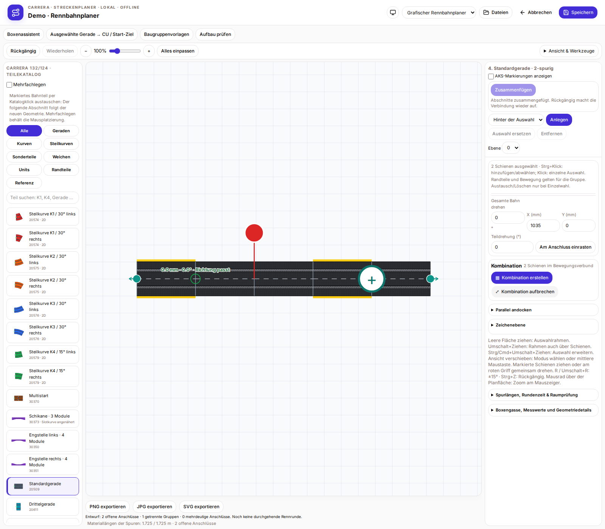

# Carrera-Streckenplaner

**Deutsch** · [English](README.md) · [Français](README.fr.md)

Eigenständiger Carrera-Streckenplaner zur Prüfung und Vorbereitung der künftigen RaceHubOS-Integration. Mit eigener Git-Historie, Lockdatei und lokalem Datenspeicher; ohne RaceHubOS-Backend oder Datenbank nutzbar.

## Start

Voraussetzung: **Node 22.13+** und npm.

```sh
npm ci
npm test
npx playwright install chromium
npm run test:browser
npm run screenshots
npm run build
npm start
```

Der Starter öffnet `http://127.0.0.1:3180` und lauscht nur lokal. Das Startterminal geöffnet lassen. Pläne und Bestand liegen im eigenen lokalen Planer-Speicher, nicht in der RaceHubOS-Datenbank.

## Funktionen

- Start/Ziel und Control Unit mit zwei parallelen Tankplätzen, Boxenassistent und Baugruppenvorlagen.
- Optionale AKS-Einbauangabe und sichtbare Markierungen.
- Mehrfachlegen, direkter Katalogaustausch mit Nachführen der Bahn und wählbarem Auftrennpunkt.
- Zwei markierte Streckenabschnitte an gewählten freien Anschlüssen zusammenfügen; Rückgängig/Wiederholen.
- Feste Bahnfläche mit unabhängig scrollenden Seitenbereichen; Deutsch, Englisch und Französisch sowie System/Hell/Dunkel.
- Nativer JSON-Austausch, unterstützte Softyroyal-/TRK-Varianten, Bildexport, Bestand und geometrische Aufbauprüfung.

## Integration zur Prüfung durch Anselme

Die **offizielle Plugin-Schnittstelle steht noch aus**. Anselme übernimmt Download, Start, Berechtigungen und Add-on-Unterstützung auf RaceHubOS-Seite. Zum Bauen und eigenständigen Betrieb sind keine neuen Host-/Core-Patches nötig.

Das bisherige experimentelle iframe-Protokoll ist als austauschbarer Adapter gekapselt. Das planereigene Layout-/Sektorenformat ist ein Abstimmungsvorschlag mit Geometrie, Spurlängen und optionalen Sektorankern. Es ist weder ein offizieller Host-Vertrag noch eine automatische Hardware-Zuordnung.

[Review-Einstieg](docs/REVIEW.de.md) · [Fähigkeitenvorschlag](addons/track-planner/integration/proposal.json) · [Layout-/Sektorenbeispiel](addons/track-planner/integration/layout-handoff.example.json) · [Integrationshinweise](docs/TRACK-PLANNER-INTEGRATION-20261106.md)

## Bilder und Prüfstand

[Deutsche Galerie: alle 24 Ansichten](docs/TRACK-PLANNER-GALLERY.de.md) · [Alle drei Galerien](docs/TRACK-PLANNER-GALLERY.md)



72 echte lokalisierte PNGs mit SHA-256-Manifesten. Enthalten und geprüft: sechs Unit-Testdateien mit 38 Fällen, 43 Browserfälle und drei Aufnahme-Szenarien. Automatische Schließvorschläge und die offizielle Plugin-API stehen weiterhin aus.

## Quellen und Lizenz

Apache-2.0. Benötigte RaceHubOS-UI- und Geometriequellen liegen mit Lizenz unter `vendor/racehubos`; die Herkunft mit Originalprüfsummen steht in [PROVENANCE.json](PROVENANCE.json). shadcn/ui-Buttons und RaceHubOS-Designvariablen werden wiederverwendet. Die Schienenoptik bleibt erhalten.


[CU, einzelne Boxenteile und paralleles Andocken](docs/CU-PIT-PARALLEL.de.md)
