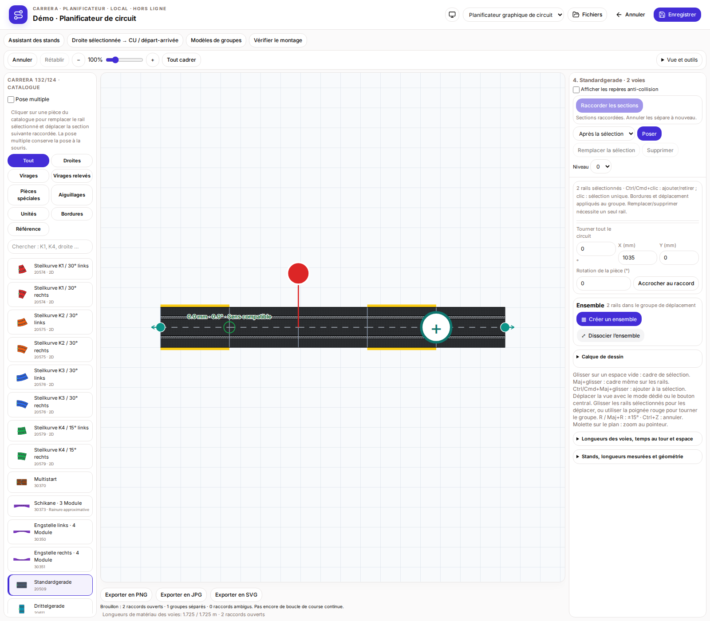

# Planificateur de circuit Carrera

[Deutsch](README.de.md) · [English](README.md) · **Français**

Planificateur Carrera indépendant, prêt à être examiné pour la future intégration à RaceHubOS. Il possède son propre historique Git, fichier de verrouillage et stockage local. Aucun backend ni base de données RaceHubOS n’est nécessaire.

## Démarrer

Prérequis : **Node 22.13+** et npm.

```sh
npm ci
npm test
npm run build
npm start
```

Le lanceur ouvre `http://127.0.0.1:3180` et écoute uniquement en local. Garder le terminal ouvert pendant l’utilisation. Circuits et inventaire sont enregistrés dans le stockage propre au planificateur, pas dans la base RaceHubOS.

## Fonctions

- Départ/arrivée et Control Unit avec deux postes de ravitaillement parallèles ; assistant des stands et modèles d’ensembles.
- Métadonnées d’installation AKS et repères facultatifs.
- Pose multiple, remplacement direct depuis le catalogue avec adaptation de la section suivante et séparation réglable.
- Raccordement de deux sections sélectionnées par leurs extrémités libres choisies ; annuler/rétablir.
- Zone de dessin fixe et panneaux défilant séparément ; allemand, anglais, français et thèmes Système/Clair/Sombre.
- Échange JSON natif, variantes Softyroyal/TRK prises en charge, export d’images, inventaire et vérification géométrique du montage.

## Intégration à examiner par Anselme

L’**interface officielle des plugins reste à définir**. Anselme prend en charge le téléchargement, le lancement, les autorisations et les modules côté RaceHubOS. Aucun nouveau correctif du cœur hôte n’est nécessaire pour compiler ou utiliser le planificateur autonome.

L’ancien protocole iframe expérimental est isolé dans un adaptateur remplaçable. Le transfert du circuit et des secteurs est une proposition du planificateur, avec géométrie, longueurs des voies et ancrages de secteurs facultatifs. Ce n’est ni un contrat officiel de l’hôte ni une association automatique au matériel.

[Guide de revue](docs/REVIEW.fr.md) · [Proposition de capacités](addons/track-planner/integration/proposal.json) · [Exemple circuit/secteurs](addons/track-planner/integration/layout-handoff.example.json) · [Notes d’intégration](docs/TRACK-PLANNER-INTEGRATION-20261106.md)

## Captures et vérifications

[Galerie française : les 19 vues](docs/TRACK-PLANNER-GALLERY.fr.md) · [Les trois galeries](docs/TRACK-PLANNER-GALLERY.md)



57 véritables captures PNG localisées, avec manifestes SHA-256. Les quatre fichiers de tests inclus contiennent 22 cas ciblés. Le build autonome préparé a aussi réussi 33 cas navigateur externes et trois scénarios de capture. Le guide de revue précise le périmètre et les limites. Les recommandations automatiques de rails pour fermer le circuit et l’API officielle ne sont pas encore implémentées.

## Sources et licence

Apache-2.0. Les sources UI et géométriques RaceHubOS nécessaires sont fournies avec leur licence sous `vendor/racehubos`. [PROVENANCE.json](PROVENANCE.json) conserve les origines et empreintes. Les boutons shadcn/ui et variables de thème RaceHubOS sont réutilisés ; le dessin des rails est conservé.
