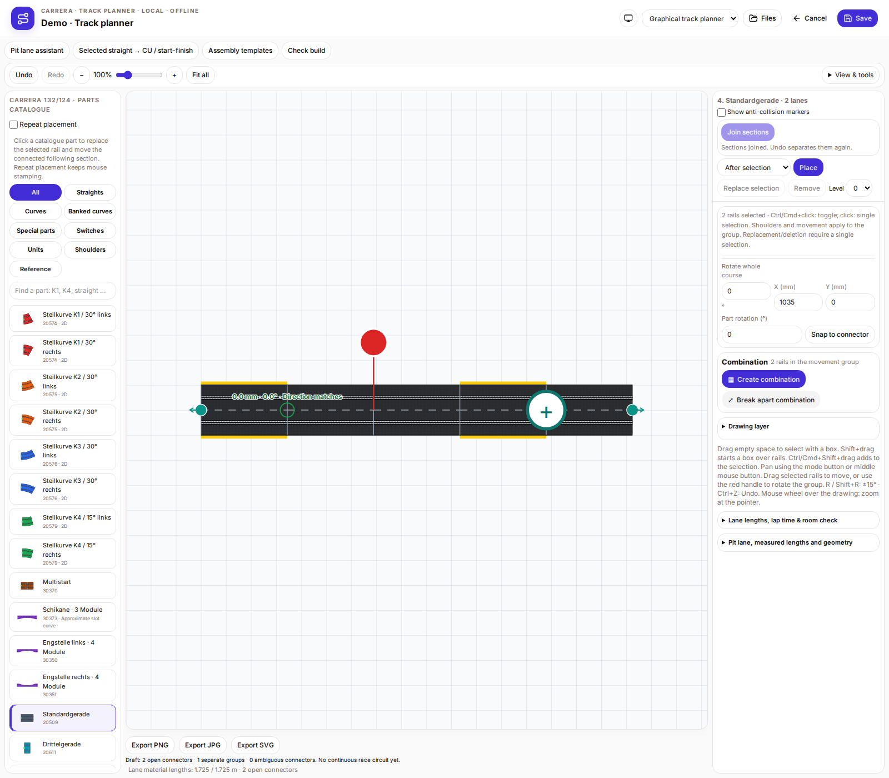

# Carrera Track Planner

[Deutsch](README.de.md) · **English** · [Français](README.fr.md)

[1.1.6 · Ebenen-Checkboxen / Layer checkboxes / Cases par calque](docs/RELEASE-1.1.6.en.md)
[1.1.5 · Ebenen ausblenden / Layer visibility / Visibilité des calques](docs/RELEASE-1.1.5.en.md)
[1.1.4 · Randstreifen / Shoulders / Bordures](docs/RELEASE-1.1.4.en.md)
Independent Carrera track planner, prepared for review and future RaceHubOS integration. It has its own source history, dependency lockfile and local data store. It runs without a RaceHubOS backend or database.

## Start

Node **22.13+** and npm are required.

```sh
npm ci
npm test
npx playwright install chromium
npm run test:browser
npm run screenshots
npm run build
npm start
```

The launcher opens `http://127.0.0.1:3180` and binds only to loopback. Keep its terminal open while using the planner. Plans and inventory use the independent planner's local store, not the RaceHubOS database.

## Features

- Start/finish and Control Unit setup with two parallel fuel bays; pit assistant and reusable assemblies.
- Optional AKS installation metadata and marker display.
- Catalogue repeat placement, direct rail replacement with following geometry and a selectable cut point.
- Join two selected sections through chosen free connections, with undo/redo.
- Fixed drawing area with independently scrolling sidebars; DE/EN/FR and System/Light/Dark appearance.
- Native JSON exchange, supported Softyroyal/TRK variants, image export, inventory and geometric build checks.
- Room-aware automatic layout search, automatic accessories and a central toolbar.
- Saved 3D elevations, adjustable smooth ramps and editable/movable 2D height labels.
- Vector PDF with embedded fonts; print, PNG and SVG preserve visible manual positions.

## Integration for Anselme's review

The **official plugin interface is pending**. Anselme owns RaceHubOS-side download, startup, permissions and add-on support. No new host/core patch is required to build or run this planner.

The current experimental iframe protocol is isolated behind a replaceable adapter. A planner-owned layout/sector handoff proposal supplies native geometry, lane lengths and optional sector anchors; it does not claim an official host contract or hardware mapping.

[Review guide](docs/REVIEW.md) · [Capabilities proposal](addons/track-planner/integration/proposal.json) · [Layout/sector example](addons/track-planner/integration/layout-handoff.example.json) · [Integration notes](docs/TRACK-PLANNER-INTEGRATION-20261106.md)

## Screenshots and checks

[English gallery: all 24 scenes](docs/TRACK-PLANNER-GALLERY.en.md) · [All three galleries](docs/TRACK-PLANNER-GALLERY.md)



156 real localized PNGs have SHA-256 manifests from 18 capture scenarios. Included: 115 unit cases in sixteen files and 89 browser cases. Release validation also checks vector PDFs and the actual older installed host parser. Automatic closing suggestions and the official plugin API remain pending.

## Source and license

Apache-2.0. Required RaceHubOS UI and geometry snapshots live under `vendor/racehubos`, with retained license and original source hashes in [PROVENANCE.json](PROVENANCE.json). shadcn/ui Buttons and the RaceHubOS design tokens are reused; rail artwork is preserved. `private: true` in package metadata prevents npm publishing; this GitHub source repository is public.


[Fixed CU, individual pit parts and parallel docking](docs/CU-PIT-PARALLEL.en.md)


[Room footprint and room-first workflow](docs/ROOM-FOOTPRINT.en.md)


[CU, start/finish and fuel rails](docs/UNIT-APPEARANCE.md)


[Automatic accessories and central toolbar](docs/AUTOMATIC-ACCESSORIES.en.md)

[3D room view](docs/ROOM-3D.en.md) — 150 mm bridge clearance, local preview.

[Version 1.1.0](docs/RELEASE-1.1.0.en.md)

[Version 1.1.1](docs/RELEASE-1.1.1.en.md)

[Version 1.1.2](docs/RELEASE-1.1.2.en.md)

[Version 1.1.3](docs/RELEASE-1.1.3.en.md)
