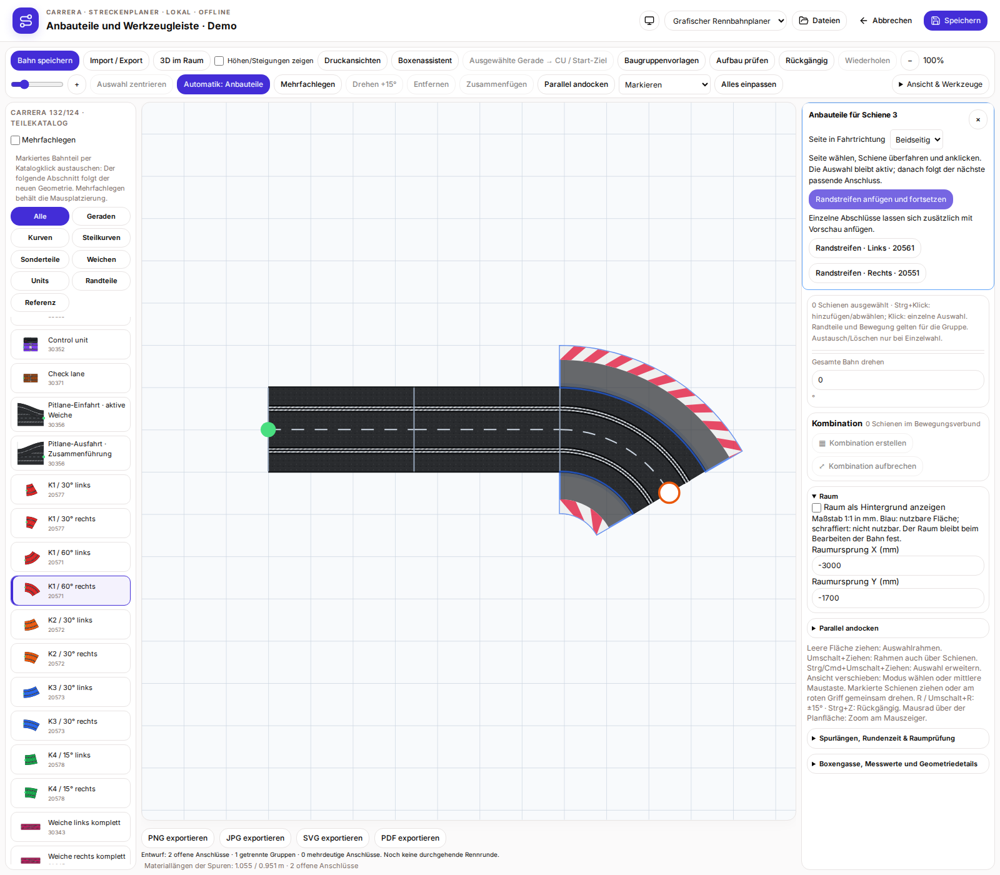
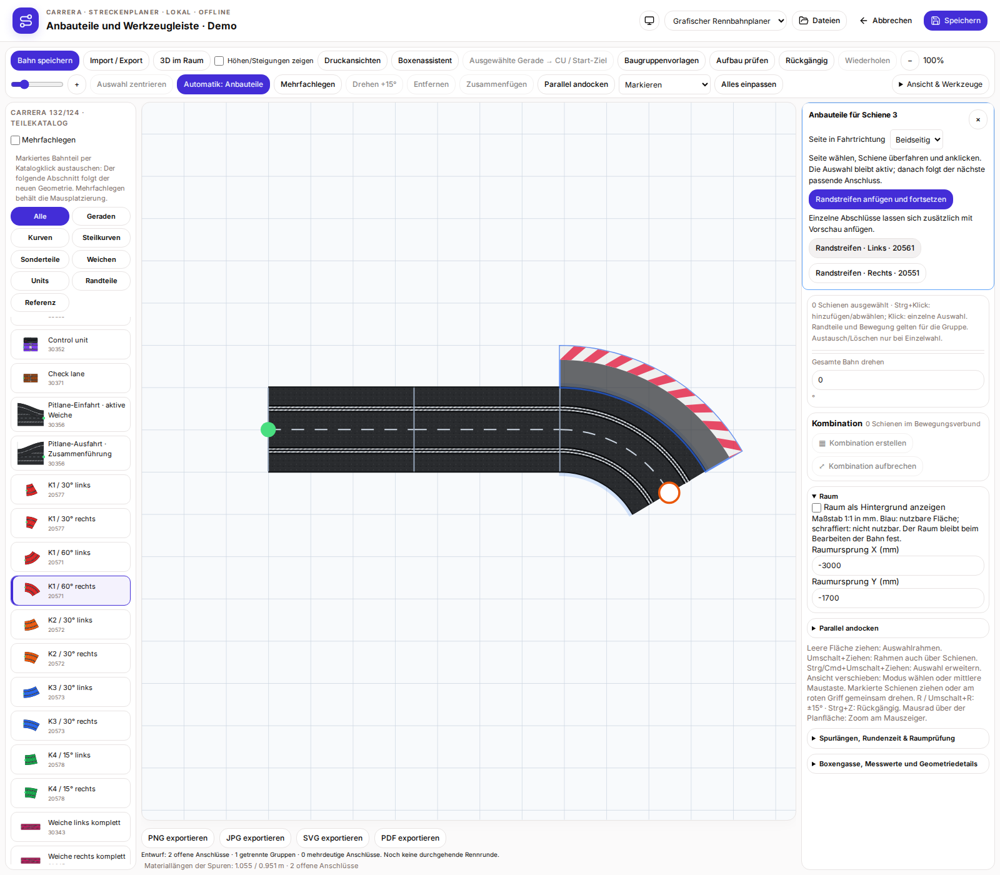
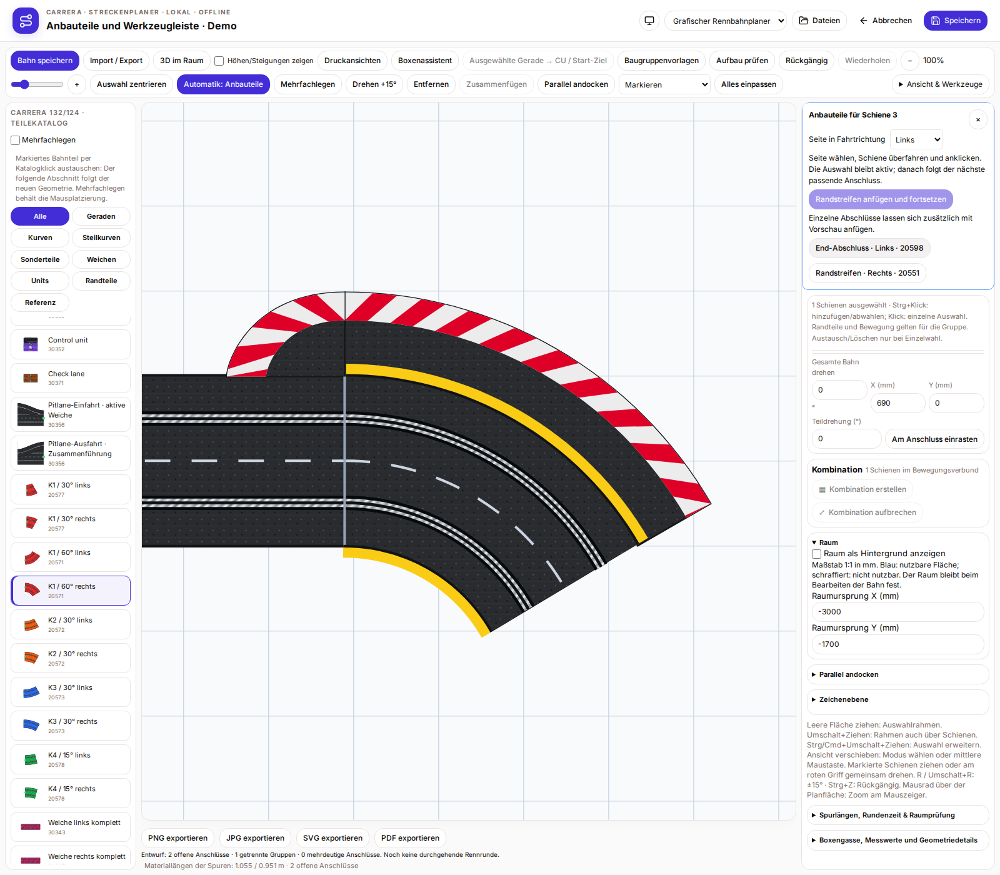
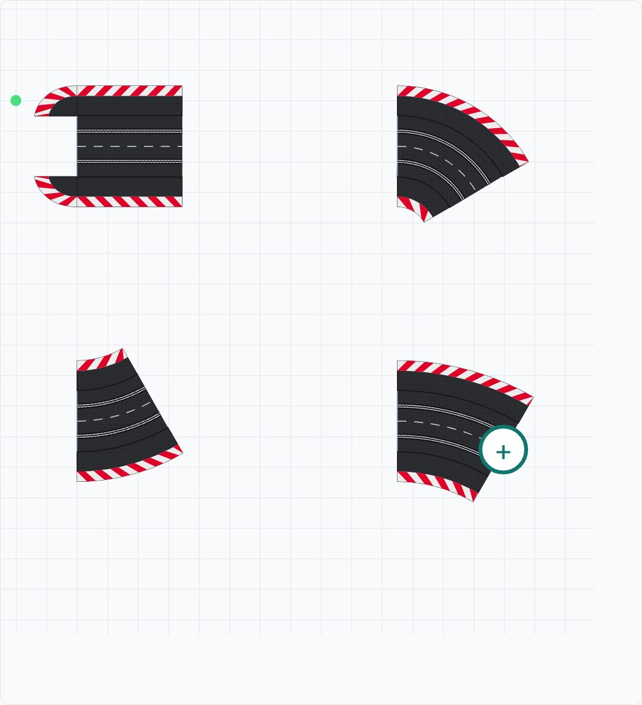

# Automatische Anbauteile und zentrale Werkzeugleiste

„Automatik: Anbauteile“ in der zentralen Leiste aktivieren und mit der Maus eine Hauptschiene überfahren. Die Zielschiene erhält eine blaue Markierung. Eine erreichbare Vorschlagsliste zeigt passende Randstreifen links/rechts und Abschlussstücke für freie Randstreifenenden. Die Liste bleibt beim Weg zur Auswahl stehen. Eine Option mit der Maus überfahren oder per Tab fokussieren: Die blaue Vorschau zeigt den geplanten Anbau. Anklicken fügt nur diese Option an. Danach erneut eine Schiene überfahren, um weiterzubauen. Rückgängig und Wiederholen gelten wie bei anderen Planänderungen.

Vorhandene Randstreifen und Abschlussstücke werden nicht doppelt angeboten. Verbundene Randstreifenenden bekommen keine Abschlussstücke; Steilkurven bekommen keine ungeeigneten Flach-Abschlüsse. Die Boxengassenseite sowie die vom CU-/Adaptergehäuse belegte Seite werden ausgespart. Es werden geometrisch unterstützte Hauptschienen-Zubehörteile angeboten; frei verschiebbare native Boxenteile und reine Katalogreferenzen erhalten keine erfundenen Anbauvorschläge. Die bestehende Aufbauprüfung kontrolliert Überschneidungen und Materialbedarf.

Die zentrale Leiste enthält Bahn speichern, Import/Export, Boxenassistent, CU, Baugruppenvorlagen, Aufbauprüfung, Rückgängig/Wiederholen, Zoom, Automatik, Mehrfachlegen, Drehen, Entfernen, Zusammenfügen und paralleles Andocken. „Auswahl zentrieren“ oder die Taste F passt die Ansicht an das markierte Teil oder die markierten Teile an; auch ein einzelnes Boxenteil wird unterstützt. Bei Baugruppen werden alle hervorgehobenen Mitglieder und ihre zugeordneten Anbauteile berücksichtigt. Schienenkoordinaten bleiben unverändert. „Alles einpassen“ stellt die Gesamtansicht wieder her. Auf kleinen Bildschirmen bleibt die Werkzeugleiste begrenzt hoch und separat scrollbar, damit die Bahn sichtbar bleibt.

## Anbauvorschläge beim Überfahren

## Vorschau vor dem Anfügen

## Markiertes Teil im Zoom zentriert

# Version 1.1.3 – Randstreifen schienenweise fortsetzen

Randstreifen erhalten eine schwarze Auslaufzone und einen schmalen rot-weißen Rand. Das Muster wird für jedes Teil separat entlang seiner Kontur berechnet: Gerade, Innenkurve, Außenkurve und Abschlussstück haben passende Farbsegmente. Bei der Standardgeraden orientiert sich die Teilung an den sechs roten Segmenten des offiziellen Produktfotos.

In **Automatik** links, rechts oder beidseitig wählen. Eine Schiene überfahren und anklicken oder **Randstreifen anfügen und fortsetzen** verwenden. Die Seitenwahl bleibt aktiv; anschließend wird der nächste tatsächlich verbundene, passende Abschnitt vorgeschlagen. Bereits belegte oder gesperrte Seiten werden übersprungen. Bei umgekehrten Teilen wird die Seite entsprechend der Fahrtrichtung gewechselt. An offenen Enden oder mehrdeutigen Abzweigungen stoppt die Fortsetzung. Anbauteile lassen sich einzeln rückgängig machen. Die Ansicht bleibt beim Anfügen stabil. Neue Randstreifen entfernen überflüssige Abschlüsse am neu geschlossenen Übergang; freie Abschlüsse und bestehende Gegenseiten bleiben erhalten.

2D, 3D und Vektorexport verwenden dieselben Farbflächen. Bahngeometrie, Höhen und manuelle Beschriftungspositionen bleiben erhalten. Die Druckdetails sind eine eigene Vektorzeichnung nach Produktfotos; die vorhandenen Formmaße werden weiterverwendet.

[Details und Bilder](AUTOMATIC-ACCESSORIES.de.md) · [Offizielles Vorbild Gerade 20560](https://carrera-toys.com/de-eu/products/20020560-outside-shoulder-for-straight-6) · [Innenkurve 20551](https://carrera-toys.com/de-eu/products/20020551-inside-shoulder-curve-1-60-3-end-piece-2)

