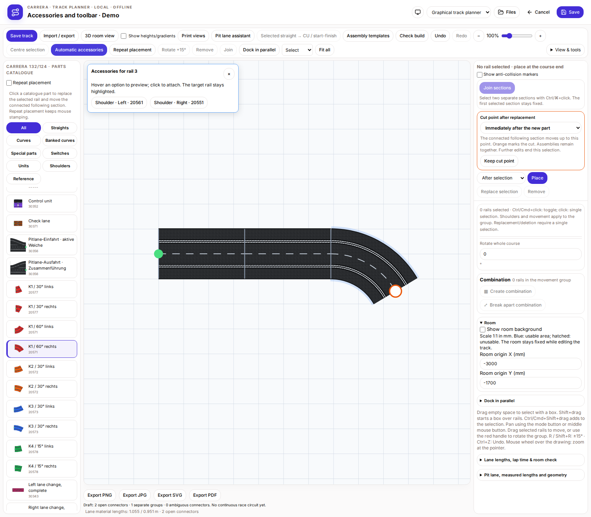
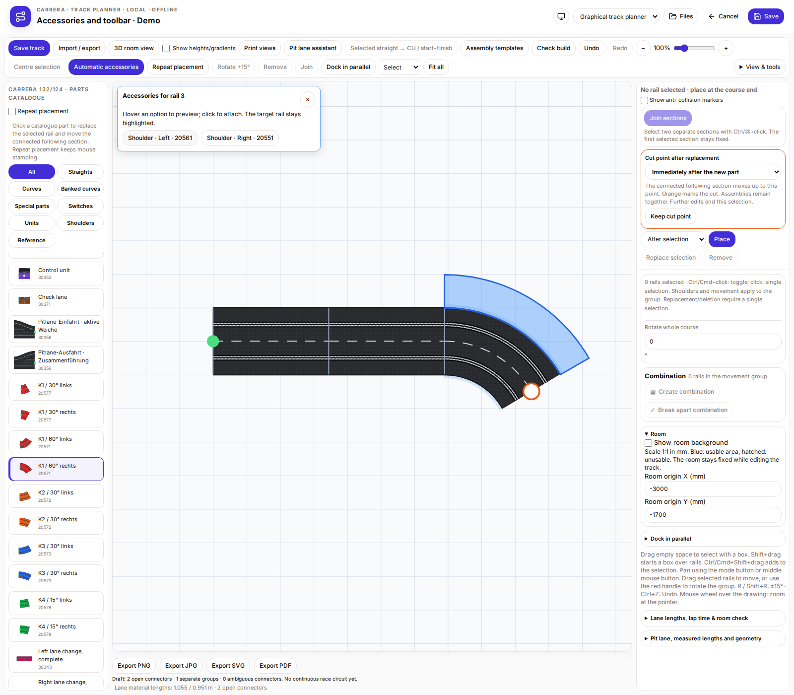
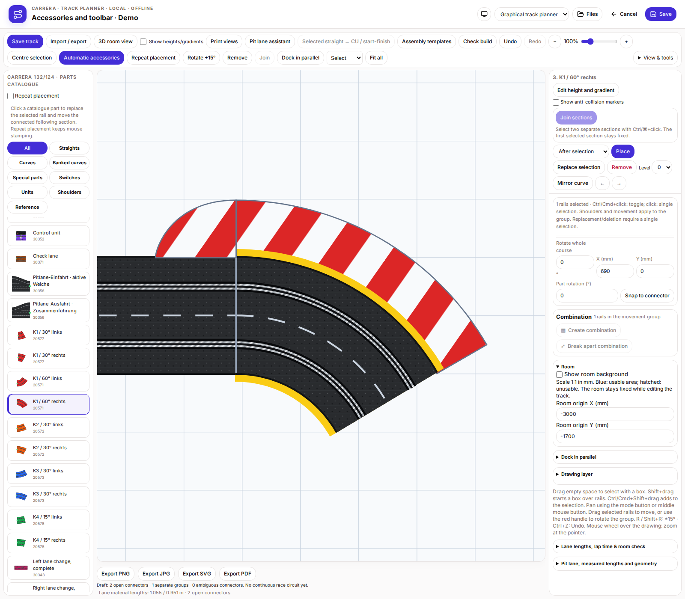

# Automatic accessories and central toolbar

Enable “Automatic accessories” in the central toolbar and hover a main rail. A blue highlight identifies the target. A reachable list offers matching left/right shoulders and end pieces for free shoulder ends. The list stays available while moving towards it. Hover or keyboard-focus an option to preview it in blue; click to attach only that option. Hover a rail again to continue. Undo and redo work as for other plan changes.

Existing parts are not offered twice. Joined shoulder ends get no end pieces; banked curves get no unsuitable flat end pieces. The pit-facing side and the CU/adapter housing side are excluded. Offers cover geometrically supported main-rail accessories; movable native pit parts and catalogue-only references do not receive invented attachment suggestions. Use the existing build check for overlaps and material requirements.

The central toolbar includes save, import/export, pit assistant, CU, templates, build check, undo/redo, zoom, automatic accessories, repeat placement, rotate, remove, join and parallel docking. “Centre selection” or F fits the view to the marked rail(s) or individual pit part without changing coordinates. Grouped selections include all highlighted members and their attached extras. Fit-all restores the full view. On small screens the toolbar has a bounded, independently scrolling area so the track stays visible.

## Hover suggestions

## Preview before attaching

## Centred selection

