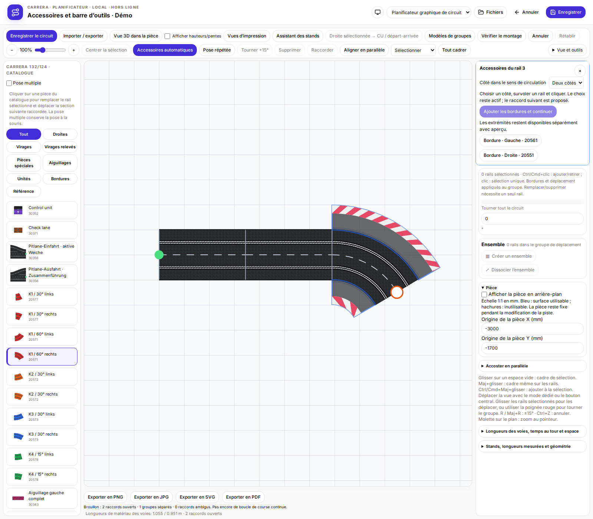
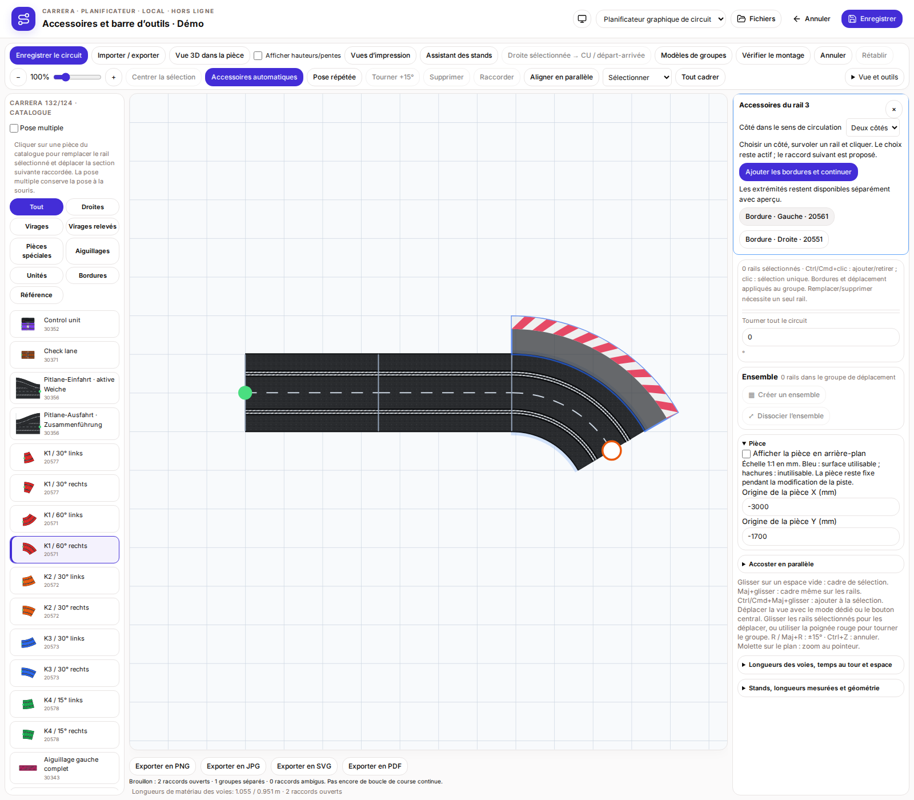
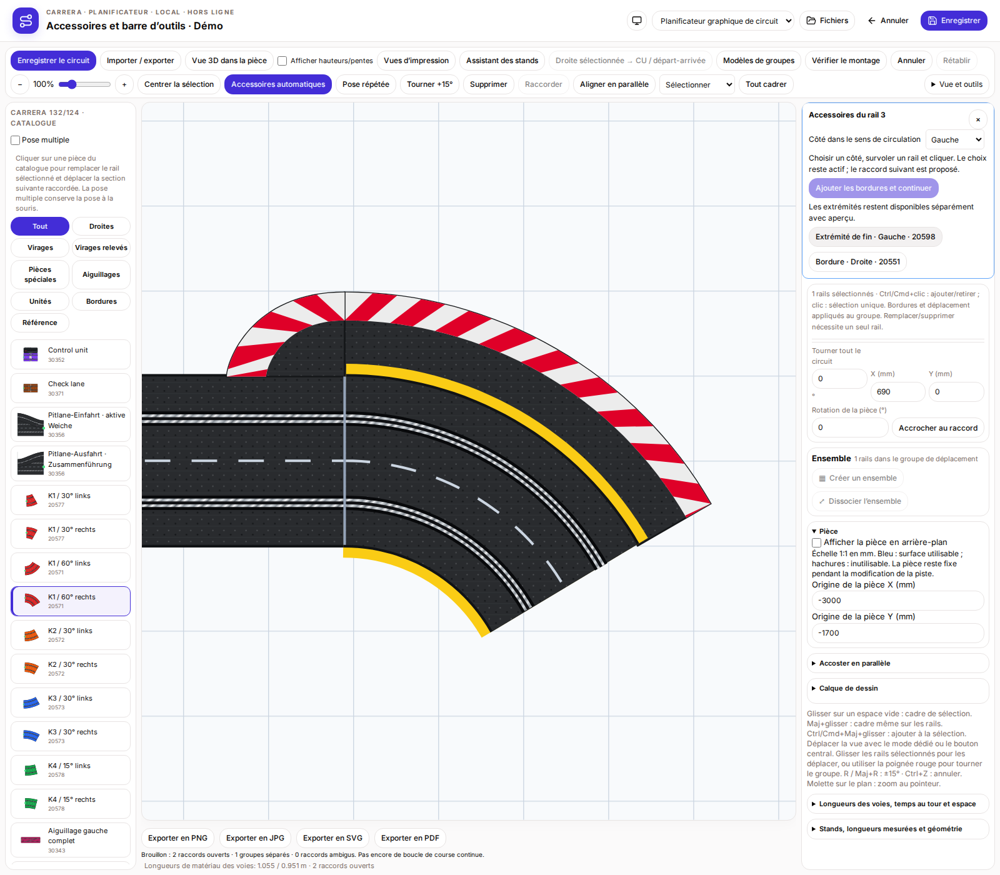
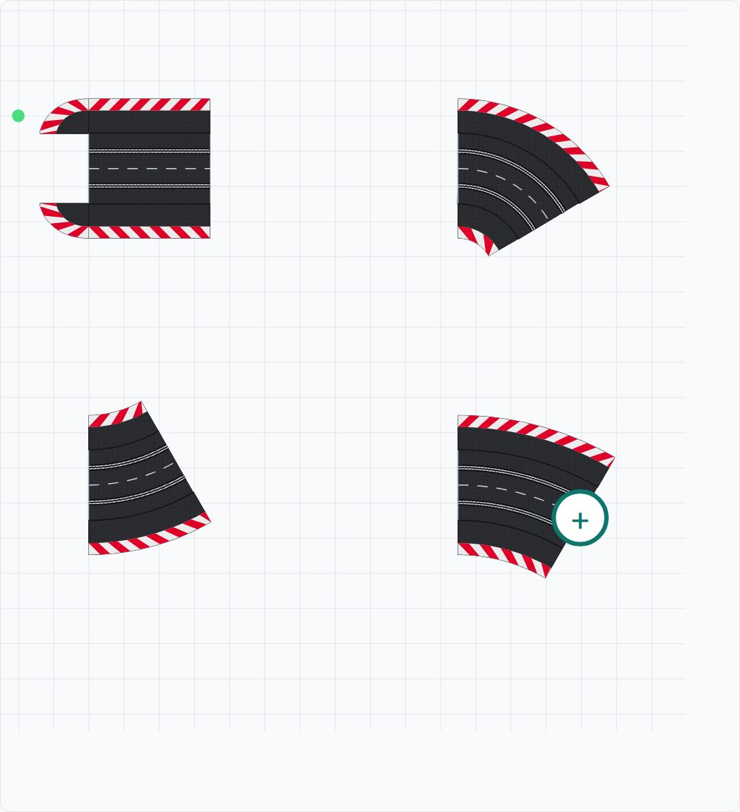

# Accessoires automatiques et barre d’outils centrale

Activer « Accessoires automatiques » dans la barre centrale et survoler un rail principal. La cible est surlignée en bleu. Une liste accessible propose les bordures gauche/droite adaptées et les extrémités des bordures libres. La liste reste affichée pendant le déplacement vers elle. Survoler ou focaliser une option au clavier affiche son aperçu bleu ; cliquer ajoute uniquement cette option. Survoler à nouveau un rail pour continuer. Annuler et rétablir fonctionnent comme pour les autres modifications.

Les pièces présentes ne sont pas proposées en double. Les bordures raccordées ne reçoivent pas d’extrémité ; les virages relevés ne reçoivent pas d’extrémité plate inadaptée. Le côté des stands et celui occupé par le boîtier CU/adaptateur sont exclus. Les propositions concernent les accessoires géométriquement pris en charge des rails principaux ; aucun ajout fictif n’est proposé aux éléments libres des stands ou aux références de catalogue seules. Le contrôle de construction vérifie chevauchements et matériel.

La barre centrale regroupe enregistrement, import/export, assistant des stands, CU, modèles, contrôle, annuler/rétablir, zoom, accessoires automatiques, pose répétée, rotation, suppression, raccordement et alignement parallèle. « Centrer la sélection » ou F ajuste la vue aux rails marqués ou à un élément individuel des stands sans changer les coordonnées. Pour un groupe, tous les membres surlignés et leurs accessoires associés sont inclus. L’ajustement global rétablit la vue complète. Sur petit écran, la hauteur de la barre est limitée avec défilement indépendant afin de garder la piste visible.

## Propositions au survol

## Aperçu avant ajout

## Sélection centrée

# Version 1.1.2 – Continuer les bordures rail par rail

Les bordures reçoivent une zone de dégagement sombre et une bande extérieure rouge/blanc étroite. Les segments colorés suivent chaque pièce : droite, courbe intérieure/extérieure et extrémité. La droite reprend la répartition des six segments rouges de la photo officielle.

En **Automatique**, choisir gauche, droite ou deux côtés. Survoler puis cliquer un rail, ou utiliser **Ajouter les bordures et continuer**. Le choix reste actif et le prochain rail raccordé compatible est proposé. Les côtés occupés ou bloqués sont ignorés ; les rails inversés échangent les côtés pour conserver le sens de circulation. La progression s’arrête aux extrémités libres ou jonctions ambiguës. Chaque pose peut être annulée et le cadrage reste stable. Les raccords nouvellement fermés perdent leurs extrémités superflues ; côtés opposés et extrémités libres sont préservés.

2D, 3D et export vectoriel partagent les mêmes surfaces colorées. Géométrie, hauteurs et positions des étiquettes sont conservées. Le dessin vectoriel est inspiré des photos produit et garde les contours existants.

[Détails et captures](AUTOMATIC-ACCESSORIES.fr.md) · [Bordure droite officielle 20560](https://carrera-toys.com/de-eu/products/20020560-outside-shoulder-for-straight-6) · [Courbe intérieure 20551](https://carrera-toys.com/de-eu/products/20020551-inside-shoulder-curve-1-60-3-end-piece-2)

