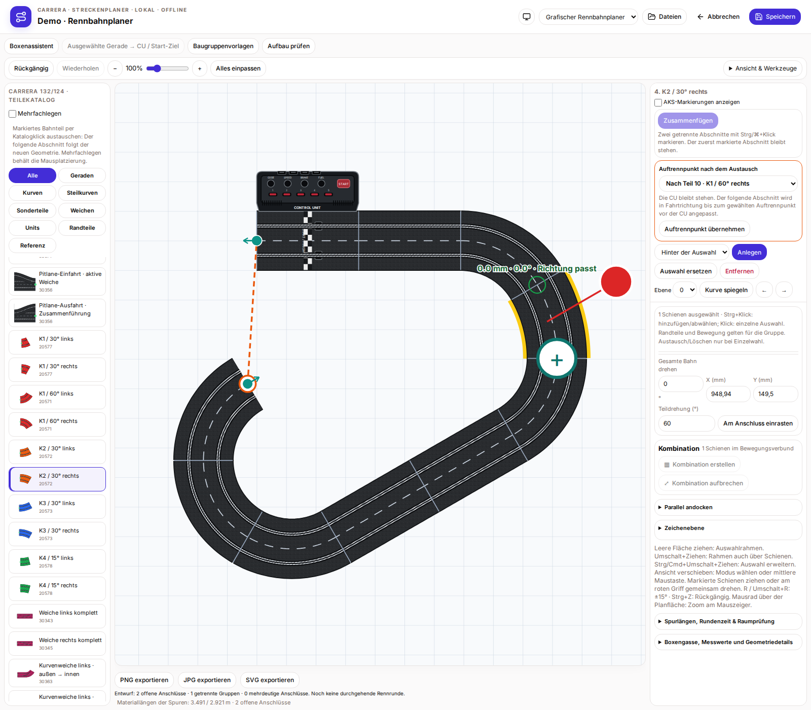
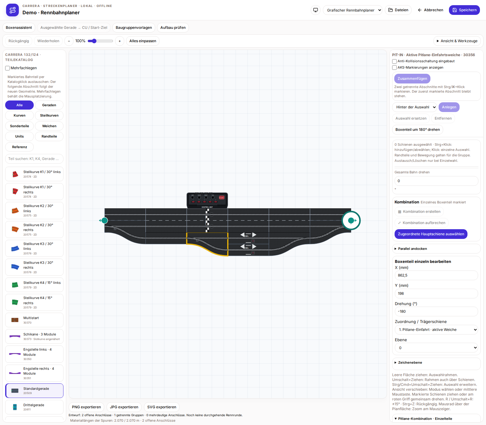
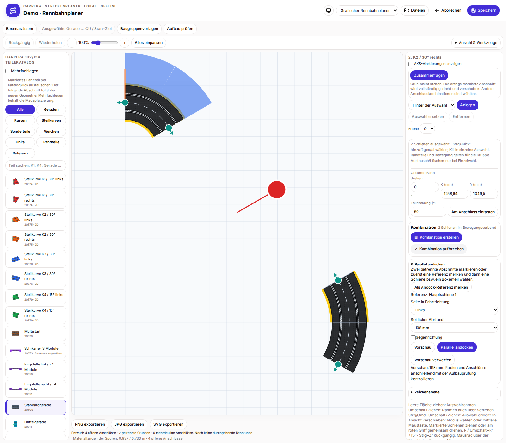
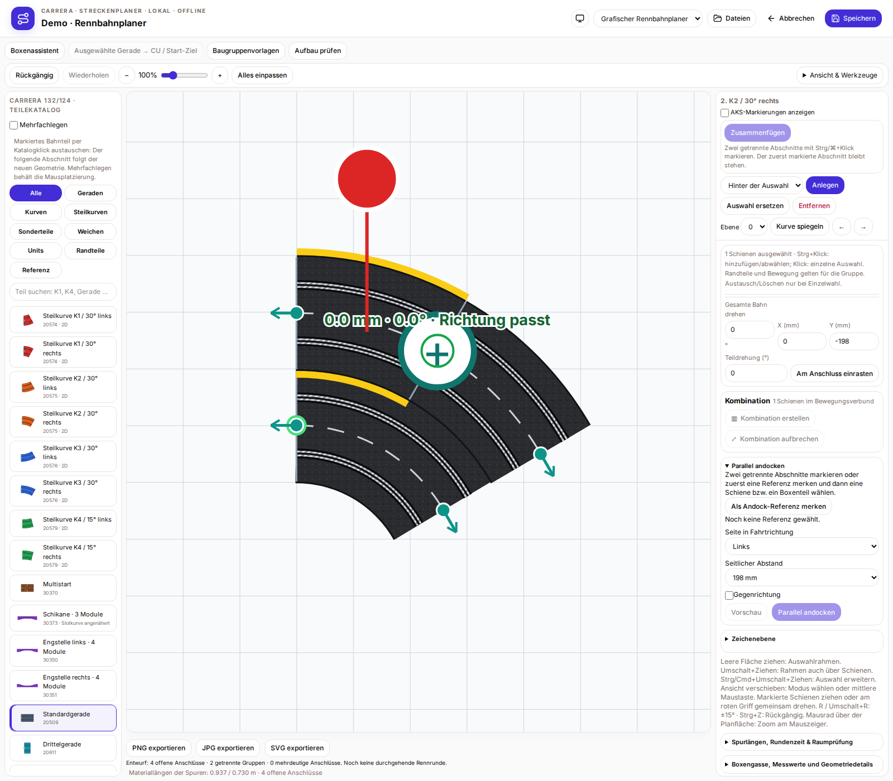
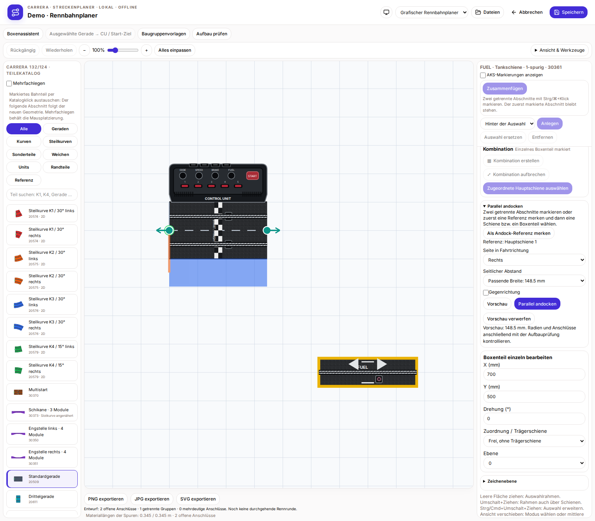

# CU, einzelne Boxenteile und paralleles Andocken

Bei Kurvenwechsel oder Spiegeln folgt der nachfolgende Abschnitt in Fahrtrichtung. Die CU bestimmt die Fahrtrichtung und bleibt an ihrer Position. Bei einer geschlossenen Strecke liegt der automatische Trennpunkt hinter der letzten Standardgeraden oder Kurve vor der CU; ein früherer Trennpunkt kann gewählt werden. Die CU lässt sich über diesen Austauschweg nicht ersetzen.

Alte und neue Boxen werden beim Öffnen oder Importieren im Editor in einzeln bearbeitbare Teile überführt. Erst Speichern übernimmt dies in die Datei. Weichen und einzelne Boxenschienen lassen sich auswählen, ziehen und über X/Y, Winkel, Ebene sowie Zuordnung zu einer Hauptschiene oder „frei“ einstellen. Tankplätze und AKS-Angaben bleiben erhalten. Eine manuelle Gruppierung ist anschließend weiterhin möglich. `pit.individualParts` ist ein optionaler Editorhinweis im bestehenden nativen Format, keine offizielle Plugin-API.

Zum parallelen Andocken zwei getrennte Abschnitte mit Strg/⌘ auswählen, auch einzelne Boxenteile. Alternativ zuerst eine Referenz merken und dann das bewegliche Teil wählen. Die Referenz bleibt stehen. Seite in Fahrtrichtung, Abstand und bei Bedarf Gegenrichtung einstellen, „Vorschau“ wählen und danach übernehmen oder verwerfen. Automatische Abstände: 198 mm zwischen zwei kompletten Fahrbahnen, 148,5 mm zwischen einer Fahrbahn und einer Einzelschiene, 99 mm zwischen zwei Einzelschienen; ein eigener Abstand ist möglich. Ein beweglicher Hauptabschnitt mit CU wird abgelehnt: Die CU-Seite zuerst als feste Referenz wählen.

Der bewegliche Hauptabschnitt wird einschließlich zugeordneter Boxenteile starr gedreht und verschoben; ein einzelnes Boxenteil bewegt sich allein. Passende Radien, etwa R1/R2, sind selbst zu wählen. Es werden keine Schienen erzeugt und keine Radien verformt. Anschlüsse und Überschneidungen anschließend mit „Aufbau prüfen“ kontrollieren.

## Feste CU und Trennpunkt in Fahrtrichtung

## Einzelne Boxenteile bearbeiten

## Parallele Mehrspurbahn: Vorschau

## Parallele Mehrspurbahn: übernommen

## Einzelne Boxenschiene parallel andocken

