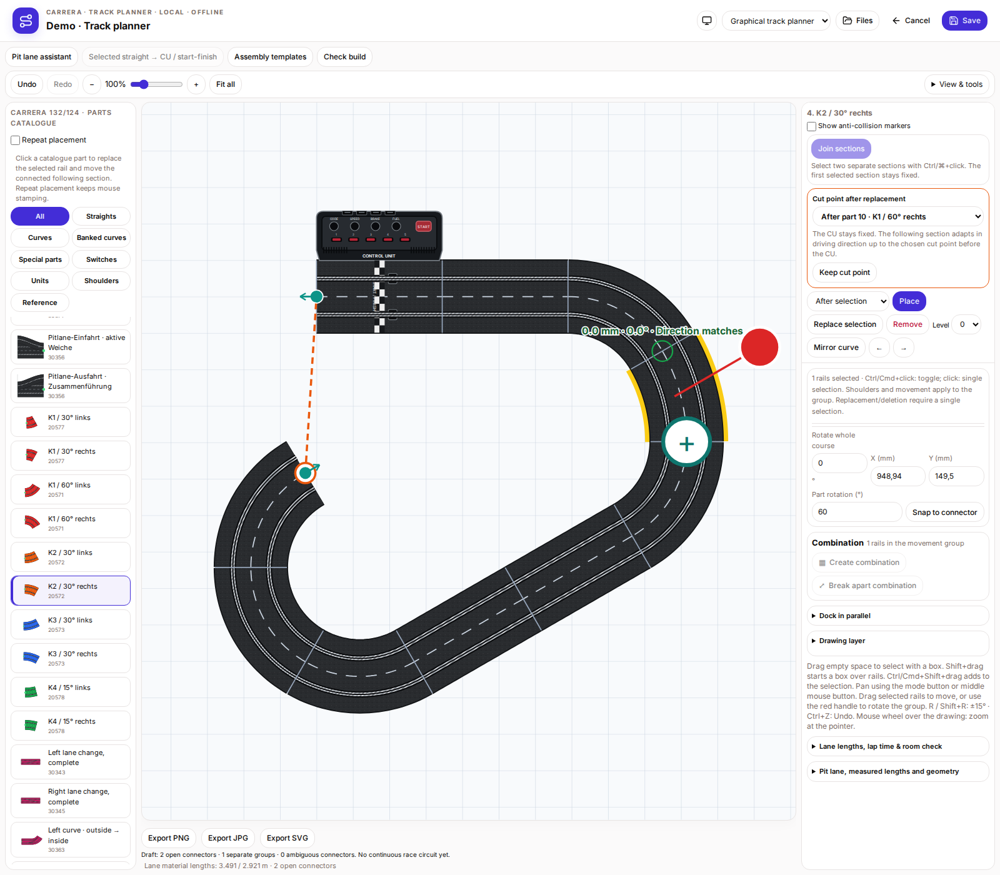
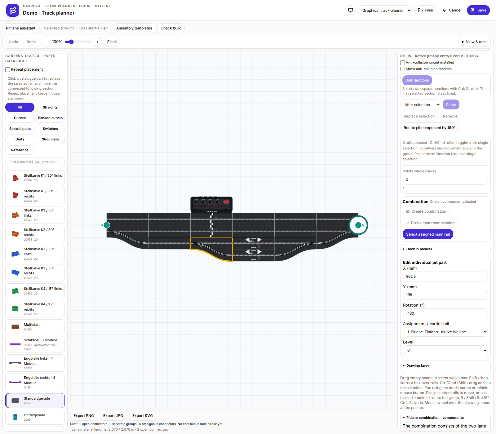
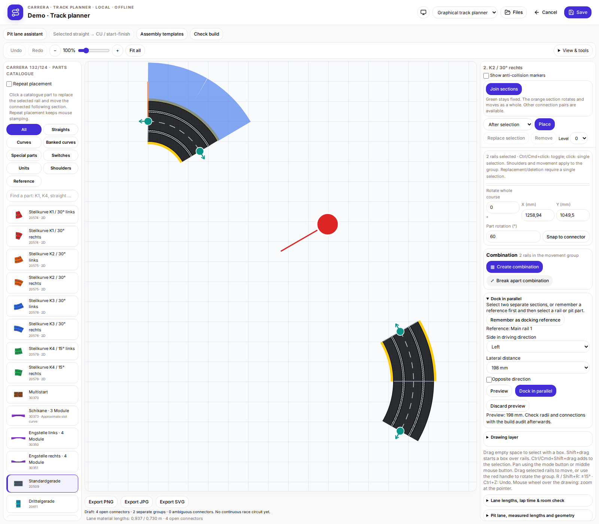
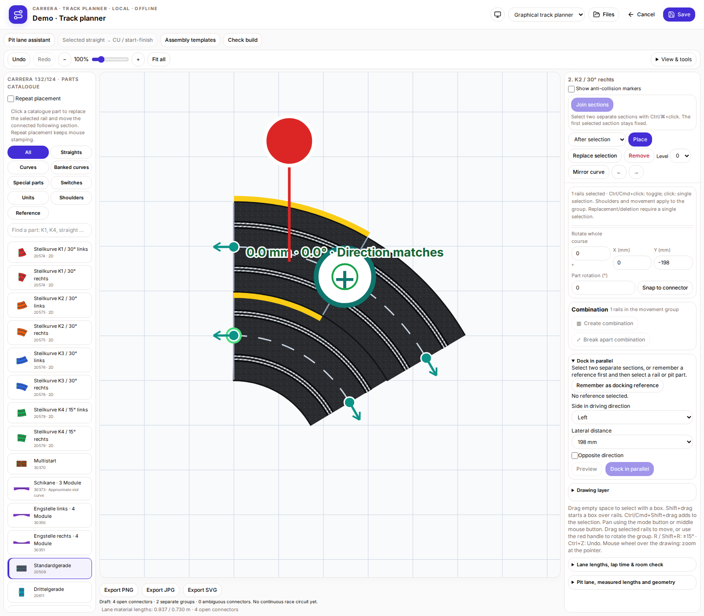
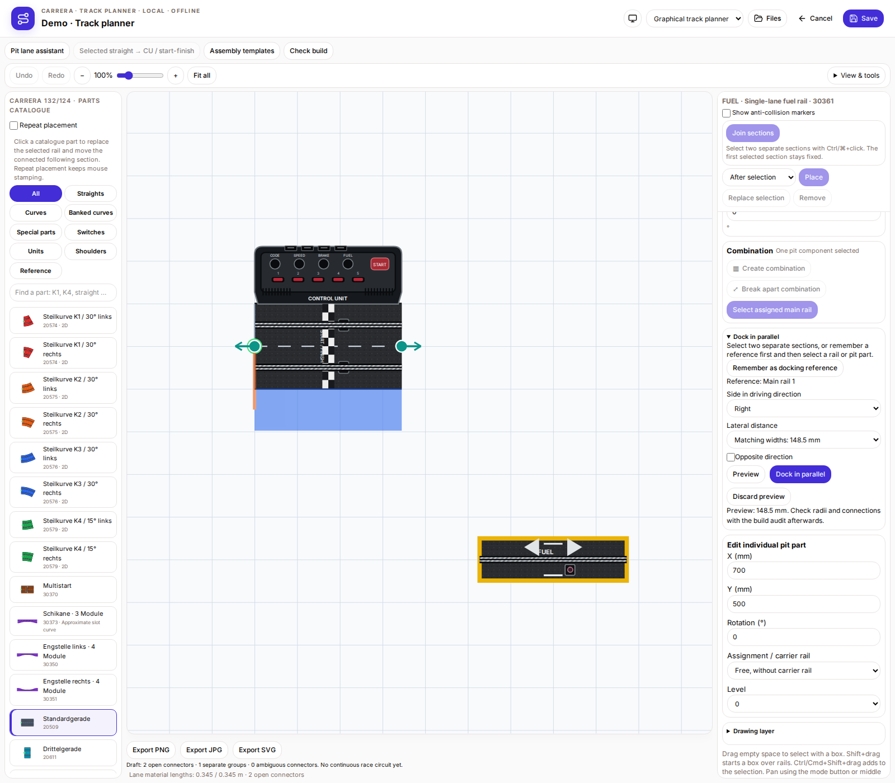

# Fixed CU, individual pit parts and parallel docking

When replacing or mirroring a curve, the following section moves in driving direction. The CU determines driving direction and stays fixed. In a closed layout the automatic cut is after the last ordinary straight or curve before the CU; an earlier cut can be selected. The CU cannot be replaced through this operation.

Old and new pit assemblies are released into individually editable parts when opened or imported in the editor. Save to persist the change. Select and drag switches or individual pit rails, or edit world X/Y, angle, level and main-rail assignment or free placement. Fuel bays and AKS metadata are retained. Explicit manual grouping remains available. `pit.individualParts` is an optional editor hint in the existing native format, not an official plugin API.

For parallel docking, Ctrl/⌘-select two separate sections, including individual pit parts. Alternatively remember a reference first, then select the moving part. The reference stays fixed. Choose side in driving direction, distance and optionally opposite direction, then preview and apply or discard. Automatic spacing is 198 mm for two full roads, 148.5 mm for a full road beside a single rail, and 99 mm for two singles; custom spacing is available. A moving main section containing the CU is rejected: choose the CU side as the fixed reference first.

The moving main section and its attached pit parts rotate and translate rigidly; an individual pit part moves alone. Select matching radii such as R1/R2 yourself. No rails are generated and no radii are deformed. Check connections and overlaps using the build check afterwards.

## Fixed CU and driving-direction cut

## Edit individual pit parts

## Parallel multilane layout: preview

## Parallel multilane layout: applied

## Dock an individual pit rail in parallel

