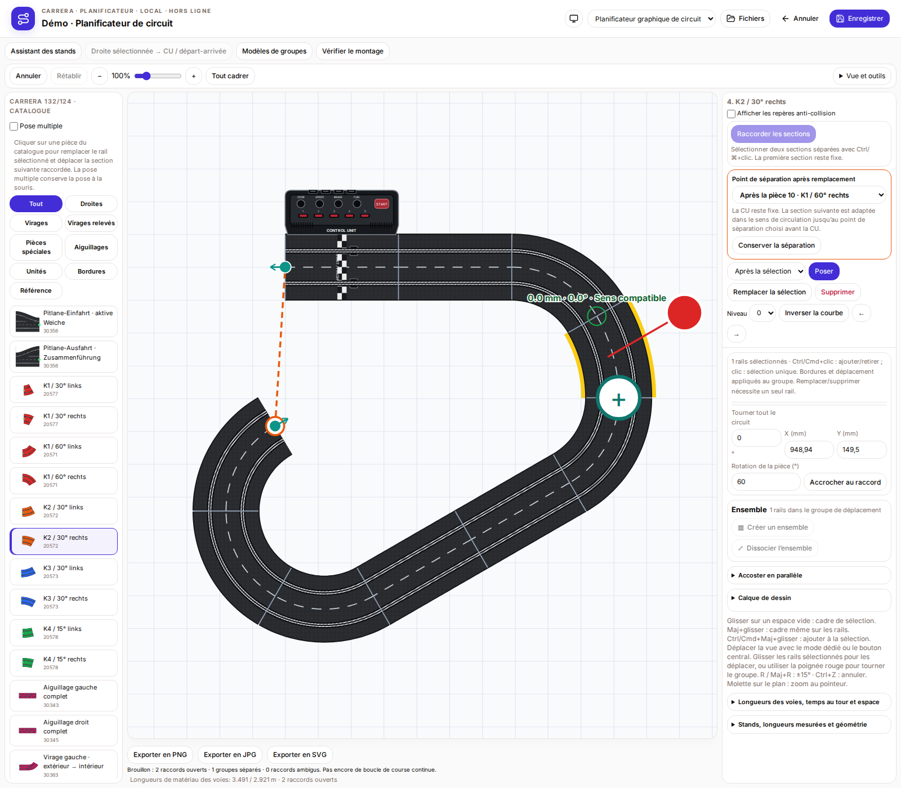
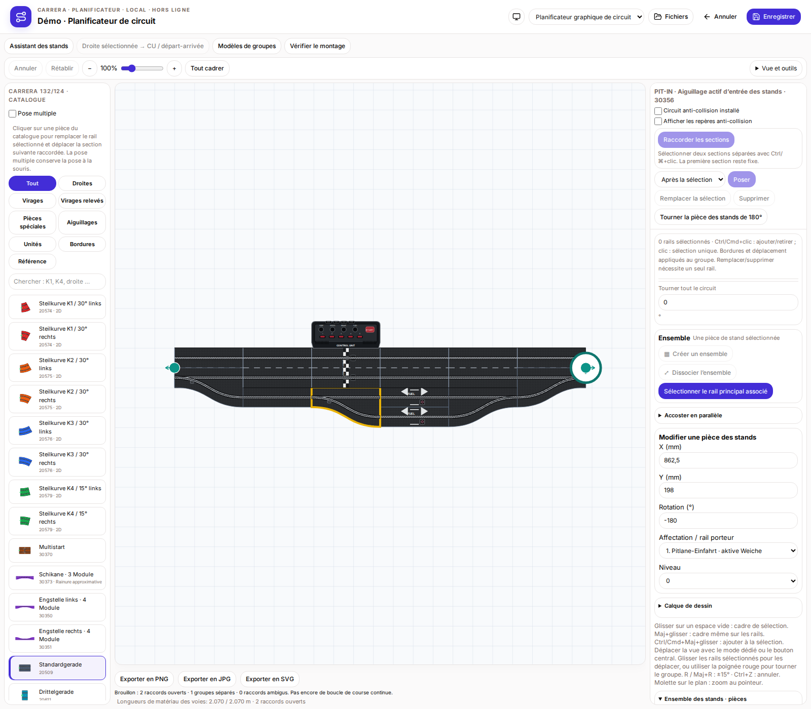
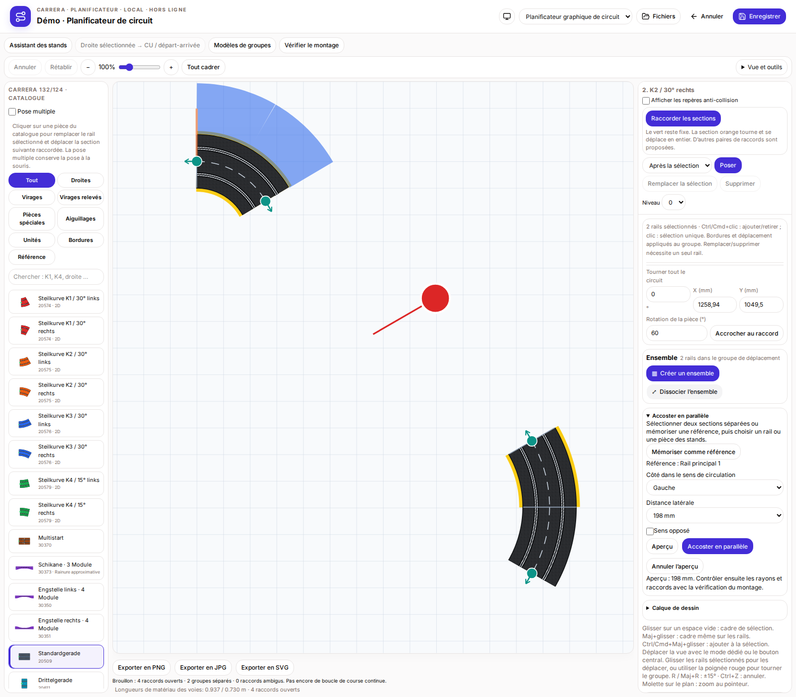
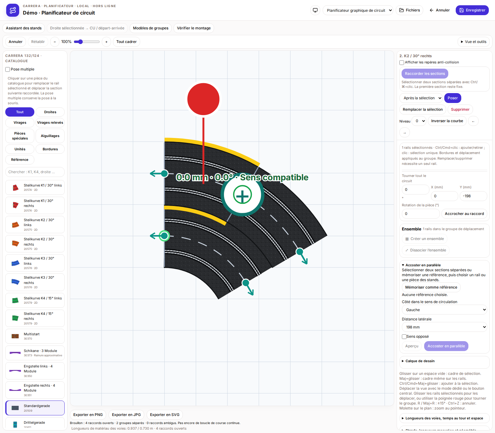
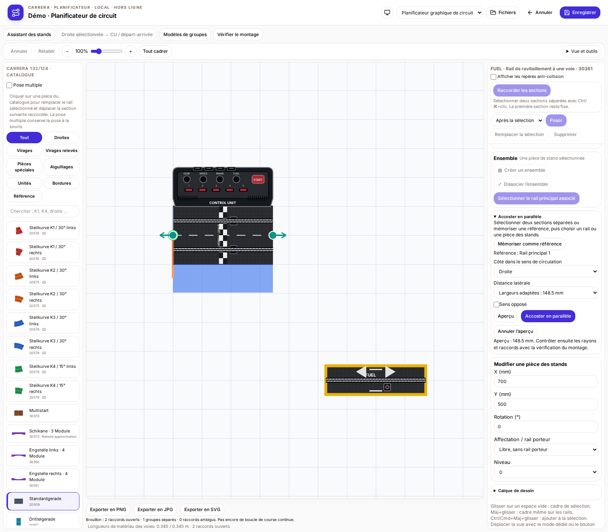

# CU fixe, éléments des stands et alignement parallèle

Lors du remplacement ou de l’inversion d’un virage, la section suivante suit le sens de circulation. La CU définit ce sens et conserve sa position. Sur une piste fermée, la coupure automatique se place après la dernière droite standard ou le dernier virage avant la CU ; une coupure antérieure peut être choisie. Cette opération ne remplace pas la CU.

Les anciens et nouveaux ensembles de stands deviennent des éléments modifiables séparément à l’ouverture ou à l’importation dans l’éditeur. Enregistrer pour conserver ce changement. Les aiguillages et rails individuels peuvent être sélectionnés, déplacés ou réglés en X/Y, angle, niveau et affectation à un rail principal ou placement libre. Les emplacements de ravitaillement et les données AKS sont conservés. Le regroupement manuel explicite reste possible. `pit.individualParts` est une indication facultative de l’éditeur dans le format natif existant, pas une API officielle de plugin.

Pour l’alignement parallèle, sélectionner deux sections séparées avec Ctrl/⌘, y compris des éléments individuels des stands. On peut aussi mémoriser une référence, puis sélectionner l’élément mobile. La référence reste fixe. Choisir le côté dans le sens de circulation, la distance et éventuellement le sens opposé, puis prévisualiser et appliquer ou abandonner. Distances automatiques : 198 mm entre deux chaussées complètes, 148,5 mm entre une chaussée et un rail simple, 99 mm entre deux rails simples ; une distance personnalisée est possible. Une section principale mobile contenant la CU est refusée : choisir d’abord le côté CU comme référence fixe.

La section principale mobile et ses éléments de stands associés sont déplacés et tournés ensemble ; un élément individuel bouge seul. Choisir soi-même les rayons correspondants, par exemple R1/R2. Aucun rail n’est généré et aucun rayon n’est déformé. Vérifier ensuite les raccordements et chevauchements avec le contrôle de construction.

## CU fixe et coupure dans le sens de circulation

## Modifier les éléments individuels des stands

## Piste multivoie parallèle : aperçu

## Piste multivoie parallèle : appliquée

## Aligner un rail individuel des stands

