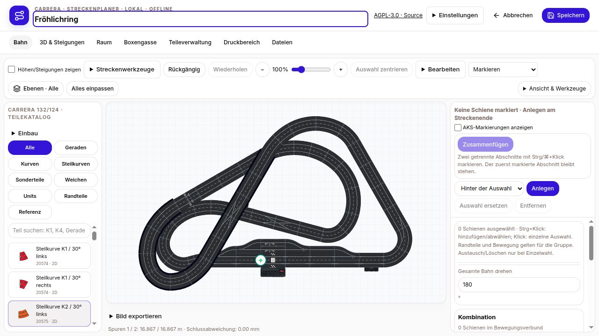
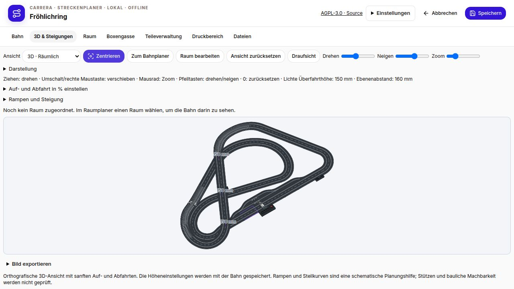
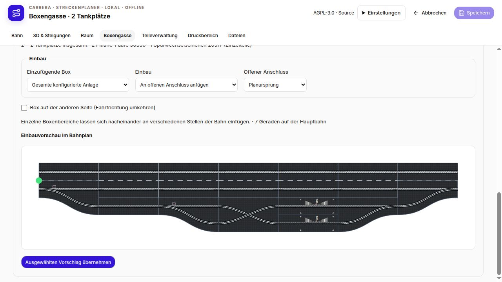
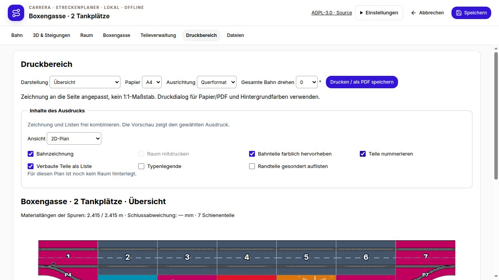
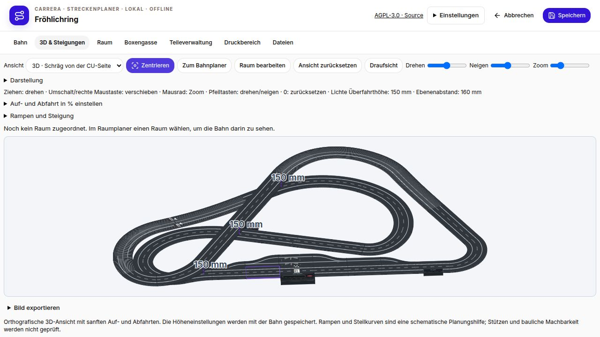
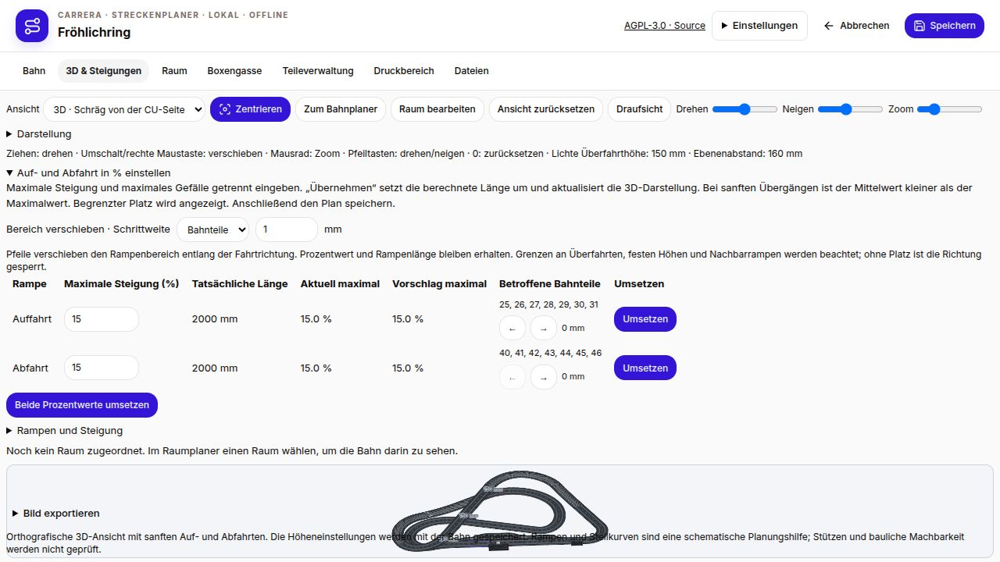
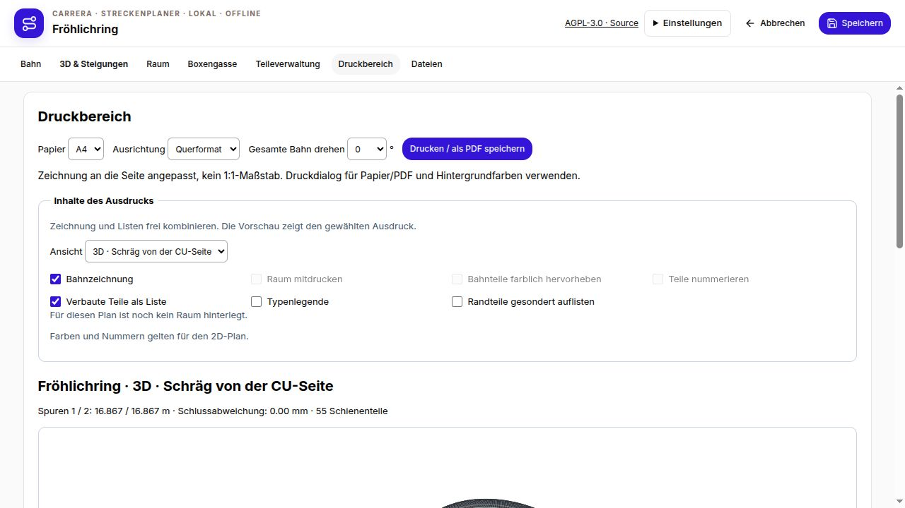

# Version 1.5.0 – Klare Oberfläche und unabhängige Tankplätze

- Feste Hauptnavigation: Bahn, 3D & Steigungen, Raum, Boxengasse, Teileverwaltung, Druckbereich und Dateien. Selten benötigte Werkzeuge, Platzierung, Bildexport und Bestand sind aufklappbar zusammengefasst.
- Druckbereich mit kombinierbaren Inhalten: Bahn und Raum, farbige Teiltypen, Nummerierung, Legende, Randteile und vollständige Materialliste. 2D sowie räumliche 3D-Ansicht, Draufsicht, Seitenansicht und Vorderansicht sind wählbar.
- 3D-Perspektiven direkt wählen. In der Seitenansicht verdecken Raumwände die Bahn nicht. Die getrennten Prozent-Eingaben für Auf- und Abfahrt bleiben erhalten.
- 3D-Zentrieren funktional korrigiert: Zoom und Verschiebung zurücksetzen, Bahn einschließlich Boxenteilen vollständig in die tatsächlich verfügbare Zeichenfläche einpassen, Perspektive beibehalten. Hohe Raumwände verkleinern die Bahn nicht mehr zum Vorschaubild. Steigungseinstellungen sind aufklappbar, damit die Darstellung Platz erhält.
- Boxengassenplanung für 1–10 Tankplätze, verteilt auf mehrere Boxenbereiche. Jeder Platz entspricht genau einer Tankschiene. Eigene Abzweige oder parallele Platzpaare verhindern, dass ein tankendes Auto die Zufahrt zu einem weiteren Platz blockiert. Gerichtete Slotwege werden bei belegten anderen Tankplätzen geprüft.
- Die Pit-Einfahrt 30356 bleibt an der Hauptbahn. Der feste Spurwechsel 20517 liegt innerhalb der Boxengasse, nach der Einfahrt und vor den Tankschienen. Er ersetzt weder Einfahrt noch Ausfahrt. Seine S-förmigen Slots sind eine Planungsnäherung; die Materialliste zählt einzelne Schienen (zwei je Packung).
- Ganze Anlage oder einzelne Boxenbereiche mit Einbauvorschau einfügen: an einen offenen Anschluss anfügen oder einen geeigneten geraden Abschnitt ersetzen. Rückgängig/Wiederholen bleibt verfügbar. Pit-Abzweige werden nicht mehr von der Hauptbahn überzeichnet.
- Native JSON-Dateien und die RaceHubOS-Speicherung erhalten interne Spurwechselschienen. Für diese neue Geometrie ist keine verifizierte SBP-Zuordnung hinterlegt; JSON erhält sämtliche Daten. Vorhandene gespeicherte Pläne werden durch das Update nicht umgebaut.

Pakete: Linux x64 portabel, Windows x64 portabel, Debian amd64, RaceHubOS-Add-on, eigenständiges Updatepaket und RaceHubOS-1.32-Integrationspaket. Die direkte Installation in RaceHubOS benötigt die `carrera-local`-Erweiterung samt Updateprüfung. Windows wird inhaltlich geprüft; eine native Windows-Ausführung ist hier nicht verfügbar.

- Auf- und Abfahrt lassen sich mit Pfeilen entlang der Bahn verschieben, wahlweise in Millimetern oder um ganze Bahnteile. Geraden- und Kurvenlängen werden berücksichtigt; Rampenlänge, maximale Steigung, zusammenhängende Höhenanschlüsse und Überfahrthöhen bleiben erhalten. Nicht mögliche Richtungen werden gesperrt. Manuell gesetzte Höhenprofile werden nicht automatisch verschoben.
- Neue schräge 3D-Ansicht von der CU-Seite: Blickrichtung aus der Control-Unit-Position mit 35° Neigung; auch im Druckbereich wählbar.

## Screenshots

**Hauptnavigation und Bahneditor**

**3D-Zentrierung**

**Boxengasse mit internem Spurwechsel**

**Wählbare Druckinhalte**

**Schräg von der CU-Seite**

**Rampenbereich in Millimetern oder Bahnteilen verschieben**

**CU-Ansicht im Druckbereich**

