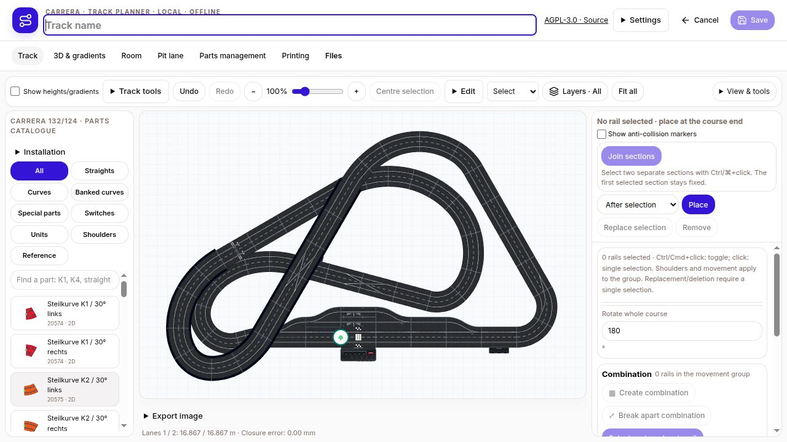
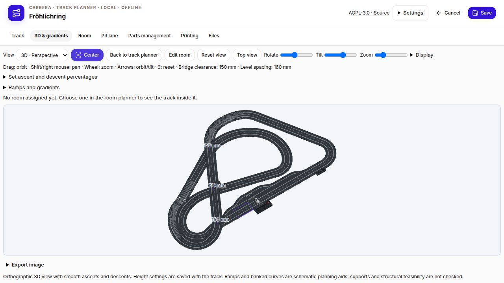
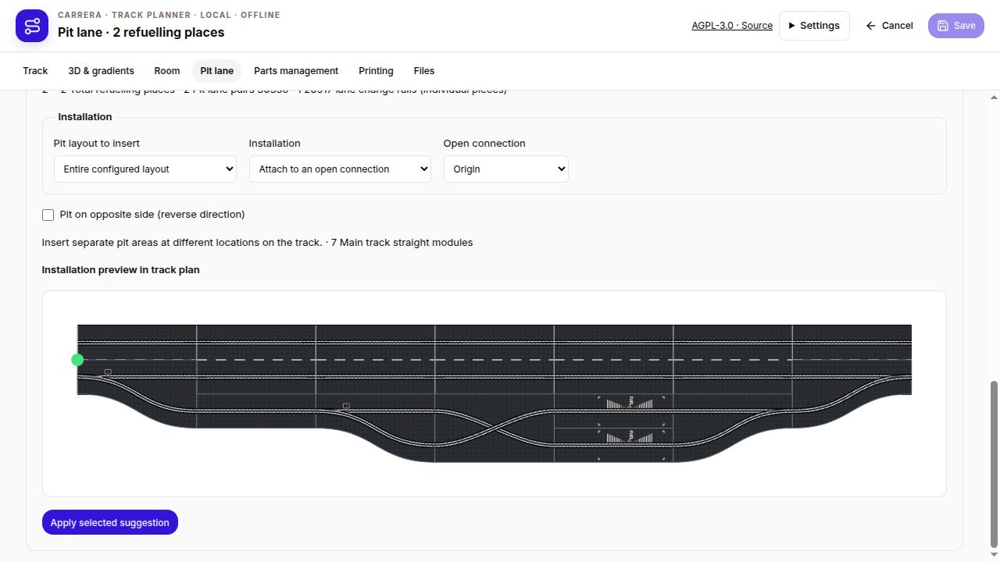
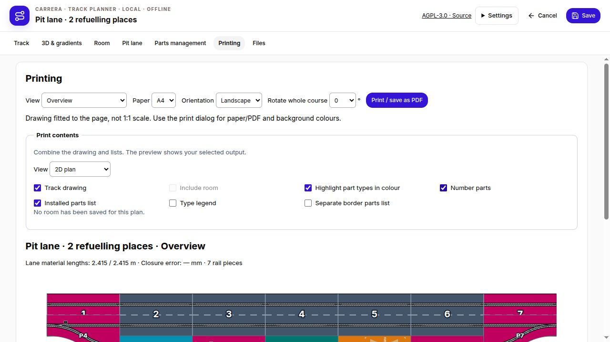
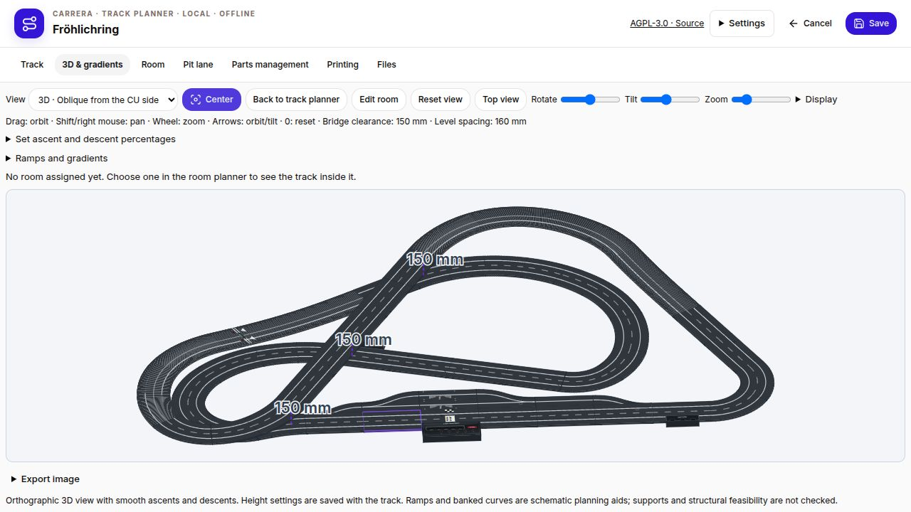
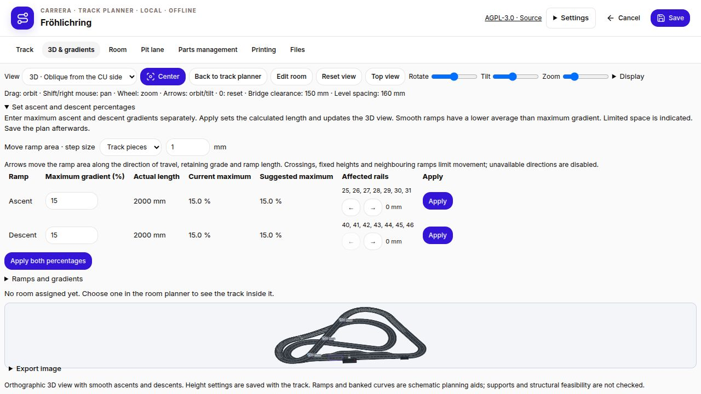
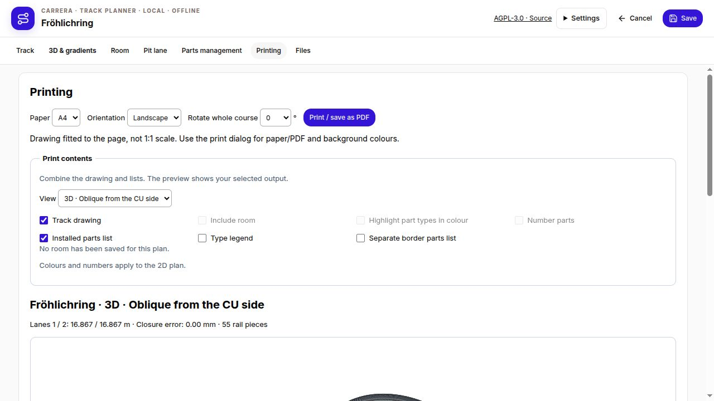

# Version 1.5.0 – Clear navigation and independently accessible pit places

- Persistent main navigation: Track, 3D & gradients, Room, Pit lane, Parts management, Printing and Files. Optional tools, placement settings, image export and stock editing are grouped in disclosures.
- Combine drawings, room, part colours, numbering, legends, borders and a full material list for printing. Choose 2D, 3D perspective, top, side or front views. The same 3D presets are available in the editor; room walls do not hide the side view.
- Corrected 3D centering resets zoom and pan, fits the complete track and pit geometry to the actual canvas, and preserves perspective. Tall room walls no longer shrink the track to a thumbnail; gradient controls collapse to leave room for the drawing.
- Configure 1–10 refuelling places across multiple pit areas. Each place is exactly one fuel rail. Separate branches or parallel pairs keep every place accessible while other places are occupied; directed slot routes are validated.
- Pit entry 30356 remains on the main track. Fixed crossover 20517 is inside the pit, after entry and before the fuel rails, and never replaces entry or exit. Its S-shaped slots are a planning approximation. Materials count individual crossover rails, two per pack.
- Preview and insert the complete layout or individual pit areas at open connections or suitable straight sections, with undo/redo. Main track surfaces no longer overpaint pit entry slots.
- Native JSON and legacy RaceHubOS storage preserve internal crossovers. Native SBP mapping for this new geometry is unverified; use JSON for complete data. Updates leave existing saved layouts unchanged.

Packages: portable Linux x64 and Windows x64, Debian amd64, RaceHubOS add-on, standalone update and RaceHubOS 1.32 bridge. Direct host installation requires carrera-local and its update guard. Windows package contents are verified; native Windows execution is unavailable here.

- Move ascent and descent areas along the track using arrows, in millimetres or complete track pieces. Actual straight and curve lengths are used; ramp length, maximum grade, connected heights and bridge clearances are retained. Unavailable directions are disabled. Manually pinned height profiles are not moved automatically.
- New oblique 3D view from the CU side: direction derived from the Control Unit position with 35° tilt; also selectable for printing.

## Screenshots

**Main navigation and track editor**

**3D centering**

**Pit lane with internal crossover**

**Selectable print contents**

**Oblique view from the CU side**

**Move ramp areas by millimetres or track pieces**

**CU-side view for printing**

