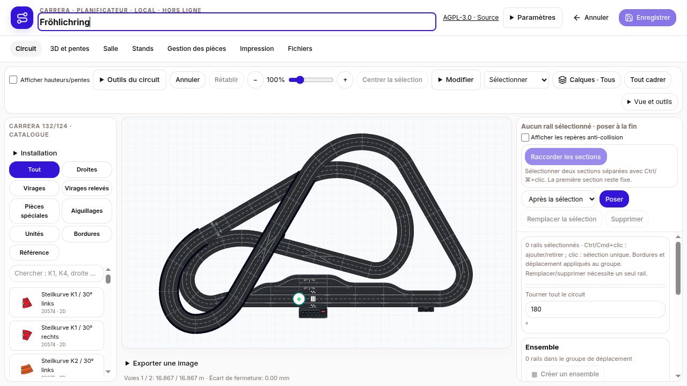
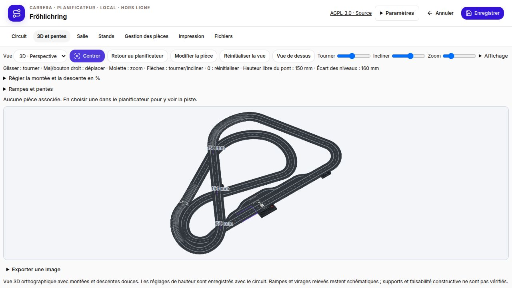
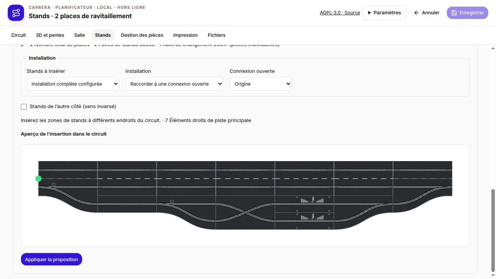
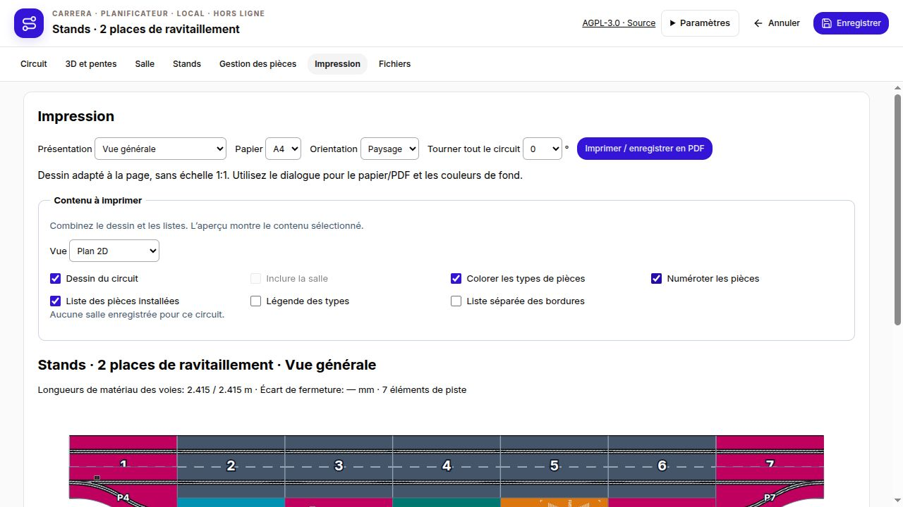
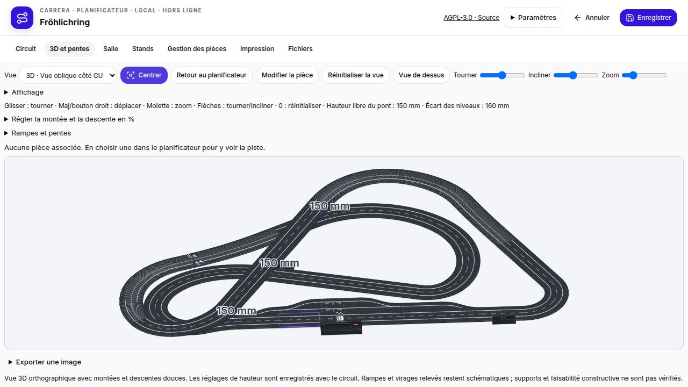
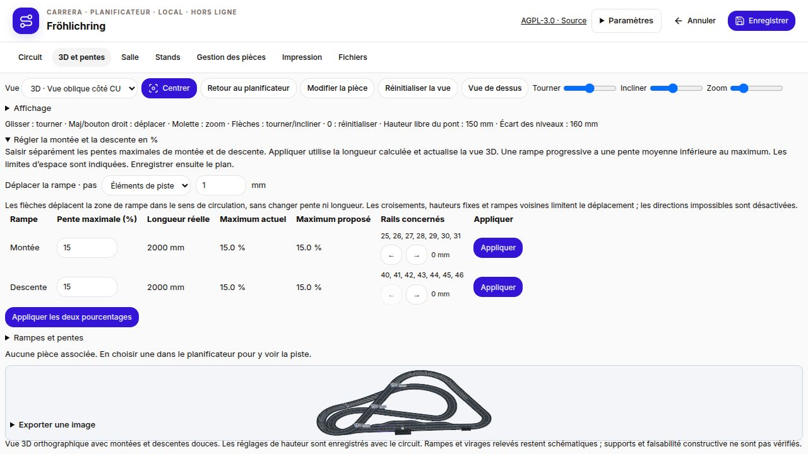
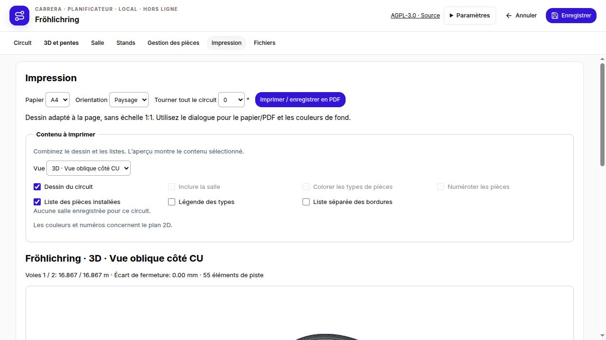

# Version 1.5.0 – Navigation simplifiée et accès indépendant aux stands

- Navigation principale permanente : Circuit, 3D et pentes, Salle, Stands, Gestion des pièces, Impression et Fichiers. Les outils secondaires, le placement, l’export d’image et le stock sont regroupés dans des sections repliables.
- Impression configurable : circuit et salle, couleurs des pièces, numérotation, légende, bordures et liste complète des pièces. Vues 2D, perspective 3D, dessus, côté et face ; également disponibles dans l’éditeur 3D.
- Centrage 3D corrigé : zoom et décalage réinitialisés, circuit et stands entièrement ajustés à la zone de dessin réelle, perspective conservée. Les murs hauts ne réduisent plus le circuit à une miniature ; réglages de pente repliables.
- Planification de 1 à 10 places de ravitaillement réparties entre plusieurs zones. Une place correspond à un seul rail de ravitaillement. Les embranchements séparés ou les paires parallèles gardent les places accessibles lorsque les autres sont occupées. Les trajets orientés sont vérifiés.
- L’entrée 30356 reste sur la piste principale. Le changement fixe 20517 est situé dans les stands, après l’entrée et avant les rails de ravitaillement ; il ne remplace jamais l’entrée ou la sortie. Courbes en S approximatives ; quantités de rails individuels, deux par boîte.
- Aperçu de l’insertion de l’installation entière ou des zones individuelles sur une connexion ouverte ou une section droite adaptée, avec annulation/rétablissement. Les aiguillages de stands ne sont plus masqués par la piste principale.
- Le format JSON natif et le stockage RaceHubOS préservent les changements internes. La correspondance SBP de cette nouvelle géométrie n’est pas vérifiée ; utiliser JSON pour conserver toutes les données. Les circuits enregistrés restent inchangés après mise à jour.

Paquets Linux x64 et Windows x64 portables, Debian amd64, extension RaceHubOS, mise à jour autonome et intégration RaceHubOS 1.32. Installation directe avec carrera-local et son contrôle de mise à jour. Contenu Windows vérifié ; exécution Windows native indisponible ici.

- Déplacer les zones de montée et de descente avec les flèches, en millimètres ou par éléments de piste. Les longueurs réelles des droites et courbes sont prises en compte ; longueur, pente maximale, continuité des hauteurs et dégagement des ponts sont conservés. Les directions impossibles sont désactivées. Les profils de hauteur fixés manuellement ne sont pas déplacés automatiquement.
- Nouvelle vue 3D oblique depuis le côté CU : orientation calculée à partir de la Control Unit, avec une inclinaison de 35°, également disponible pour l’impression.

## Captures d’écran

**Navigation principale et éditeur de circuit**

**Centrage 3D**

**Stands avec changement de voie interne**

**Contenu d’impression au choix**

**Vue oblique côté CU**

**Déplacement des rampes en millimètres ou éléments**

**Vue côté CU pour l’impression**

