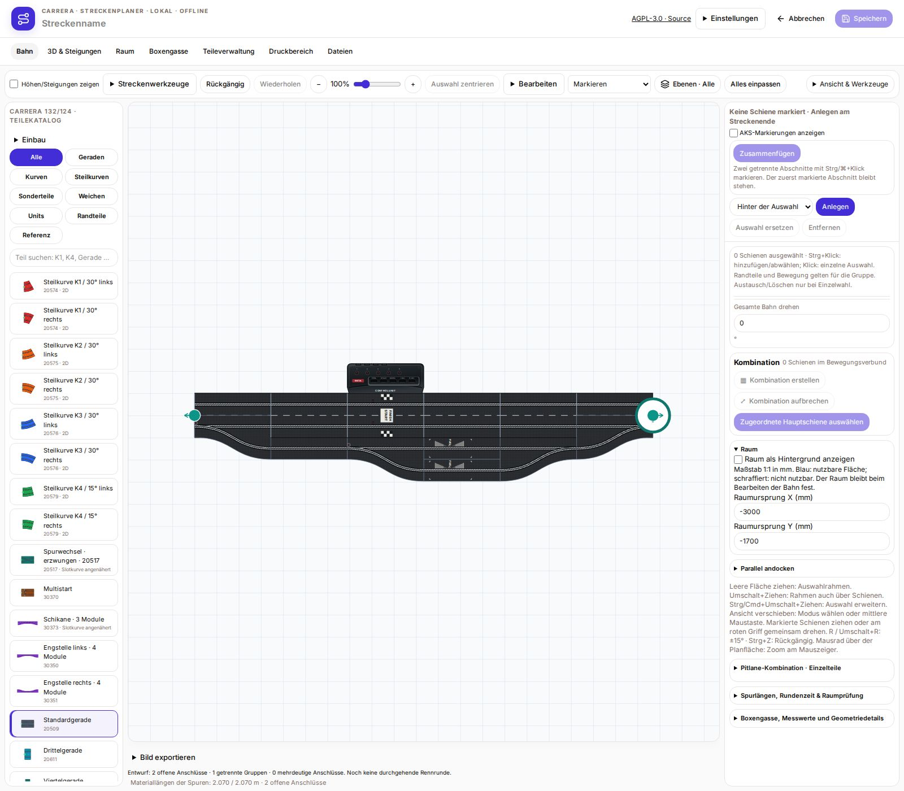
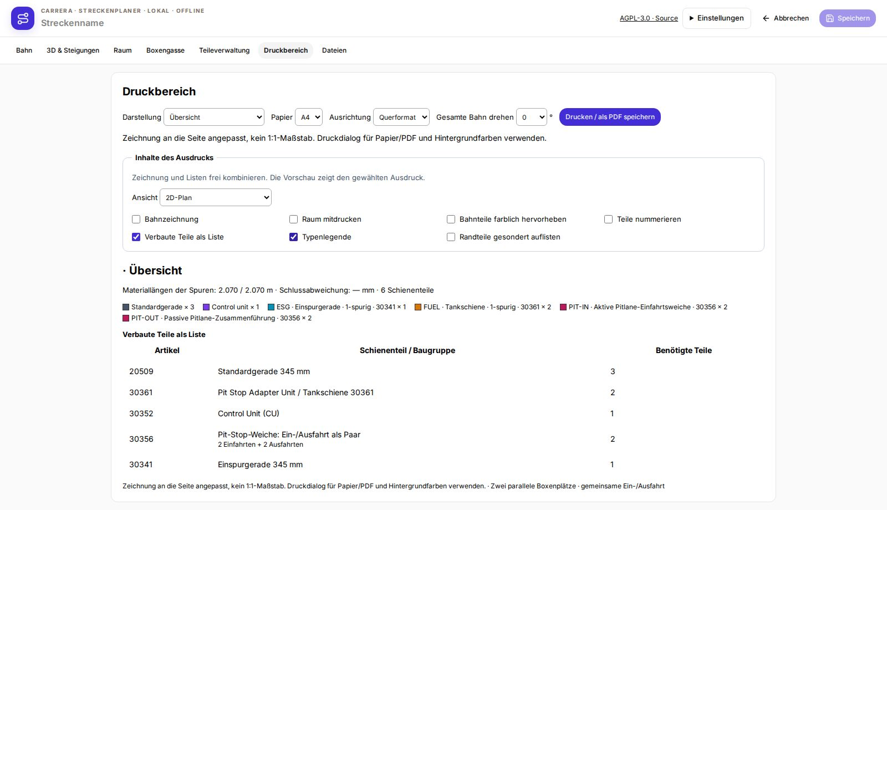

# Version 1.5.1 – Diodenpositionen und Aufdrucke

- Diodenmitte bei Tankschiene, CU/Start-Ziel und Zwischenzeitschiene: 116 mm ab Schienenanfang in Fahrtrichtung.
- Diodenmitte bei aktiven Weichen und Pit-Einfahrten: 6 mm ab Schienenanfang. Passive Ausfahrten erhalten keine Diode.
- START/FINISH-Aufdruck beginnt bei 150 mm und liegt damit hinter den Dioden. Zugehörige Tank- und Zwischenzeit-Aufdrucke wurden mitverschoben.
- Längsmaße nach Nutzermessungen; seitliche Abstände bleiben unverändert. Aufdruckdetails sind schematisch und nicht separat vermessen.
- Gemeinsame Darstellung in Teilekatalog, Bahnplan, 3D und Druck. Gespeicherte Pläne werden nicht verändert.
- Installationspakete: Linux x64, Windows x64, Debian amd64, RaceHubOS-Add-on, direktes Update und RaceHubOS-1.32-Integration. Windows-Paket inhaltlich geprüft; keine native Windows-Ausführung.

- Drucklegende korrigiert: Trägerschienen werden nicht zusätzlich als einzelne Pit-Ein-/Ausfahrt aufgeführt. Die Materialliste nennt bei zwei Paaren ausdrücklich zwei Einfahrten und zwei Ausfahrten.

