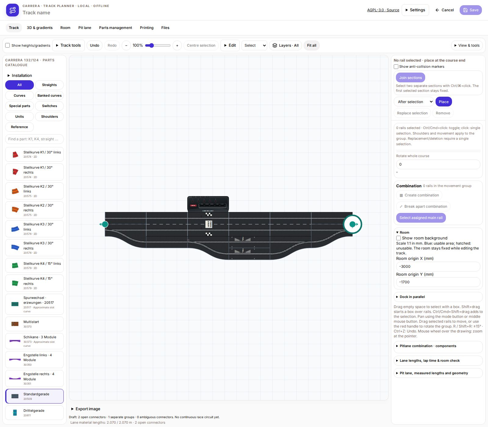
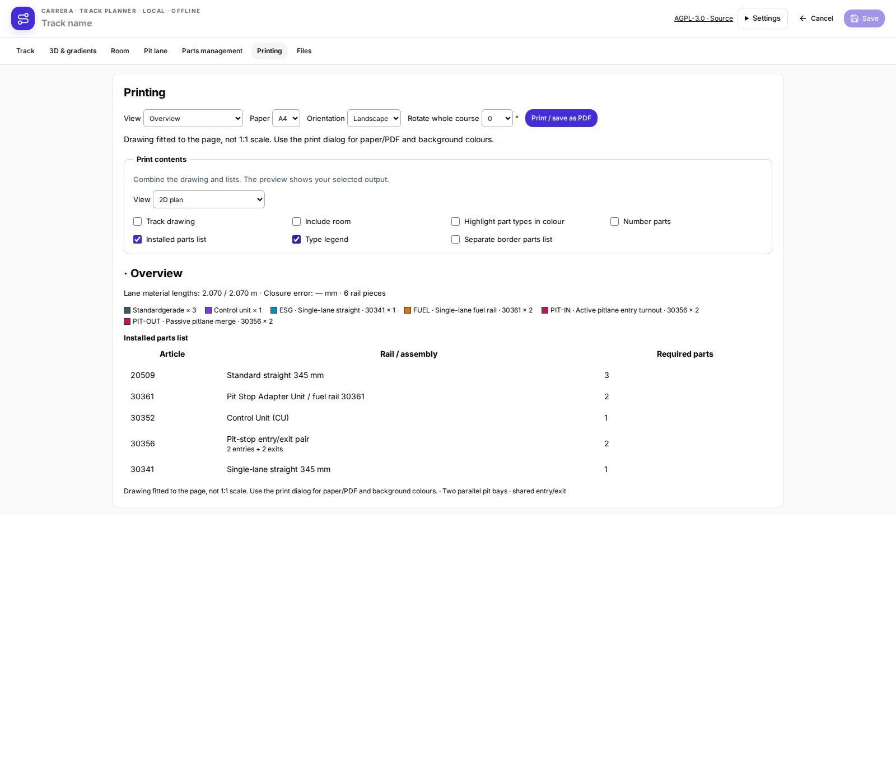

# Version 1.5.1 – Sensor positions and printed markings

- Sensor centres on fuel, CU/start-finish and timing rails: 116 mm from the leading rail edge in the driving direction.
- Sensor centres on active lane switches and pit entries: 6 mm from the leading rail edge. Passive exits have no sensor.
- START/FINISH printing begins at 150 mm, after the sensors. Associated fuel and timing markings move with their sensors.
- Longitudinal dimensions follow user measurements; lateral offsets are unchanged. Printed details remain schematic and were not measured separately.
- Shared artwork in the catalogue, track plan, 3D and print. Saved plans are preserved.
- Packages: Linux x64, Windows x64, Debian amd64, RaceHubOS add-on, direct update and RaceHubOS 1.32 integration. Windows package contents verified; no native Windows execution.

- Corrected print legend: carrier rails are no longer listed as additional single pit entries/exits. The installed-parts list explicitly identifies two entries and two exits for two pairs.

