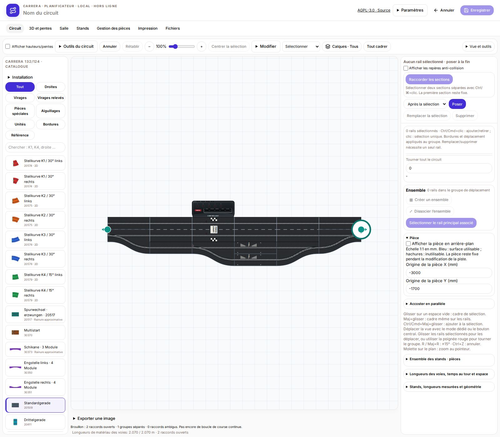
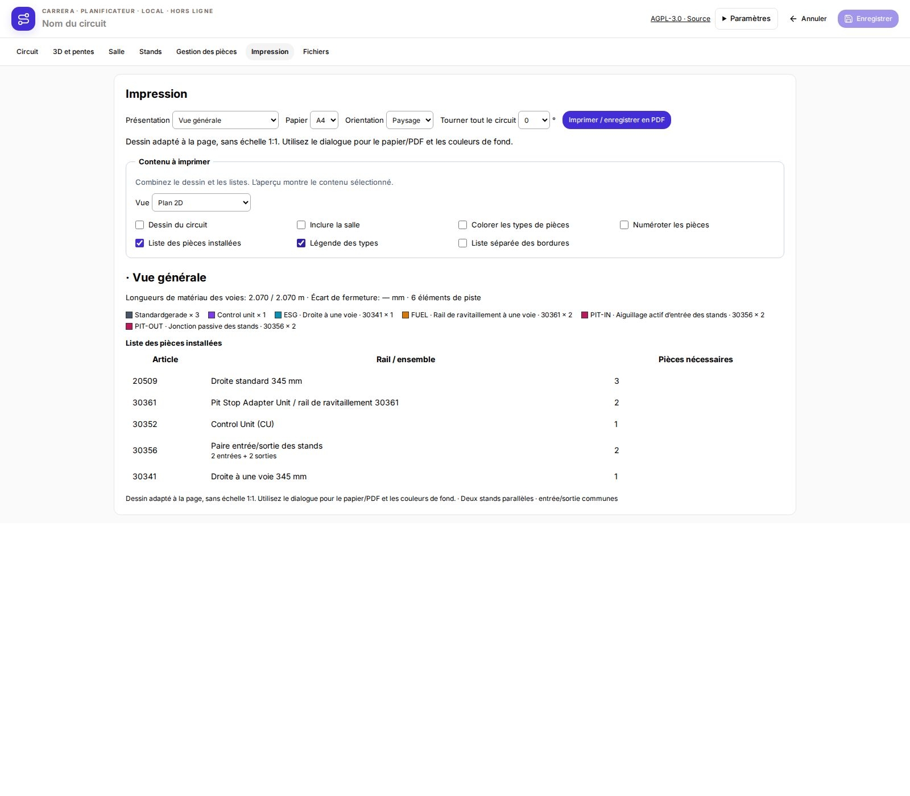

# Version 1.5.1 – Position des capteurs et marquages

- Centre des capteurs des rails de ravitaillement, CU/départ-arrivée et temps intermédiaires : 116 mm depuis le début du rail dans le sens de circulation.
- Centre des capteurs des aiguillages actifs et entrées des stands : 6 mm depuis le début du rail. Les sorties passives restent sans capteur.
- Le marquage START/FINISH commence à 150 mm, après les capteurs. Les marquages de ravitaillement et de temps intermédiaires sont déplacés avec leurs capteurs.
- Les distances longitudinales suivent les mesures fournies par l’utilisateur ; les décalages latéraux restent inchangés. Les détails imprimés sont schématiques et ne sont pas mesurés séparément.
- Graphismes partagés entre catalogue, circuit, vue 3D et impression. Les circuits enregistrés sont conservés.
- Paquets : Linux x64, Windows x64, Debian amd64, module RaceHubOS, mise à jour directe et intégration RaceHubOS 1.32. Contenu Windows vérifié ; sans exécution native sous Windows.

- Légende d’impression corrigée : les rails supports ne figurent plus comme entrées/sorties supplémentaires. La liste précise deux entrées et deux sorties pour deux paires.

