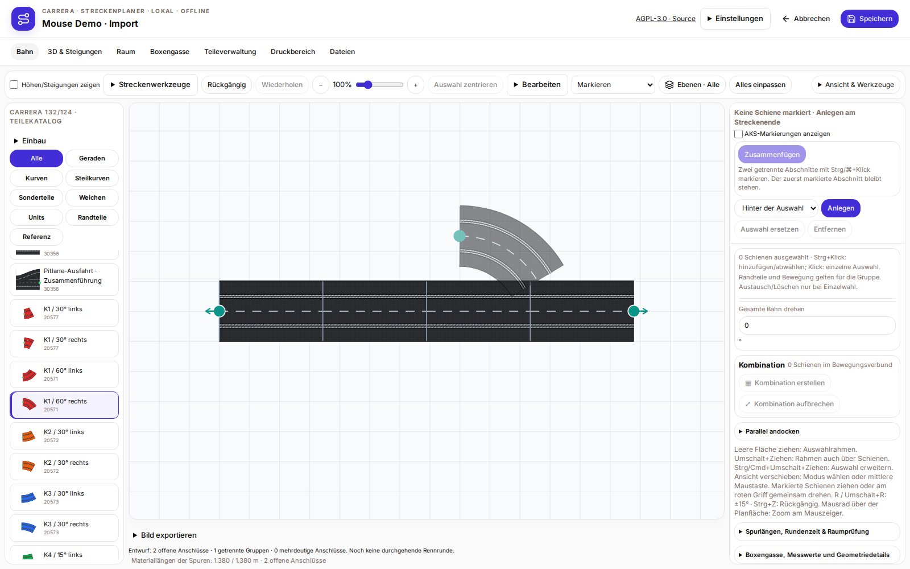
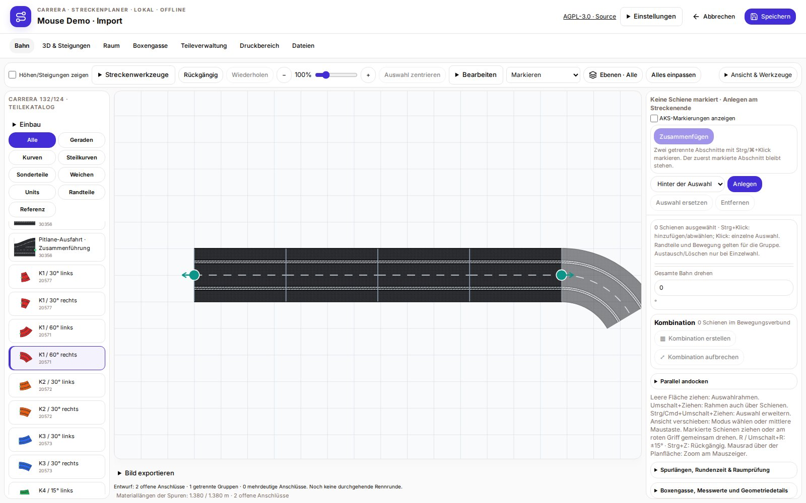
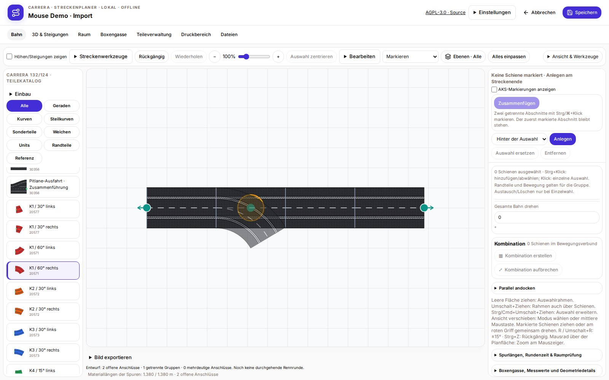
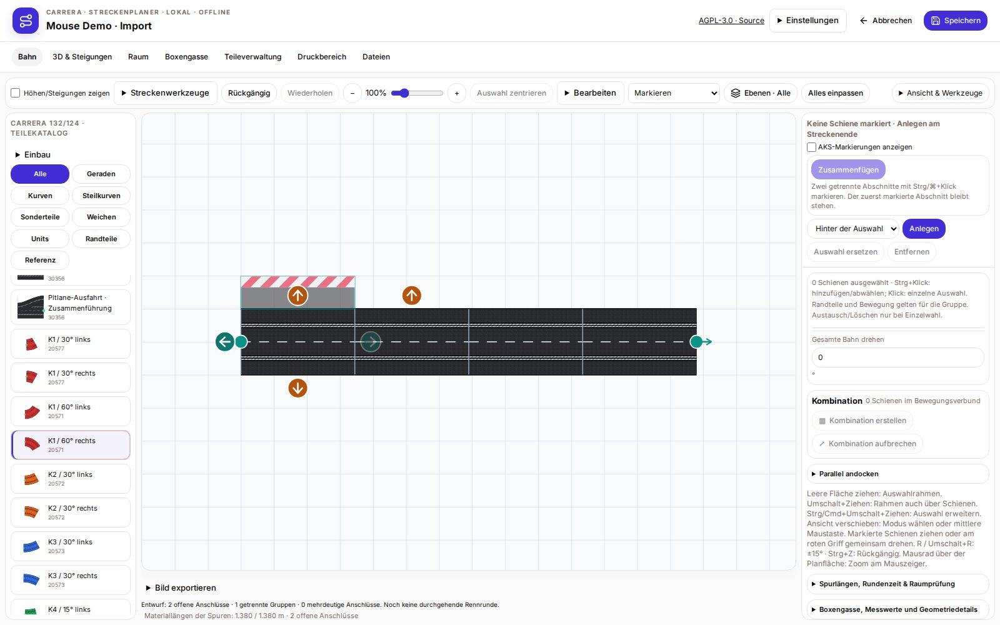
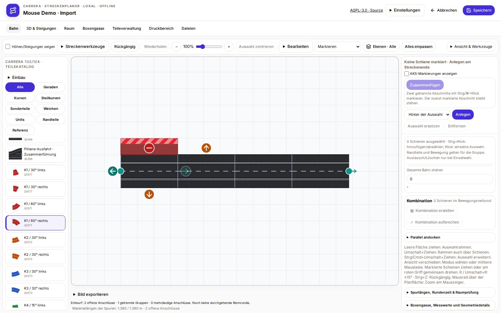
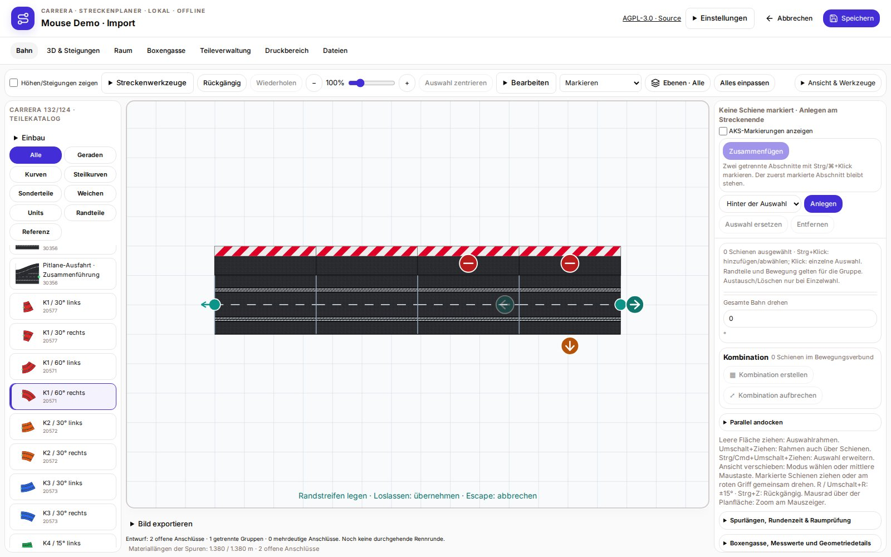
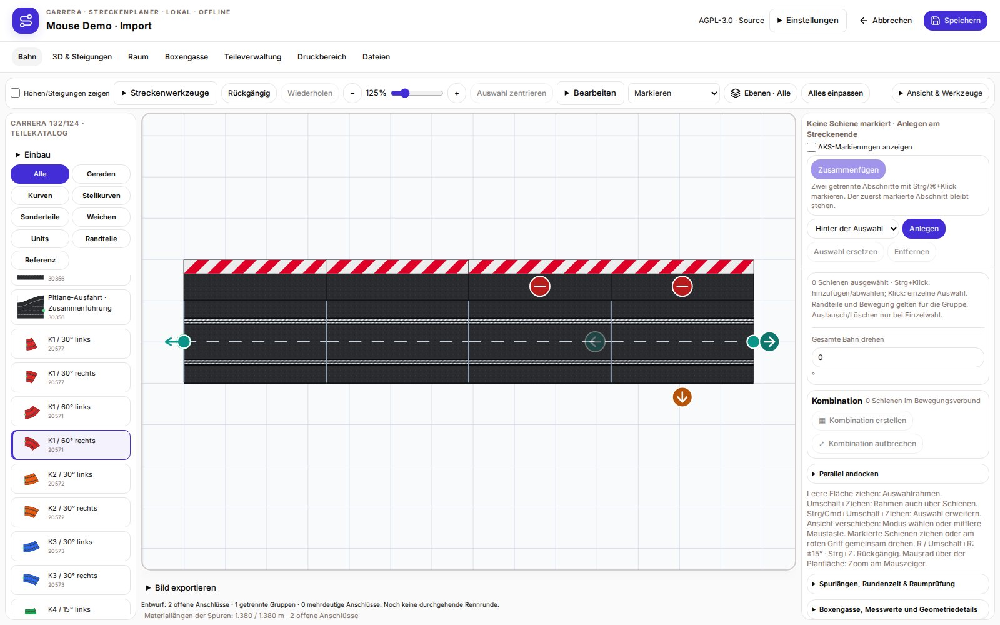

# Version 1.6.0 – Mausplatzierung und flüssige Randstreifen-Bearbeitung

- Katalogauswahl folgt direkt der Maus. Am freien Ende einrasten oder in der Mitte einer vorhandenen Schiene austauschen; die folgende Bahn folgt der neuen Geometrie. Mehrfachlegen hält die Auswahl. R dreht, Escape beendet die Platzierung.
- Strg + Mausrad sowie Strg + Bild auf/ab zoomen die Bahn.
- Vier unverändert große Pfeile am überfahrenen Teil: gleiche Schiene vorwärts/rückwärts anfügen und Randstreifen links/rechts bearbeiten. Unsichtbare Trefferflächen erleichtern das Treffen.
- Vorschau vor dem Klick. Ein Seitenpfeil fügt den Randstreifen an; das rote Minus entfernt ihn samt Endstücken. Rückgängig/Wiederholen bleibt verfügbar.
- Nachbarpfeile sind direkt erreichbar. Bei gedrückter linker Maustaste fortlaufend legen/entfernen; der erste Pfeil bestimmt die Aktion. Wiederholtes Überfahren schaltet nichts zurück. Der ganze Zug ist ein Rückgängig-Schritt. Escape oder Fokusverlust verwirft ihn.
- Boxengassensperren bei frei platzierten Teilen folgen tatsächlicher Überlappung auf derselben Ebene statt alten Einfahrts-/Ausfahrtsnummern. Gültige Sperren werden begründet. Randstreifen an gruppierten Schienen bleiben einzeln bearbeitbar.
- Vorschauen und Pfeile werden nicht mit exportiert. Schienenoptik und gespeicherte Bahnformate bleiben erhalten.

## Pakete

Debian amd64: `.deb` mit gebündelter Node-Runtime. Linux x64: Archiv entpacken und `Start.sh` starten. Windows x64: ZIP vollständig entpacken und `Start.cmd` starten; `node.exe` ist enthalten. Das ZIP ist ein portables Paket, kein nativer EXE-/MSI-Installer. Windows wurde hier inhaltlich geprüft, nicht nativ ausgeführt. Mangels macOS-Toolchain wird kein fertiger Mac-Installer angeboten.

`track-planner.racehub-addon.json` ist das RaceHubOS-Add-on. Die ältere RaceHubOS-1.32-Brücke bleibt ein separates, versionsgebundenes Integrationspaket; nicht auf andere Host-Versionen anwenden. `Carrera-Track-Planner-update.json` ist für den integrierten Updater, `SHA256SUMS` enthält die Paket-Prüfsummen. Quellarchiv, Lizenzen und Hinweise liegen bei. Vorhandene Pläne bleiben im jeweiligen Datenspeicher.

## Screenshots

