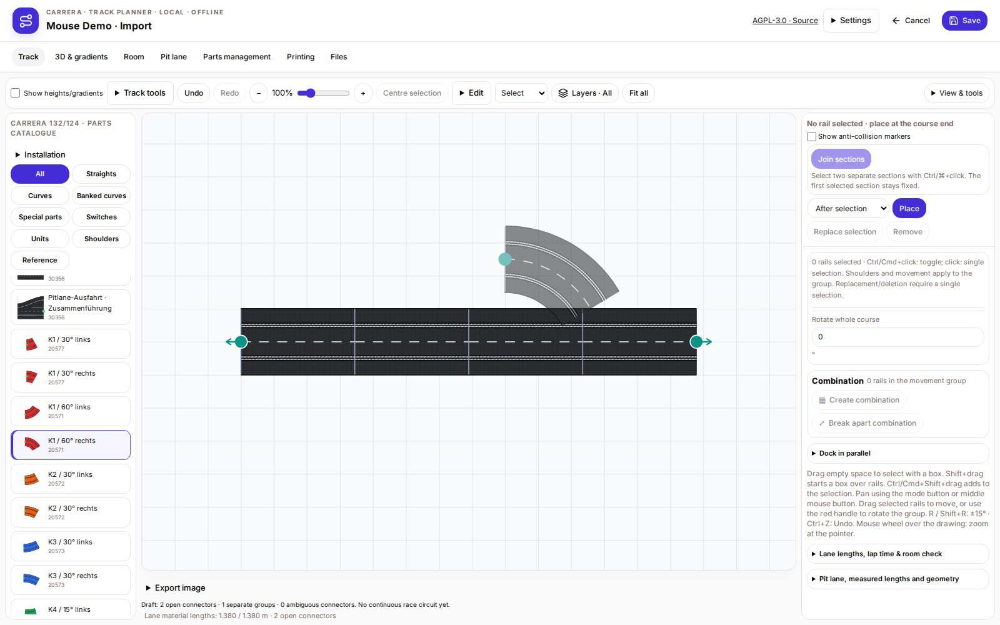
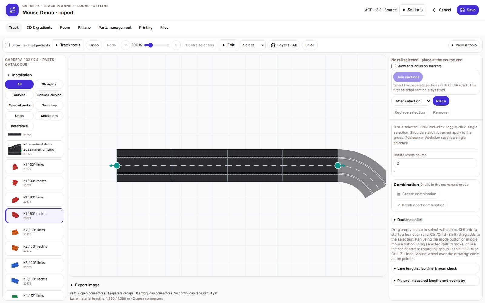
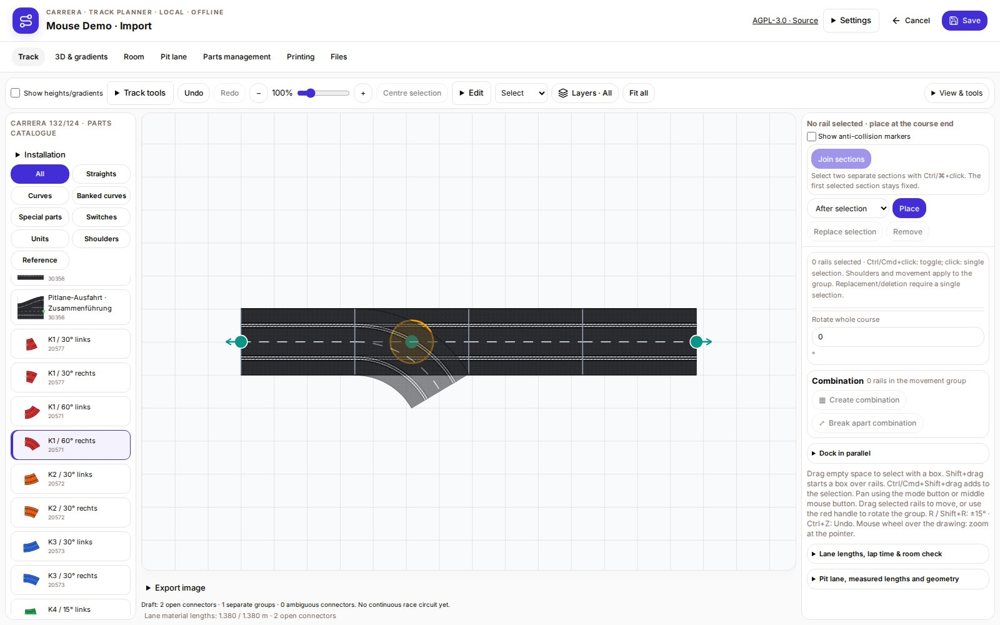
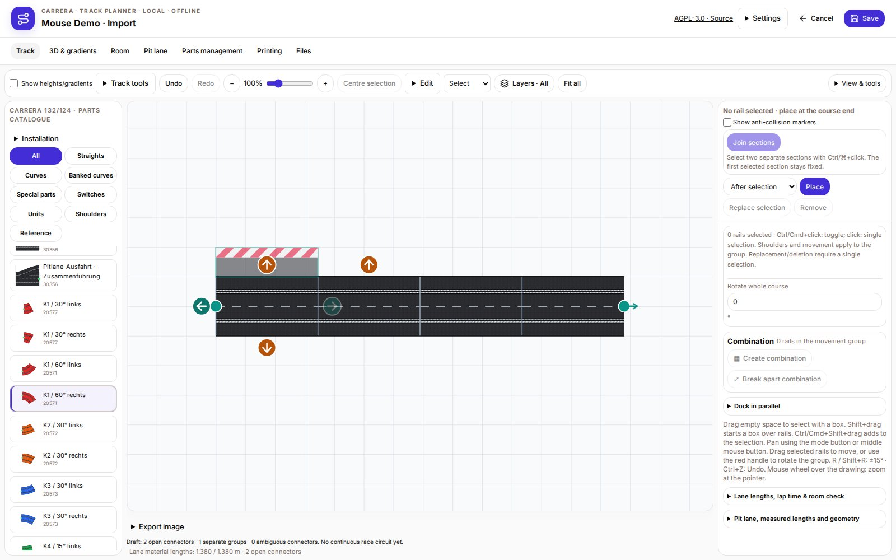
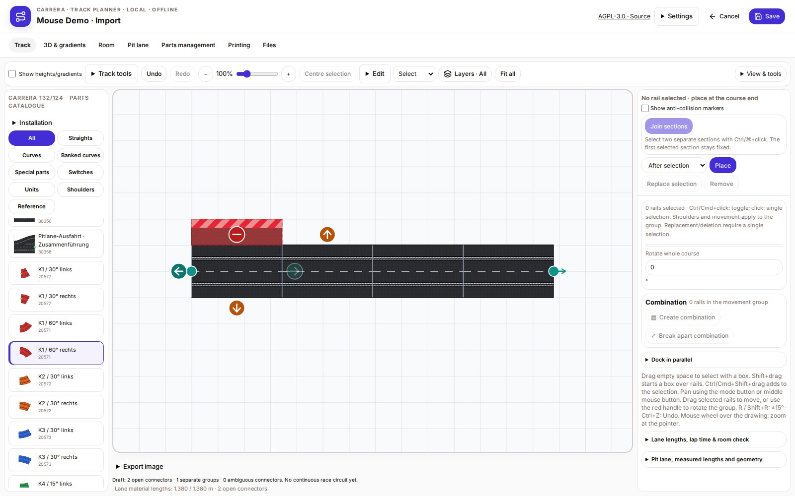
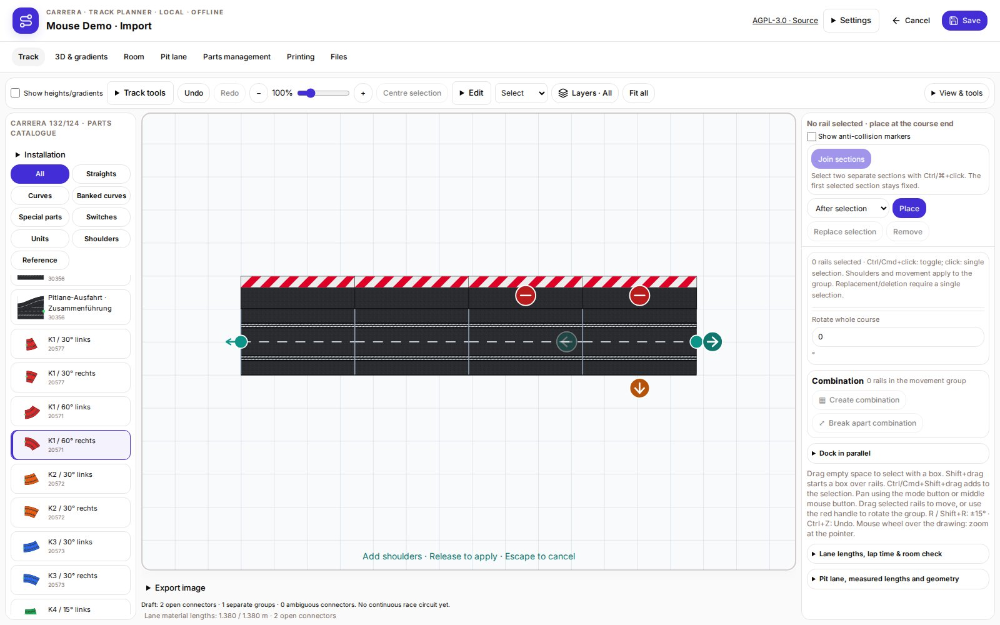
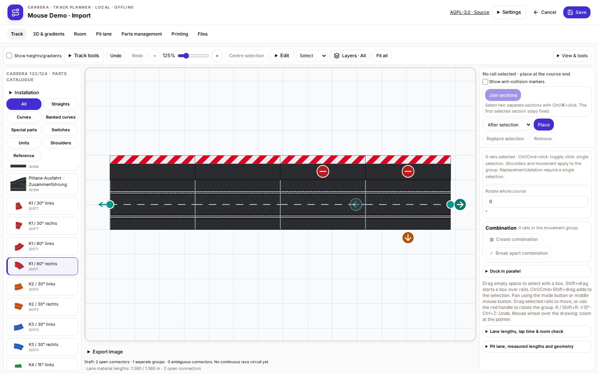

# Version 1.6.0 – Pointer placement and continuous shoulder editing

- Catalogue selections follow the pointer. Snap at an open end or replace at a rail centre, moving the following section with the new geometry. Repeat placement keeps the selection. R rotates; Escape cancels.
- Ctrl + wheel and Ctrl + Page Up/Down zoom the drawing.
- Four arrows keep their visible size, with larger invisible hit areas: extend the same rail in either driving direction or edit left/right shoulders.
- Hover previews the action. Click a side arrow to add a shoulder; its red minus removes it including end caps. Undo/redo remains available.
- Neighbouring side arrows are directly reachable. Hold the left mouse button and sweep across arrows to add/remove continuously. The first arrow fixes the mode; revisits never toggle back. One stroke is one undo step. Escape or loss of focus cancels it.
- Free-placement pit restrictions use actual overlap at the same level, not obsolete entry/merge indices. Valid restrictions show a reason. Grouped rails still allow individual shoulder editing.
- Controls and previews are excluded from exports. Rail appearance and saved layout formats are retained.

## Packages

Debian amd64: `.deb` with bundled Node runtime. Linux x64: extract the archive and run `Start.sh`. Windows x64: fully extract the ZIP and run `Start.cmd`; `node.exe` is included. This is a portable ZIP, not a native EXE/MSI installer. Windows contents are verified, but not executed natively here. No finished Mac installer is offered because a macOS toolchain is unavailable.

`track-planner.racehub-addon.json` is the RaceHubOS add-on. The legacy RaceHubOS 1.32 bridge remains a separate version-specific integration package; do not apply it to other host versions. `Carrera-Track-Planner-update.json` is for the built-in updater. `SHA256SUMS` provides package hashes. Source, licences and notices are included. Existing plans stay in their respective data stores.

## Screenshots

