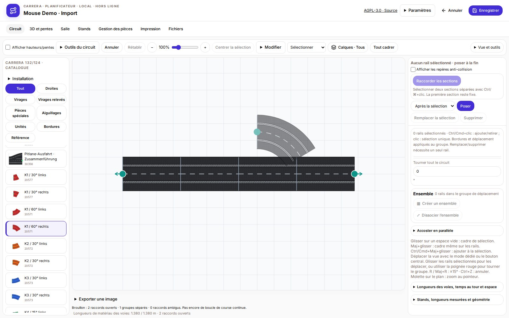
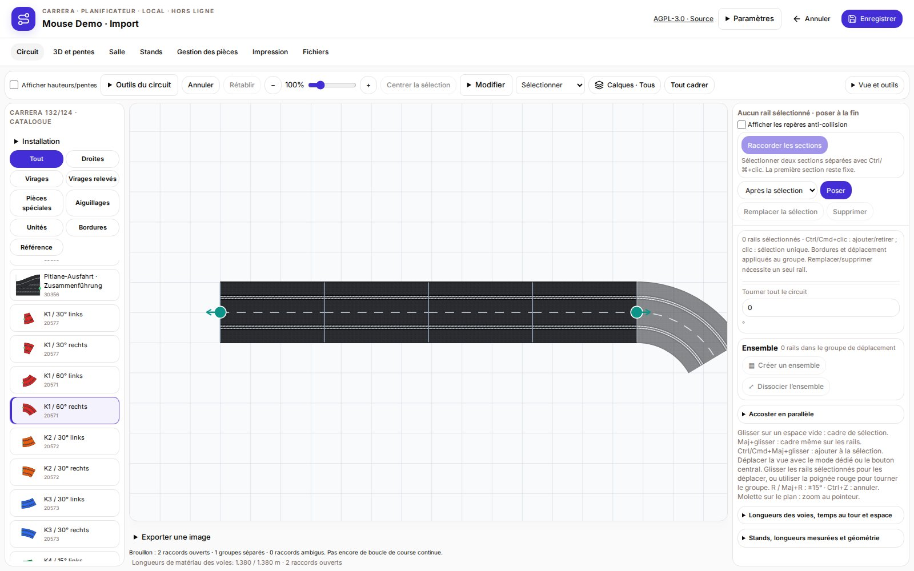
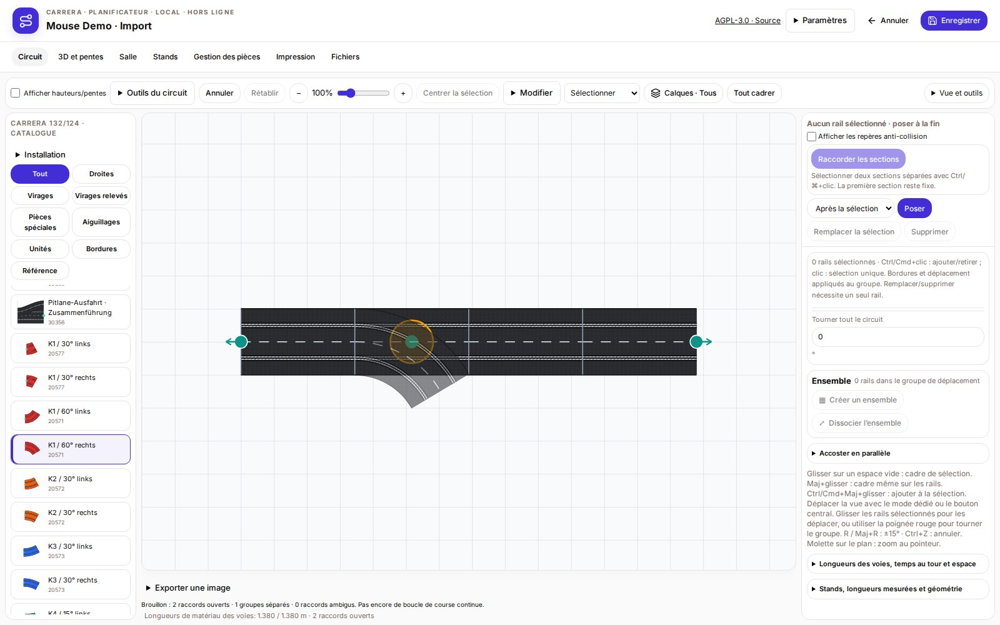
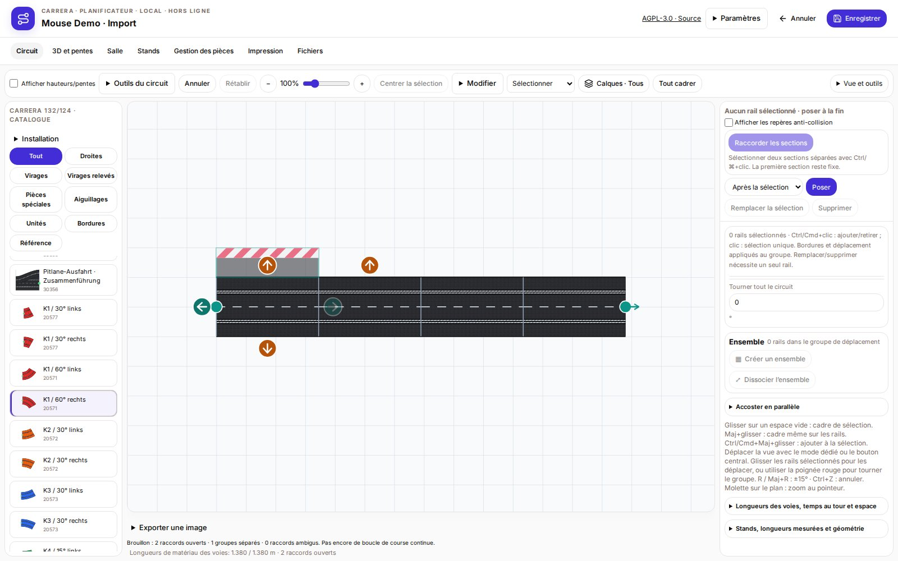
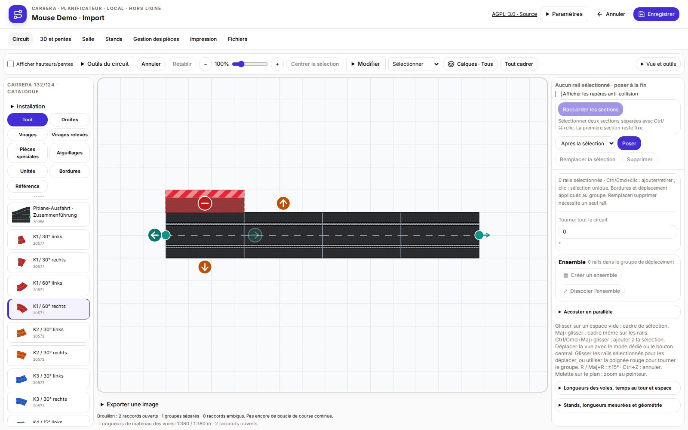
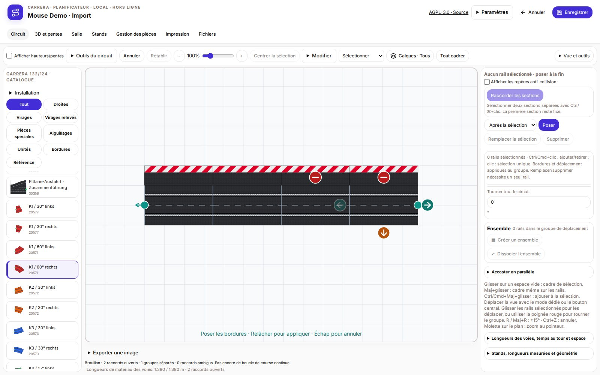
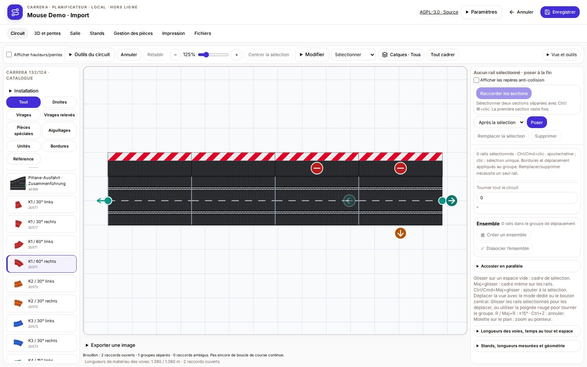

# Version 1.6.0 – Pose à la souris et édition continue des bordures

- Une sélection du catalogue suit la souris : raccorder à une extrémité libre ou remplacer au centre d’un rail, avec adaptation de la section suivante. La pose multiple conserve la sélection. R tourne ; Échap annule.
- Ctrl + molette et Ctrl + Page haut/bas règlent le zoom.
- Quatre flèches de taille visible inchangée, avec zones de clic invisibles élargies : prolonger dans les deux sens et modifier les bordures gauche/droite.
- Le survol affiche un aperçu. Cliquer ajoute la bordure ; le moins rouge la retire avec ses embouts. Annuler/rétablir reste disponible.
- Les flèches voisines sont directement accessibles. Maintenir le bouton gauche et glisser sur les flèches pour ajouter/retirer en continu. La première fixe le mode ; les passages répétés ne basculent pas les pièces. Un geste correspond à un pas d’annulation. Échap ou la perte de focus annule le geste.
- En placement libre, les restrictions des stands reposent sur un chevauchement réel au même niveau, et non sur d’anciens indices d’entrée/sortie. Leur motif est indiqué. Les bordures des rails groupés restent modifiables séparément.
- Les commandes et aperçus sont exclus des exports. L’aspect des rails et les formats de plans enregistrés sont conservés.

## Paquets

Debian amd64 : `.deb` avec Node inclus. Linux x64 : extraire l’archive puis lancer `Start.sh`. Windows x64 : extraire entièrement le ZIP puis lancer `Start.cmd` ; `node.exe` est inclus. Ce ZIP est portable, sans installateur EXE/MSI natif. Son contenu est vérifié, sans exécution Windows native ici. Aucun installateur Mac terminé n’est proposé faute de chaîne macOS.

`track-planner.racehub-addon.json` est le module RaceHubOS. L’ancienne passerelle RaceHubOS 1.32 reste un paquet séparé lié à cette version ; ne pas l’appliquer aux autres versions hôtes. `Carrera-Track-Planner-update.json` sert à la mise à jour intégrée. `SHA256SUMS` contient les empreintes des paquets. Sources, licences et notices sont incluses. Les plans existants restent dans leurs stockages respectifs.

## Captures d’écran

