# Bahn und Raum in 3D

Öffnen über **3D im Raum** in der zentralen Werkzeugleiste oder der Ansichtsauswahl. Die Ansicht verwendet die vorhandene Raumkontur einschließlich Nischen, gesperrter Flächen, Fahrerplätze und Laufwege. CU, Start/Ziel, Tankschienen und Randstreifen werden aus dem bestehenden Plan dargestellt.

- Ziehen dreht die Ansicht. Umschalt + Ziehen oder rechte/mittlere Maustaste verschiebt sie; das Mausrad zoomt.
- Pfeiltasten drehen/neigen, +/− zoomt, 0 setzt zurück. Draufsicht und Einpassen sind direkt erreichbar.
- Wände, Schnittansicht, Hindernisse, Beschriftungen und Höhenmaße sind einzeln schaltbar.
- Standard für Überfahrten: **150 mm lichte Höhe** zwischen unterer Fahrbahnoberseite und oberer Schienenunterseite. Mit 10 mm dargestellter Schienenstärke ergeben sich 160 mm Ebenenabstand. Das freie Maß ist einstellbar.
- Wand-, Hindernis-, Aufbau- und Überfahrthöhe werden beim Speichern mit der Bahn abgelegt und beim Öffnen wiederhergestellt. Auch der native JSON-Export und -Import erhalten diese Werte. Änderungen sind über Rückgängig/Wiederholen nachvollziehbar. PNG, JPG und SVG exportieren die aktuelle Perspektive.

Die orthografische 3D-Ansicht ist eine Planungshilfe. Auf- und Abfahrten verlaufen sanft mit waagerechtem Anfang und Ende; die Schienenoberfläche ist dafür in Teilflächen unterteilt. Die Durchfahrtshöhe bleibt am Kreuzungspunkt erhalten. Die Übergänge sind schematisch, keine physikalische Rampen- oder Stützenberechnung. Das optionale native Feld `sceneHeights` speichert vier Höhen in Millimetern; alte Pläne ohne dieses Feld verwenden die bisherigen Standardwerte. Kamera und Sichtbarkeit bleiben Ansichtseinstellungen. Die XY-Koordinaten der Bahn werden nicht verändert. Fremdformate TRK/Softyroyal übertragen diese zusätzliche Einstellung nicht. Ohne zugeordneten Raum erscheint die Bahn allein.

## Screenshots

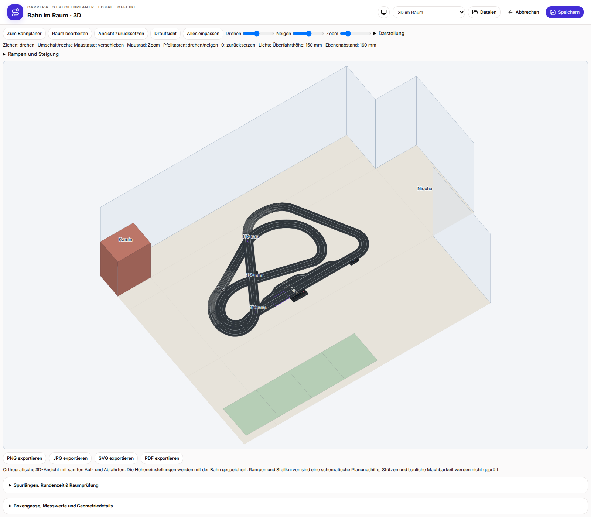

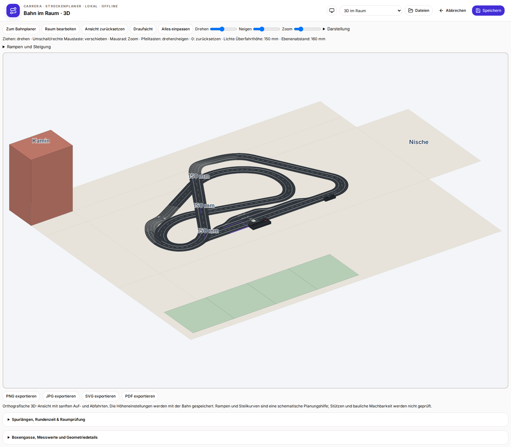

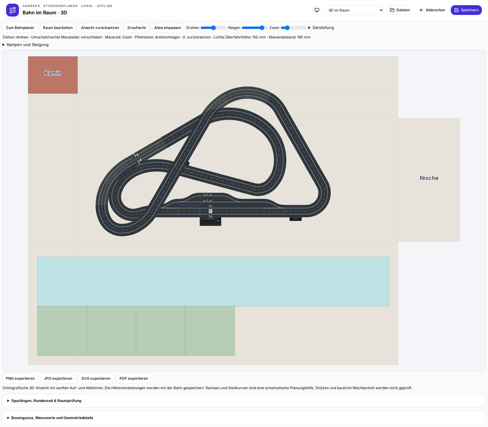

## Einstellbare Rampenlängen und Steigung

Unter **Darstellung** lassen sich Auffahrts- und Abfahrtslänge getrennt zwischen 100 und 20.000 mm einstellen. „Rampenlängen anwenden“ aktiviert die Vorgaben von jeweils 1.000 mm auch ohne Änderung der Zahlen. Alte Pläne behalten bis dahin ihr bisheriges Höhenprofil.

Die Länge wird entlang der horizontalen Bahnmittellinie gemessen, einschließlich Kurven. Die Rampe kann über mehrere verbundene Schienen verlaufen. CU und Überfahrtsschienen bleiben waagerecht auf ihrer vorgesehenen Höhe. Die vorhandene Bahn wird nicht verlängert: Wenn zwischen diesen festen Abschnitten oder benachbarten Rampen weniger Platz verfügbar ist, wird die Rampe gekürzt und in der Anzeige gekennzeichnet.

**Rampen und Steigung** zeigt je Übergang die tatsächliche Länge, den Höhenunterschied, die mittlere Steigung und die maximale Steigung des sanften Profils. Beispiel: 160 mm Höhenunterschied auf 1.000 mm horizontaler Länge ergeben 16 % mittlere und 30 % maximale Steigung. Maßgeblich für die Anzeige ist die tatsächlich verfügbare Länge, nicht ein unerreichbarer Wunschwert. Bei null verfügbarer Rampenlänge erscheint kein erfundener Prozentwert.

Das optionale native Feld `sceneRamps` speichert `ascentLengthMm` und `descentLengthMm`. Speichern, erneutes Öffnen und nativer JSON-Austausch erhalten beide Werte. Die Übergänge bleiben schematisch; die Anzeige bewertet keine fahrdynamische oder konstruktive Machbarkeit.

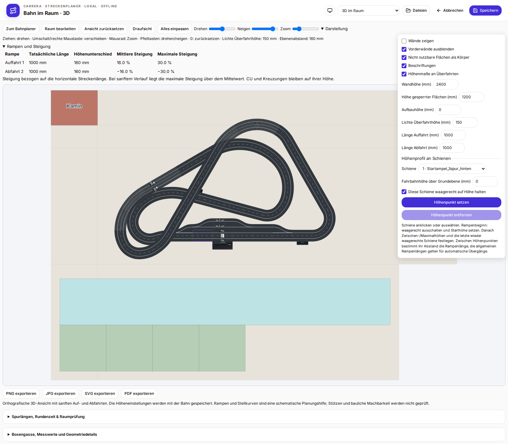

## Individuelle Höhen je Schiene

Unter **Darstellung → Höhenprofil an Schienen** eine Schiene auswählen oder in der 3D-Bahn anklicken. Die Auswahl aus dem Bahnplaner wird beim Öffnen der 3D-Ansicht übernommen.

1. Am Rampenbeginn die Starthöhe setzen und „Diese Schiene waagerecht auf Höhe halten“ ausschalten. Der Übergang beginnt am Anfang dieser Schiene.
2. An der gewünschten oberen Schiene die Maximalhöhe setzen; „waagerecht“ erzeugt dort ein ebenes Schienenstück.
3. Weitere Zwischenhöhen und Plateaus ergänzen. An der letzten Schiene die Rückkehrhöhe (beispielsweise 0 mm) setzen und „waagerecht“ aktivieren.
4. Bei Auswahl einer oberen Überfahrtsschiene lässt sich ihre **lichte Durchfahrtshöhe direkt** einstellen. Andere Überfahrten behalten ihre eigenen Höhen. Das Modell berücksichtigt dafür die 10 mm dargestellte Schienenstärke.

Die Höhen beziehen sich auf die Grundebene der Fahrbahn; die allgemeine Aufbauhöhe kommt hinzu. Zwischen expliziten Höhenpunkten bestimmen die Schienenabstände die tatsächlichen Rampenlängen und Steigungen. Die allgemeinen Auf-/Abfahrtslängen steuern die automatischen Ebenenübergänge. Ohne neue Höhenpunkte bleibt das bisherige Verhalten erhalten.

Die Vorgabe liegt direkt an der Schiene als optionales `pieces[].elevation = {heightMm, flat}`. Speichern und nativer JSON-Austausch erhalten sie; beim Entfernen einer Schiene entfällt auch deren Vorgabe. „Höhenpunkt entfernen“ setzt die Schiene auf das automatische Profil zurück. CU und Adapter bleiben waagerecht. Durchfahrtsmaße werden aus den tatsächlichen Höhen am Kreuzungspunkt berechnet; negative Abstände erscheinen rot. Es handelt sich weiterhin um ein schematisches Modell ohne konstruktive oder fahrdynamische Prüfung.

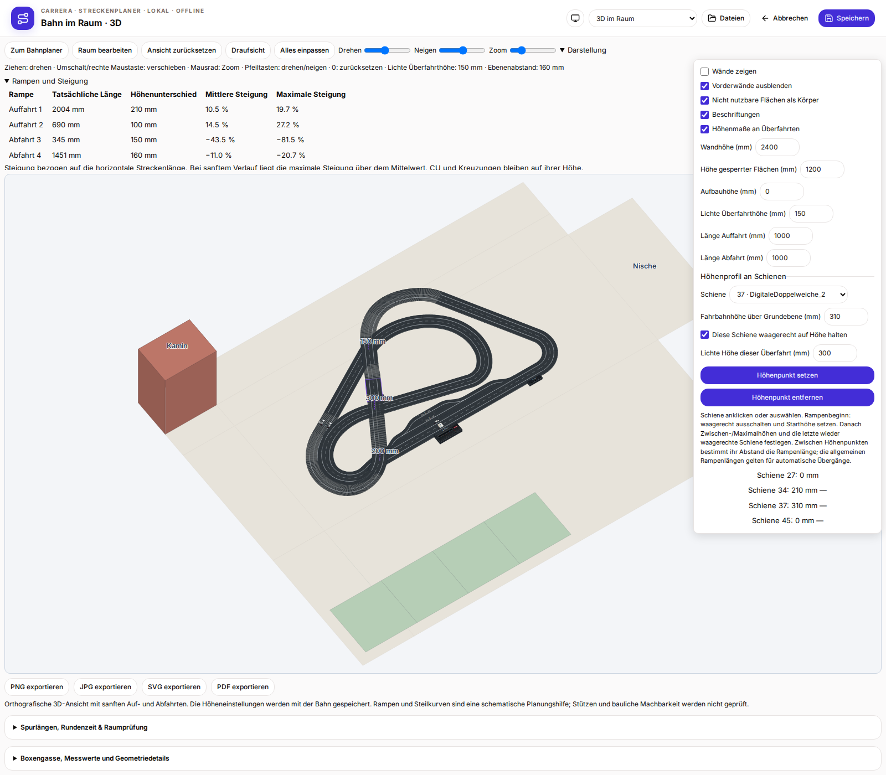

## Höhen und Steigungen in 2D

**Höhen/Steigungen zeigen** in der zentralen Werkzeugleiste blendet die Werte an den Schienen ein oder aus. Die Einstellung wird mit der Bahn gespeichert; Ausblenden entfernt keine Höhenpunkte. Die Schienenoptik bleibt erhalten.

Die Beschriftung enthält die Fahrbahnhöhe am Anfang und Ende der Schiene in Millimetern über der Grundebene sowie die tatsächlich berechnete mittlere Steigung beziehungsweise das Gefälle dieser Schiene in Prozent. Bei waagerechten Schienen erscheint eine einzelne Höhe und 0 %. Der Ebenenfilter gilt auch für die Höhenbeschriftungen.

Ein Klick auf die Beschriftung öffnet **Höhe und Steigung bearbeiten** rechts (auf kleinen Bildschirmen unterhalb der weiterhin sichtbaren Bahn). Alternativ eine Schiene markieren und die gleichnamige Schaltfläche verwenden. Höhenpunkt, waagerechter Abschnitt und Entfernen funktionieren mit denselben gespeicherten Daten wie in 3D. Der Bearbeitungsbereich zeigt auch die maximale berechnete Steigung der einzelnen Schiene.

Für eine direkte Steigungseingabe eine **Zielschiene in Fahrtrichtung** wählen, den mittleren Prozentwert eingeben und **Steigung anwenden** anklicken. Beispiel: +10 % über 1.035 mm setzen die Zielhöhe 103,5 mm über die Starthöhe. Negative Werte erzeugen eine Abfahrt. Die Funktion setzt Höhenpunkte am Anfang der ausgewählten Schiene und an der waagerechten Zielschiene. Dazwischenliegende Vorgaben bleiben erhalten; der sanfte Verlauf hat deshalb örtlich andere Steigungen als den Mittelwert über die gesamte gewählte Strecke. Diese tatsächlichen Werte stehen an den einzelnen Schienen.

Nicht verbundene/mehrdeutige Strecken und Zielhöhen außerhalb 0–3.000 mm werden abgewiesen. Die CU/Adapter-Schiene bleibt waagerecht. Rückgängig/Wiederholen, Speichern und Neuladen erhalten die Bearbeitung. Ein Wechsel zu 3D zeigt dieselben Höhen; Änderungen dort erscheinen wieder in 2D. Eingeblendete Beschriftungen sind Teil des Bildexports.

Das optionale native Feld `showElevationLabels` speichert nur die Sichtbarkeit. Die Höhen bleiben in `pieces[].elevation`; eingegebene Steigungen werden durch die berechneten Höhenpunkte gespeichert, nicht als davon unabhängige widersprüchliche Werte.

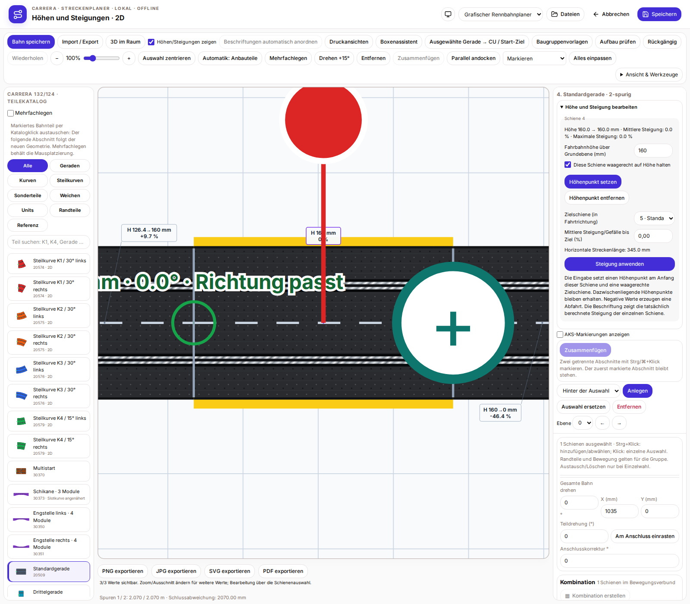

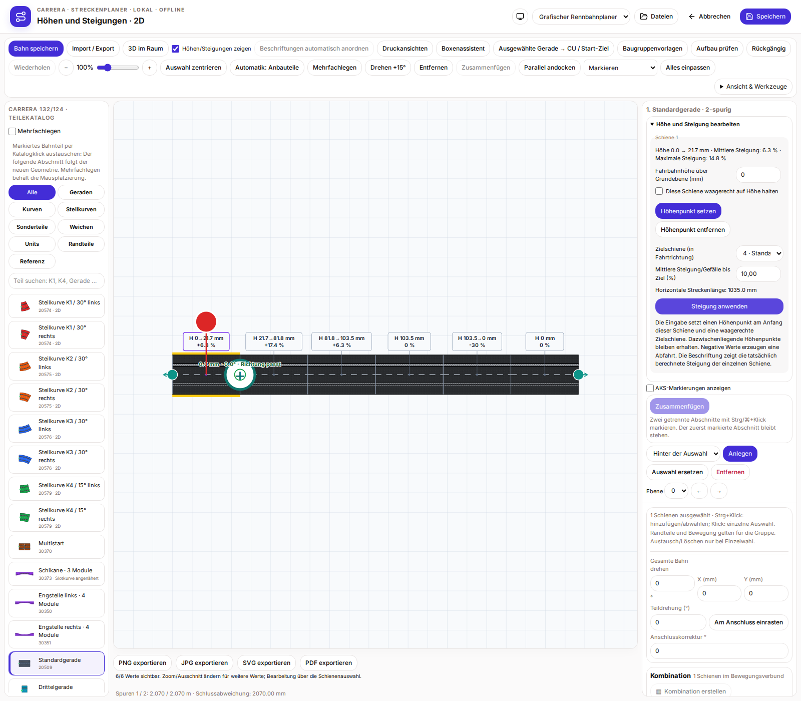

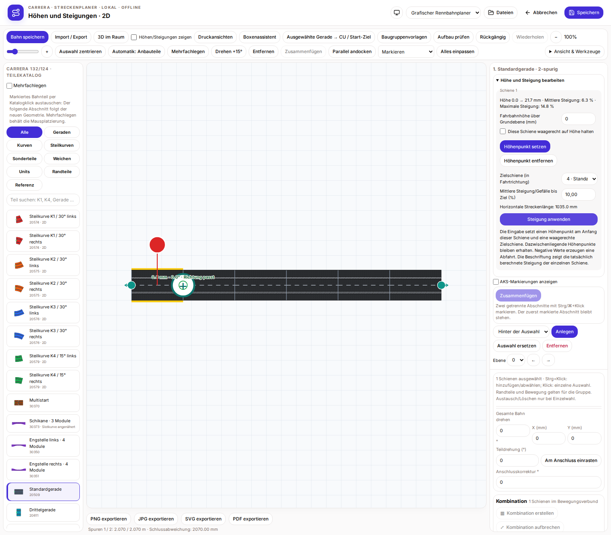

Bei Überfahrten ergänzt „↕ … mm“ die tatsächliche lichte Durchfahrtshöhe. Sie lässt sich im 2D-Bearbeitungsbereich direkt ändern; dabei wird die Schienenstärke berücksichtigt. Bei mehreren Kreuzungen unter einer Schiene wird der kleinste Abstand angezeigt.

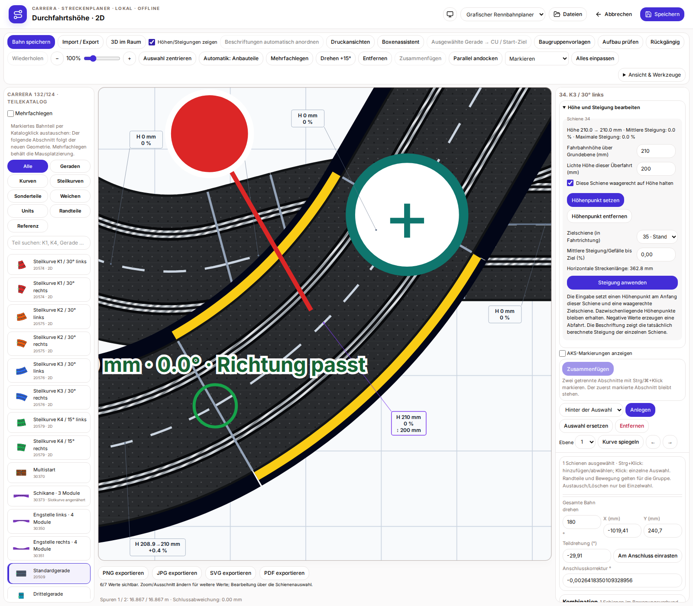

## Zoomabhängige Platzierung ohne Überlagerung

Höhen- und Steigungswerte erscheinen jetzt als waagerechte Karten **neben** der Fahrbahn. Dünne Verbindungslinien zeigen die zugehörige Schiene. Schienenflächen, Randstreifen, CU-Gehäuse und native Boxenschienen bleiben von den Karten frei. Die Schrift bleibt beim Zoomen zwischen 10 und 12 Bildschirmpixeln groß; die Karten wachsen nicht mit dem Auswahlzoom über die Strecke.

Die Anordnung wird bei Zoom, Verschieben und Fenstergrößenwechsel neu berechnet. Karten überlagern sich nicht und bleiben innerhalb des sichtbaren Zeichenbereichs. Die ausgewählte Schiene wird zuerst berücksichtigt, danach gesetzte Höhenpunkte, Durchfahrtshöhen und Rampenwerte.

Reicht der freie Platz nicht, werden weitere Karten vorübergehend ausgeblendet. Der Zähler unter der Bahn zeigt sichtbare Karten im aktuellen Ausschnitt, beispielsweise 4/55. Zoom oder Ausschnitt ändern zeigt weitere Werte. Alle Vorgaben bleiben über die Schienenauswahl bearbeitbar; es werden keine Höhen gelöscht. **Höhen/Steigungen zeigen** schaltet weiterhin alle Karten aus oder ein.

Nur die Darstellung ändert sich. Bahnkoordinaten, Höhen, Steigungen und gespeicherte Vorgaben bleiben beim Zoomen und Umordnen unverändert. Automatisch berechnete Kartenpositionen sind reine Ansichtsdaten. Manuelle Wunschpositionen werden dagegen mit der Bahn gespeichert; siehe folgenden Abschnitt. Der Bildexport übernimmt die sichtbare Anordnung.

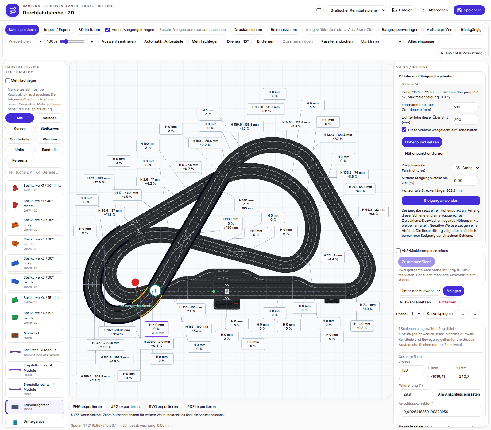

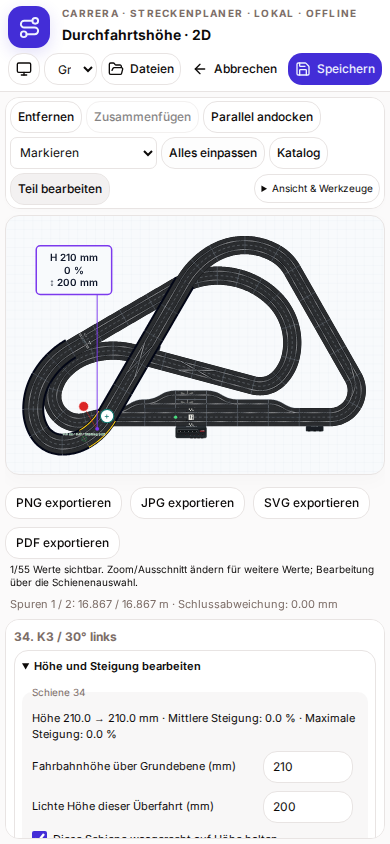

## Beschriftungen manuell verschieben und zurücksetzen

Eine Wertekarte mit Maus oder Touch ziehen. Ein kurzer Klick öffnet weiterhin die Höhenbearbeitung. Die dünne Verbindungslinie bleibt der Schiene zugeordnet. Das Ablegen speichert genau eine Positionsänderung und lässt sich rückgängig machen oder wiederholen.

**Beschriftungen automatisch anordnen** in der zentralen Werkzeugleiste entfernt alle manuellen Vorgaben. Für nur eine Karte die Schiene auswählen und im Höheneditor **Diese Beschriftung automatisch anordnen** verwenden. Beide Funktionen ändern ausschließlich Beschriftungspositionen, keine Schienen oder Höhen.

Mit Tastaturfokus auf einer Karte verschieben Pfeiltasten die Karte um 4 Bildschirmpixel, mit Umschalt um 16. Entf/Rücktaste setzt nur deren Position auf automatisch zurück; die Schiene wird nicht gelöscht. Escape bricht ein laufendes Ziehen ab.

Die manuelle Position wird mit der Bahn gespeichert, auch beim nativen JSON-Export/-Import. Das optionale Feld `pieces[].heightLabelOffset = {alongMm, acrossMm}` enthält Millimeter relativ zu Mitte und Richtung der zugehörigen Schiene. Dadurch folgt die Position beim Verschieben oder Drehen der Bahn der Schiene; es werden keine Bildschirmkoordinaten gespeichert. Alte Pläne ohne Vorgabe verwenden die Automatik.

Die Kollisionsvermeidung bleibt aktiv: Beim Ziehen wird ein freier Platz gesucht, der keine Schienen oder anderen Karten verdeckt. Bei verändertem Zoom oder kleinerem Fenster kann eine gespeicherte Wunschposition vorübergehend versetzt dargestellt oder ausgeblendet werden. Diese Darstellungsanpassung überschreibt die gespeicherte Position nicht. Die bevorzugten Positionen, Höhen und Bahnkoordinaten bleiben beim reinen Zoomen unverändert. Fremdformate TRK/Softyroyal übertragen diese native Erweiterung nicht.

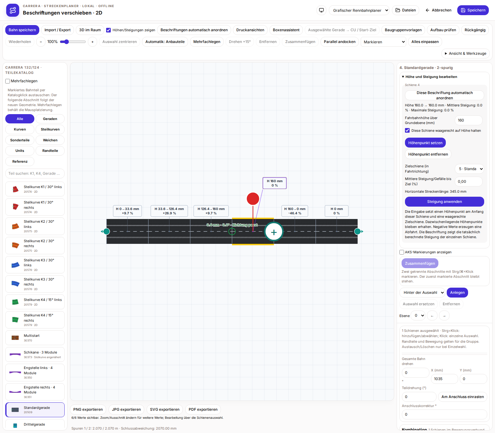

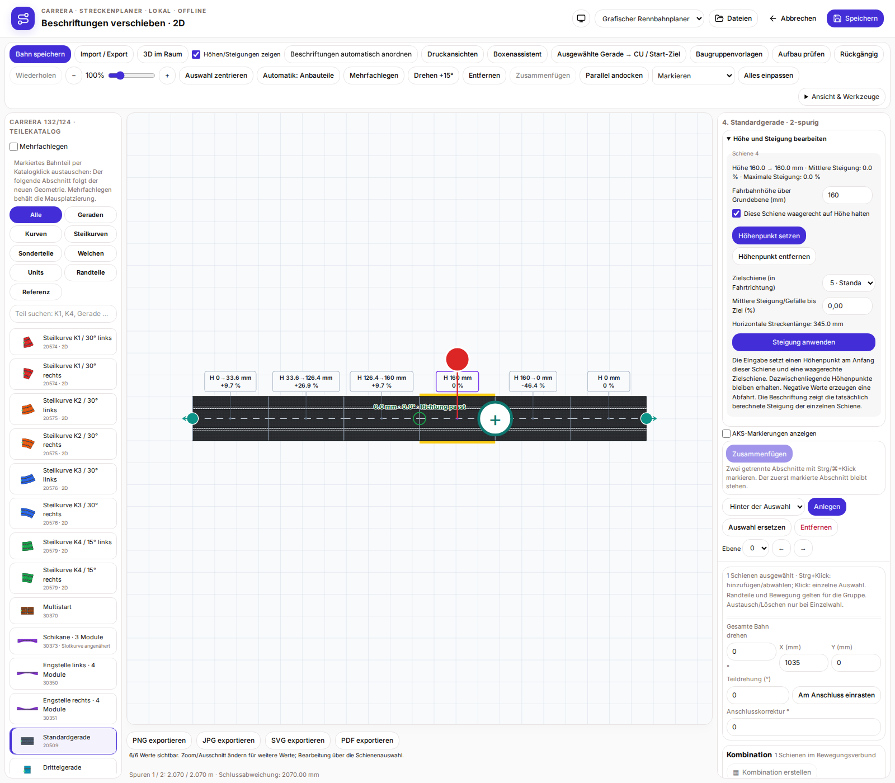

## Druck und Export wie in der Ansicht

PNG, JPG, SVG und der neue **PDF exportieren**-Knopf übernehmen einen eingefrorenen Schnappschuss des aktuellen Zeichenbereichs. Manuell verschobene Karten, ihre dünnen Verbindungslinien, Sichtbarkeit, Zoom und Ausschnitt werden nicht neu angeordnet. Auch eine momentan wegen Platzmangels angepasste Kartenposition wird so übernommen, wie sie gerade sichtbar ist. Ausgeblendete Werte bleiben ausgeblendet. Die Exportfunktion ändert weder Bahn noch gespeicherte Wunschpositionen.

**Druckvorschau** ist direkt in der zentralen Werkzeugleiste erreichbar und öffnet standardmäßig **Aktuelle Ansicht mit Beschriftungen**. Drucken und **PDF exportieren** in dieser Vorschau verwenden denselben eingefrorenen Zeichenbereich. Papiergröße und Orientierung passen die gesamte Grafik proportional auf das Blatt an; sie berechnen die Kartenpositionen nicht neu. Für die vollständige Bahn vor dem Öffnen **Alles einpassen** wählen. Ein zuvor gezoomter oder verschobener Ausschnitt wird bewusst genau so ausgegeben.

Die bisherigen gesonderten Übersichts-, Farb-, Aufbau- und Ebenendrucke bleiben verfügbar. Diese erzeugen ihre eigene technische Zeichnung; für eine Ausgabe exakt wie am Bildschirm den Modus **Aktuelle Ansicht mit Beschriftungen** verwenden.

SVG und PDF bleiben Vektorgrafiken mit eingebetteten Schriften. Schienen, Oberflächenmuster, Leiter, Verbindungslinien und Beschriftungen bleiben beim Vergrößern scharf. Der PDF-Export nutzt jsPDF/svg2pdf lokal, ohne Internetverbindung; gemusterte Schienenstriche werden dafür in Vektorflächen umgewandelt. Manuelle Beschriftungen werden aus dem eingefrorenen Schnappschuss unverändert übernommen, nur die gesamte Grafik wird proportional auf die gewählte Papiergröße skaliert. PNG/JPG bleiben Rasterausgaben bis 2.400 Pixel. Die native Bahn bleibt unabhängig davon bearbeitbar.

Prüfung: Positionsattribute aller Karten und Verbindungslinien zwischen Ansicht, SVG und Druckschnappschuss verglichen. Direkte PDFs und PDFs aus der Druckvorschau enthalten eingebettete Schriften und keine Rasterbilder. Tatsächliche PDF-Dateien wurden auf eine Seite geprüft und in hoher Auflösung gerendert; zusätzlich Kurven, CU und zwei Tankschienen geprüft. Die Positionsprüfung umfasst Deutsch, Englisch und Französisch sowie Auswahlzoom und ausgeblendete Werte.

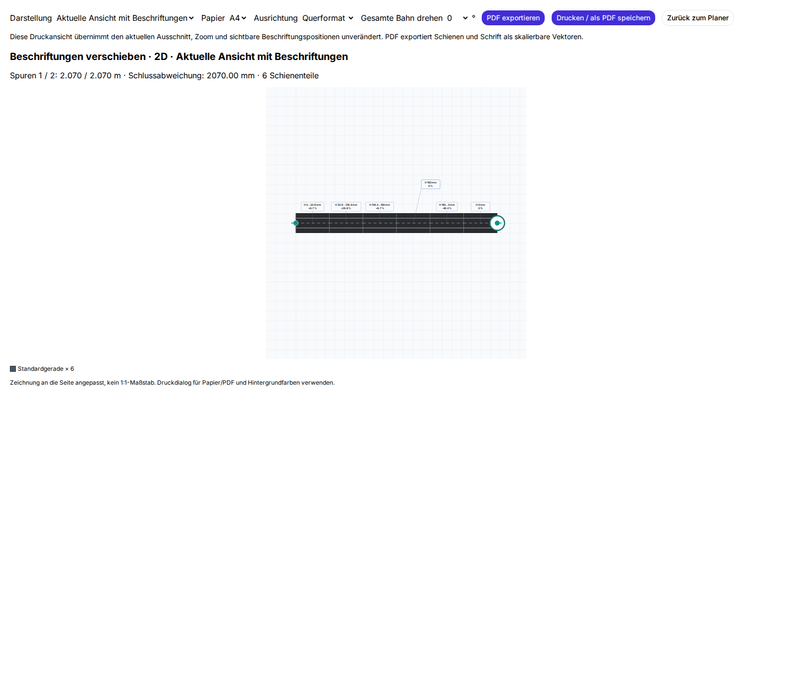

## RaceHubOS-Kompatibilität

Der experimentelle Legacy-Adapter legt Höhen, Rampen, Sichtbarkeit und manuelle Schienenbeschriftungen zusätzlich als validierten Schnappschuss in den erweiterbaren Bahnmetadaten ab. Dadurch bleiben sie beim Speichern und erneuten Öffnen durch ältere Host-Parser erhalten. Die Zuordnung wird gegen Anzahl und Typen der Schienen geprüft; native JSON-Dateien verwenden weiterhin die normalen Felder. Dies definiert keine offizielle Plugin-Schnittstelle.
