# Track and room in 3D

Open **3D in room** from the central toolbar or view selector. The view uses the actual room outline including alcoves, excluded areas, driver places and aisles. CU, start/finish, fuel rails and shoulders come from the existing plan.

- Drag to orbit. Shift + drag or the right/middle mouse button pans; the wheel zooms.
- Arrow keys orbit/tilt, +/− zoom, 0 resets. Top view and fit are available directly.
- Toggle walls, cutaway, obstacles, labels and clearance dimensions separately.
- Bridges default to **150 mm clear space** between the lower road surface and upper rail underside. With 10 mm illustrated rail thickness, nominal level spacing is 160 mm. Clearance is adjustable.
- Wall, obstacle, base and crossing clearance heights are saved with the track and restored on reopening, including native JSON export/import. Changes participate in undo/redo. PNG, JPG and SVG export the current perspective.

The orthographic 3D view is a planning aid. Ascents and descents ease smoothly into flat ends, using a tessellated road surface. Crossing clearance is preserved at the bridge. Transitions remain schematic rather than physical ramp or support calculations. The optional native `sceneHeights` field stores four heights in millimetres; older plans retain default values. Camera and visibility remain view settings. Track XY coordinates are unchanged. TRK/Softyroyal exchange formats do not carry these additional settings. Without an assigned room the track appears alone.

## Screenshots

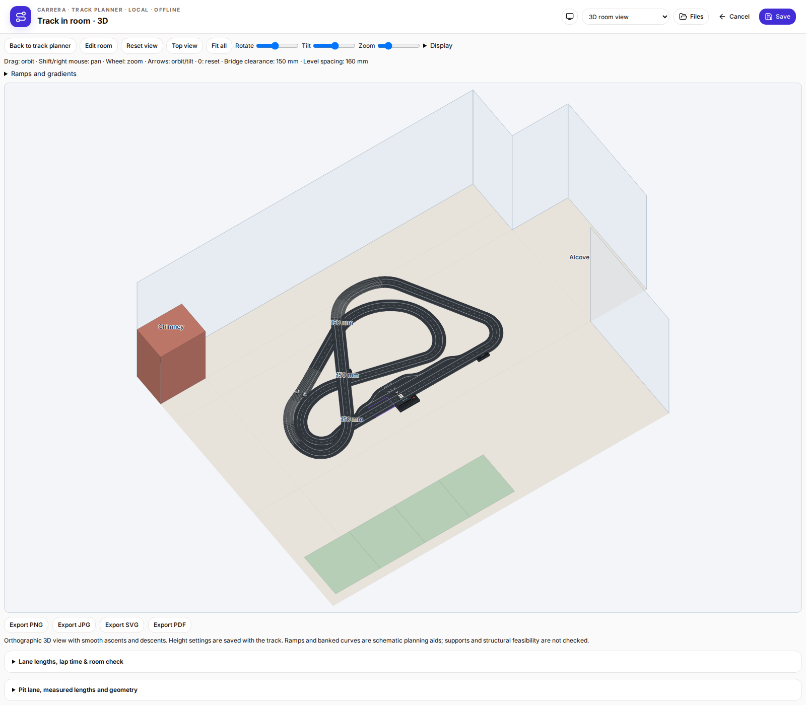

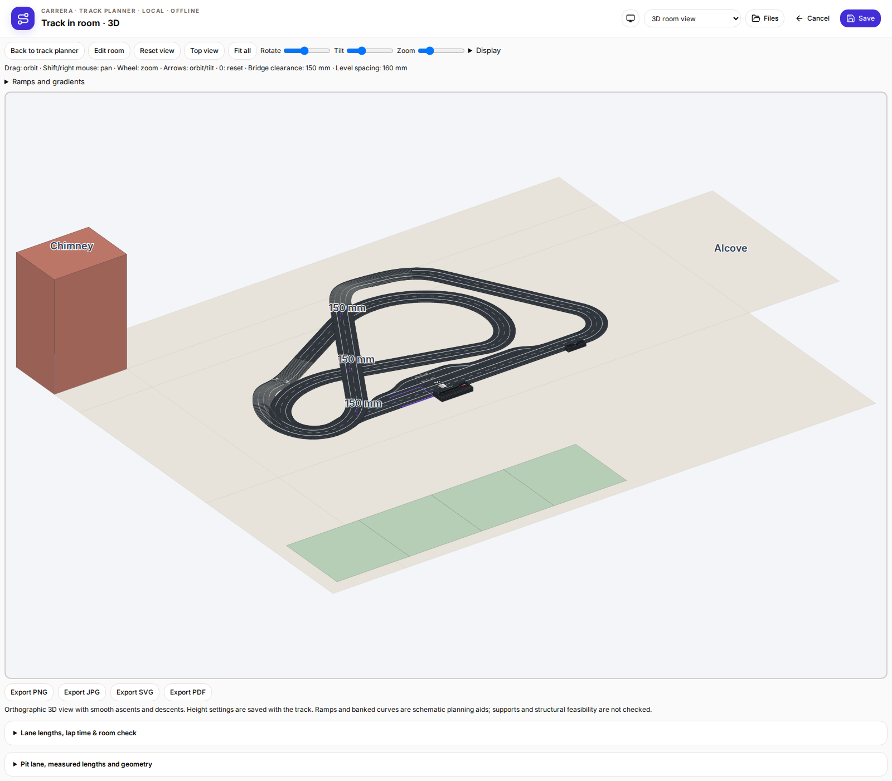

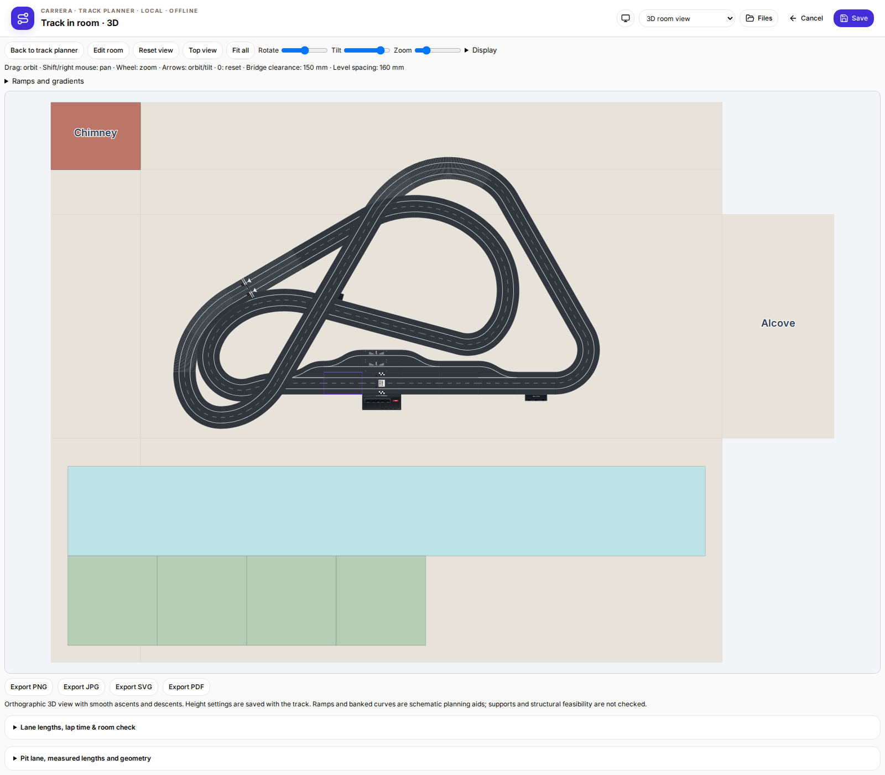

## Adjustable ramp lengths and gradients

In **Display**, set ascent and descent lengths independently from 100 to 20,000 mm. “Apply ramp lengths” activates the 1,000 mm defaults without editing numbers. Older plans retain their previous height profile until activation.

Length follows the horizontal track centreline, including curves, and may span several connected rails. CU and bridge rails stay flat at their prescribed heights. Existing track is not extended: ramps are shortened and flagged when fixed sections or neighbouring ramps leave insufficient space.

**Ramps and gradients** lists actual length, height change, mean gradient and peak gradient for every transition. For example, a 160 mm rise over 1,000 mm horizontal length gives 16% mean and 30% peak gradient. Calculations use actual available length rather than an unattainable request. No percentage is invented when no ramp space exists.

The optional native `sceneRamps` field stores `ascentLengthMm` and `descentLengthMm`. Saving, reopening and native JSON exchange preserve both values. Profiles remain schematic rather than a driving-dynamics or structural feasibility assessment.

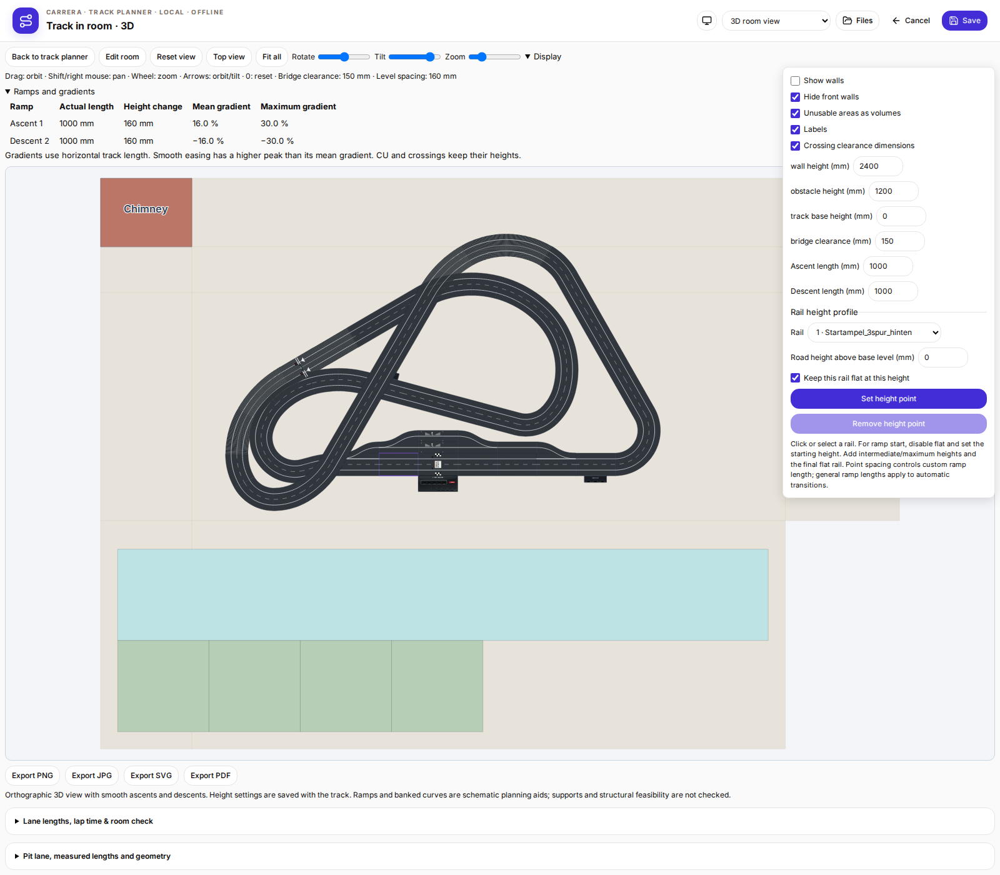

## Individual heights on each rail

In **Display → Rail height profile**, select a rail or click it in the 3D track. The editor selection is carried into 3D.

1. At ramp start set the starting height and disable “Keep this rail flat”. The transition starts at this rail’s beginning.
2. Set the maximum height on the upper rail; enabling flat creates a level rail there.
3. Add intermediate heights and plateaus. Set the final rail to the return height (e.g. 0 mm) and enable flat.
4. On an upper bridge rail, set its **clear passage height directly**. Other bridges retain their own heights. The model accounts for 10 mm illustrated rail thickness.

Heights refer to the road base level, with the general installation height added. Explicit point spacing determines custom ramp lengths and gradients. General ascent/descent lengths control automatic level transitions. Plans without new points retain their previous behavior.

The optional `pieces[].elevation = {heightMm, flat}` belongs to its rail. Native saving/JSON exchange preserves it; deleting a rail removes its point. “Remove height point” restores the automatic profile. CU and adapter remain level. Crossing clearances use actual heights at the intersection; negative clearance is red. This remains a schematic model without structural or driving-dynamics validation.

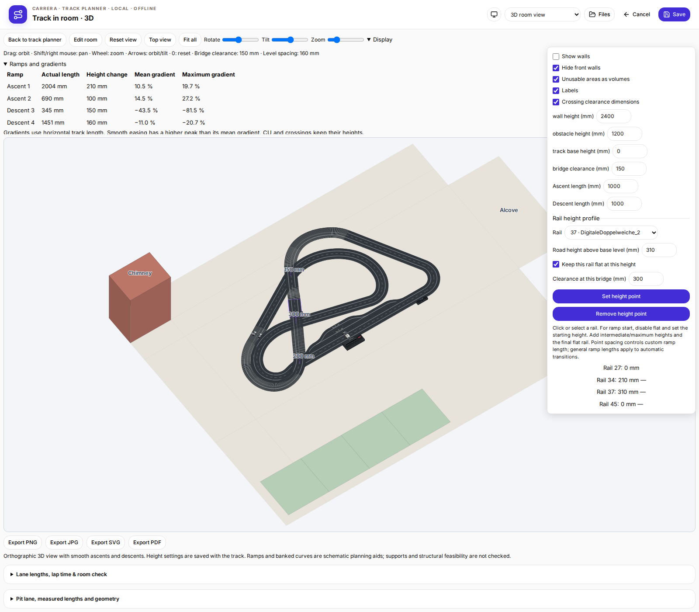

## Heights and gradients in 2D

**Show heights/gradients** in the central toolbar toggles values on the rails. The preference is saved with the track; hiding labels does not remove height points. Existing rail artwork is retained.

Labels show start/end road height in millimetres above the base level and the actual mean gradient of that rail. Flat rails show one height and 0%. The level filter also applies to these labels.

Click a label to open **Edit height and gradient** on the right (below the still-visible track on small screens). Alternatively select a rail and use the same-named button. Height points, flat sections and point removal use the same saved data as 3D. The editor also shows the rail’s maximum calculated gradient.

To enter a gradient directly, select a **target rail in driving direction**, enter the mean percentage and click **Apply gradient**. For example, +10% over 1,035 mm sets the target 103.5 mm above the start. Negative values descend. This creates a height point at the selected rail’s start and a flat target rail. Intermediate constraints remain; smooth local gradients therefore differ from the mean over the whole selected span. Labels report each rail’s actual calculated values.

Disconnected/ambiguous spans and target heights outside 0–3,000 mm are rejected. CU/adapter remains flat. Undo/redo, saving and reopening preserve edits. Switching to 3D shows the same heights, and edits there reappear in 2D. Visible labels are included in image exports.

The optional native `showElevationLabels` field stores visibility only. Heights remain in `pieces[].elevation`; entered gradients are retained through their calculated height points rather than an independent, potentially contradictory slope value.

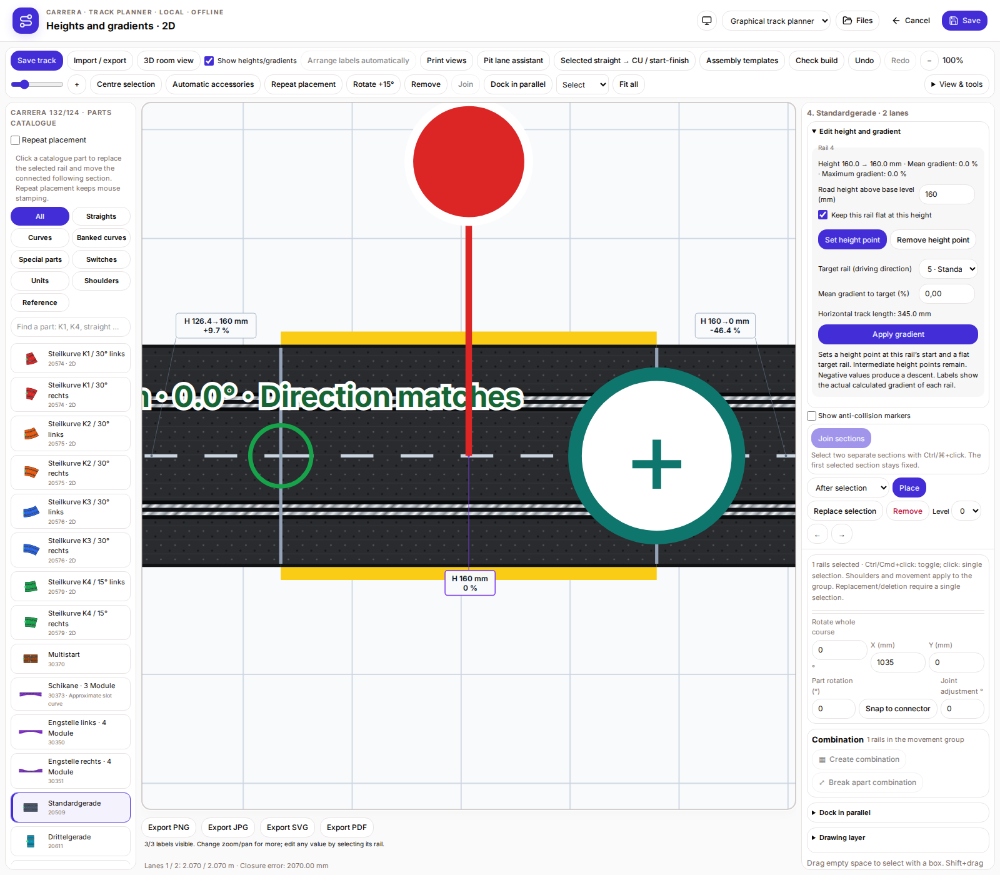

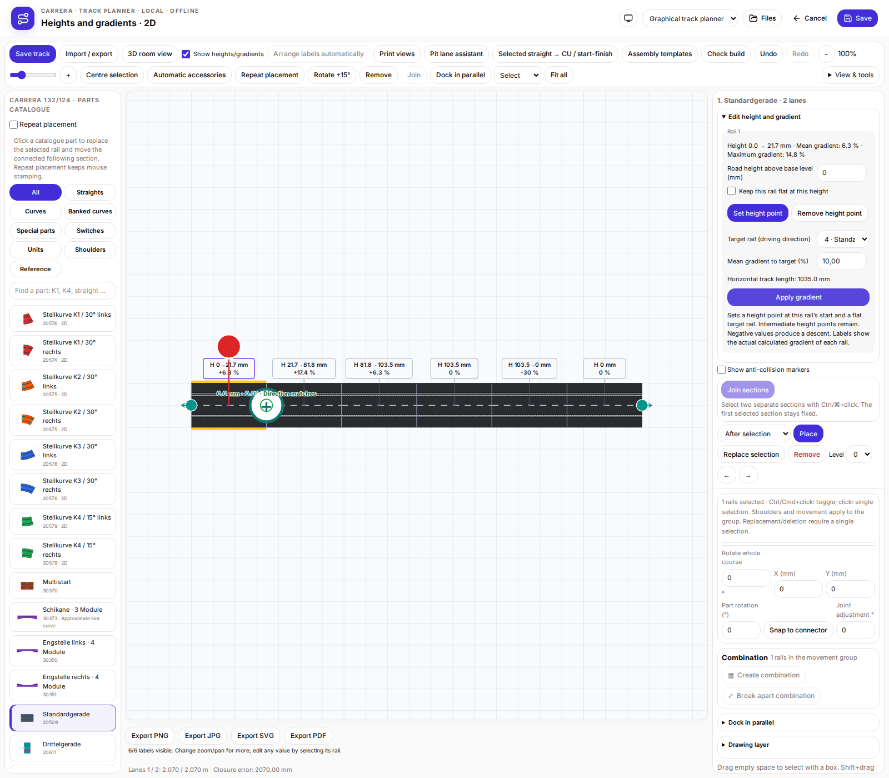

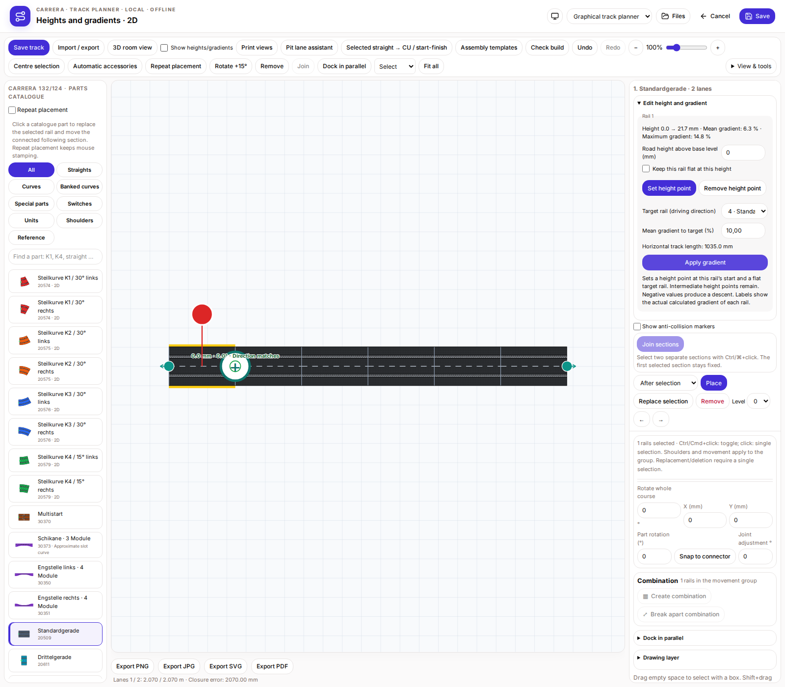

At bridges, “↕ … mm” adds the actual clear passage height. Edit it directly in the 2D inspector, with rail thickness accounted for. If one upper rail crosses several lower rails, its minimum clearance is shown.

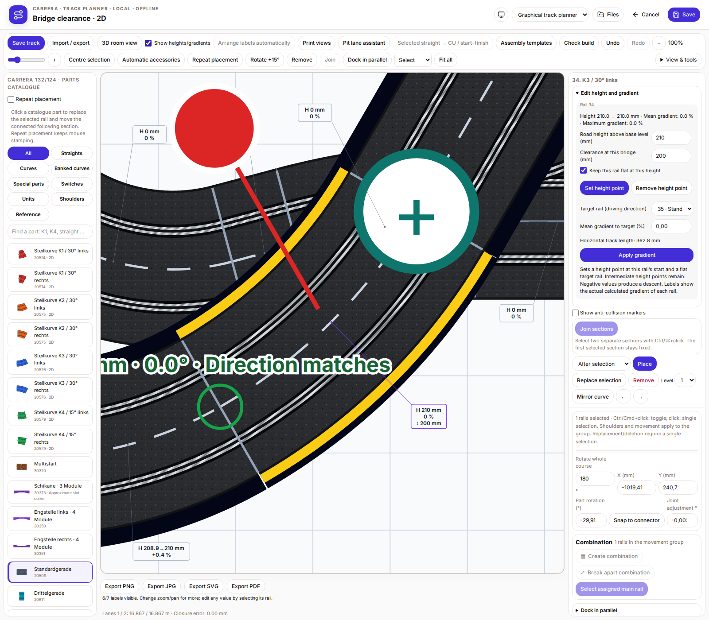

## Zoom-aware placement without overlaps

Height and gradient values now appear as horizontal cards **beside** the road, with thin leaders identifying their rails. Cards avoid road surfaces, shoulders, CU housings and native pit rails. Font size stays between 10 and 12 screen pixels; selection zoom no longer enlarges the cards over the track.

Placement updates on zoom, pan and resizing. Cards do not overlap and stay inside the visible drawing area. The selected rail takes priority, followed by explicit height points, bridge clearance and ramp values.

When free space runs out, additional cards are temporarily omitted. The counter below the drawing reports visible cards in the current view, for example 4/55. Change zoom or pan to see more. Every value remains editable by selecting its rail, and no height is deleted. **Show heights/gradients** still switches all cards on or off.

Only presentation changes. Track coordinates, heights, gradients and saved settings remain unchanged during zoom and rearrangement. Automatic card positions are view data. Manual preferred positions are saved with the track, as described below. Image exports use the visible arrangement.

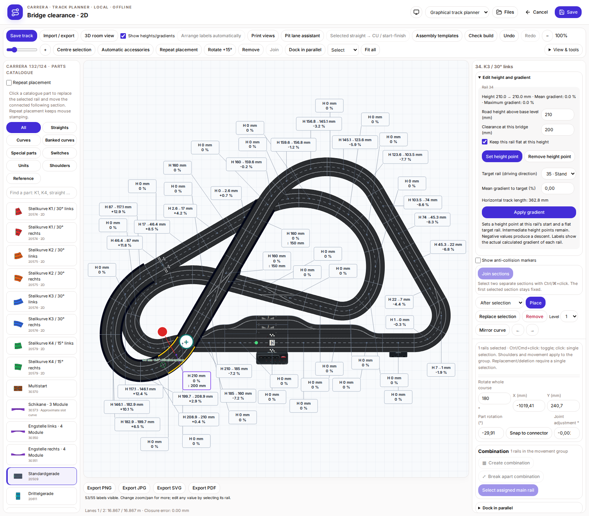

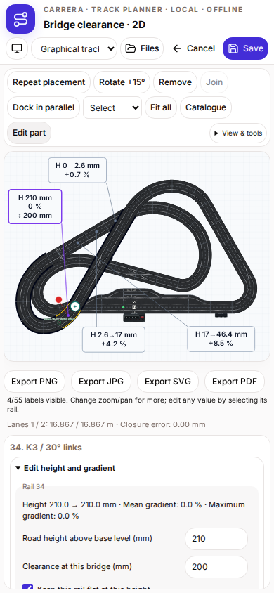

## Move labels manually and restore automatic placement

Drag a value card with mouse or touch. A short click still opens height editing. Its thin leader remains linked to the rail. Dropping records one position change, with undo and redo available.

**Arrange labels automatically** in the central toolbar removes all manual positions. To reset just one card, select its rail and use **Arrange this label automatically** in the height editor. Both actions change label placement only, preserving rails and heights.

With keyboard focus on a card, arrow keys move it 4 screen pixels, or 16 with Shift. Delete/Backspace restores that card’s automatic placement without deleting the rail. Escape cancels an active drag.

Manual positions are saved with the track and native JSON exchange. The optional `pieces[].heightLabelOffset = {alongMm, acrossMm}` stores millimetres relative to its rail’s centre and direction. Positions therefore follow moved or rotated rails rather than fixed screen coordinates. Older plans retain automatic placement.

Collision avoidance remains active: dragging searches for free space without covering rails or other cards. A changed zoom or smaller window can temporarily adjust or omit a saved preferred position. This display adjustment does not overwrite the saved position. Pure zooming preserves preferences, heights and track coordinates. TRK/Softyroyal exchange formats do not carry this native extension.

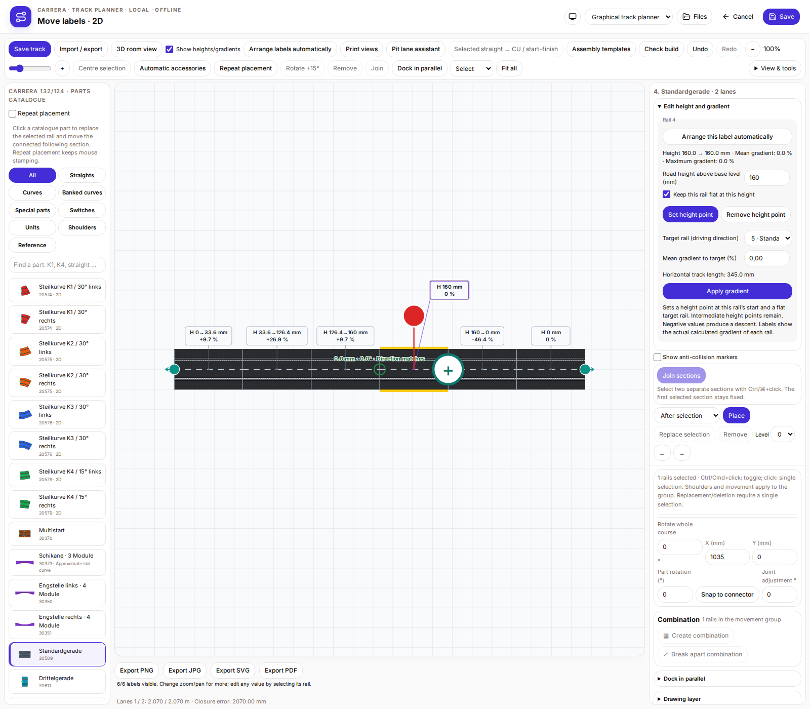

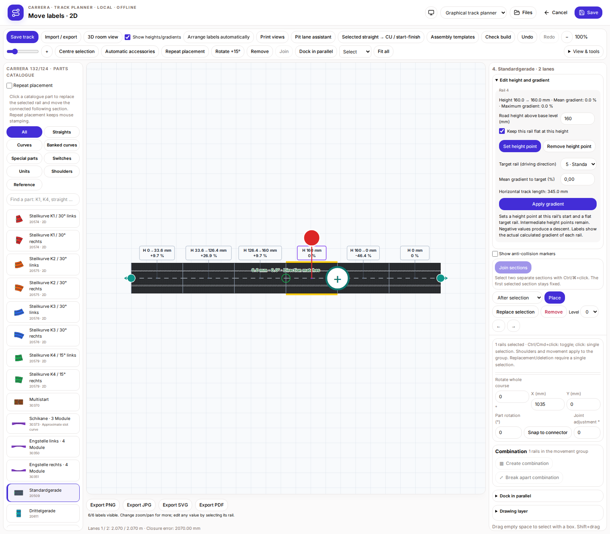

## Print and export the current view

PNG, JPG, SVG and the new **Export PDF** button capture the current drawing. Manually moved cards, leaders, visibility, zoom and framing are not laid out again. A card temporarily adjusted for available space is exported exactly where it is visible. Hidden values remain hidden. Export does not change the plan or saved preferred positions.

**Print preview** is available directly in the central toolbar and defaults to **Current view with labels**. Printing and **Export PDF** in this preview use the same frozen drawing. Paper size and orientation fit the whole graphic proportionally without recomputing labels. Use **Fit all** before opening the preview for the complete track. A zoomed or panned view is deliberately exported with that framing.

Existing overview, color, assembly and per-level print modes remain available as separate technical drawings. Use **Current view with labels** for output matching the screen.

SVG and PDF remain vector artwork with embedded fonts. Rails, surface patterns, conductors, leaders and labels remain sharp when enlarged. PDF export uses jsPDF/svg2pdf locally without an internet connection; patterned rail strokes are converted to vector outlines. Manual label positions are retained from the frozen snapshot; only the complete drawing is scaled proportionally to the selected paper size. PNG/JPG remain raster outputs up to 2,400 pixels. The native track remains independently editable.

Validation compares every card and leader position between the live view, SVG and print snapshot. Direct PDFs and print-preview PDFs contain embedded fonts and no raster images. Actual PDFs were checked for a single page and rendered at high resolution; curves, CU and two fuel rails were also checked. Position checks cover German, English and French, selection zoom and hidden values.

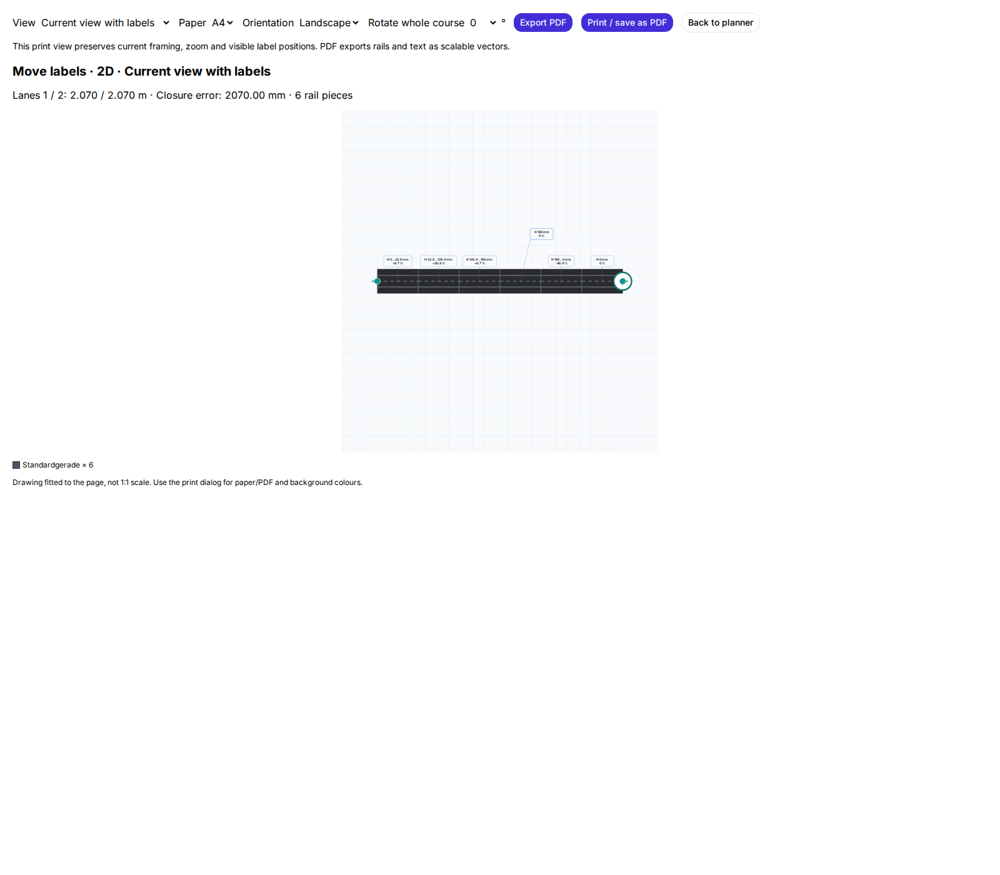

## RaceHubOS compatibility

The experimental legacy adapter also stores a validated snapshot of heights, ramps, visibility and manual rail labels in extensible layout metadata. This preserves them through older host parsers when saving and reopening. Rail counts and types are checked before restoring the snapshot; native JSON files continue to use their normal fields. This is not an official plugin interface.
