# Circuit et pièce en 3D

Ouvrir **3D dans la pièce** depuis la barre d’outils centrale ou le sélecteur de vue. La vue utilise le contour réel de la pièce, niches, zones exclues, postes de pilotage et passages compris. CU, départ/arrivée, rails de ravitaillement et bordures proviennent du plan existant.

- Glisser pour tourner. Maj + glisser ou bouton droit/central pour déplacer ; molette pour zoomer.
- Flèches pour tourner/incliner, +/− pour zoomer, 0 pour réinitialiser. Vue de dessus et cadrage sont accessibles directement.
- Murs, coupe, obstacles, étiquettes et cotes de hauteur sont activables séparément.
- Les ponts ont par défaut **150 mm de passage libre** entre la surface de la piste inférieure et le dessous du rail supérieur. Avec 10 mm d’épaisseur représentée, l’écart nominal entre niveaux est de 160 mm. Le passage libre est réglable.
- Les hauteurs de mur, d’obstacle, de base et de passage libre sont enregistrées avec le circuit et restaurées à l’ouverture, y compris via export/import JSON natif. Annuler/rétablir s’applique à ces changements. Export PNG, JPG et SVG de la perspective actuelle.

La vue 3D orthographique reste une aide à la conception. Les montées et descentes sont douces avec des extrémités horizontales et une surface subdivisée. Le passage libre reste préservé au croisement. Les transitions sont schématiques, sans calcul physique des rampes ou supports. Le champ natif optionnel `sceneHeights` conserve quatre hauteurs en millimètres ; les anciens plans utilisent les valeurs par défaut. Caméra et visibilité restent des réglages d’affichage. Les coordonnées XY sont inchangées. Les formats TRK/Softyroyal ne transmettent pas ces réglages supplémentaires. Sans pièce associée, le circuit apparaît seul.

## Captures

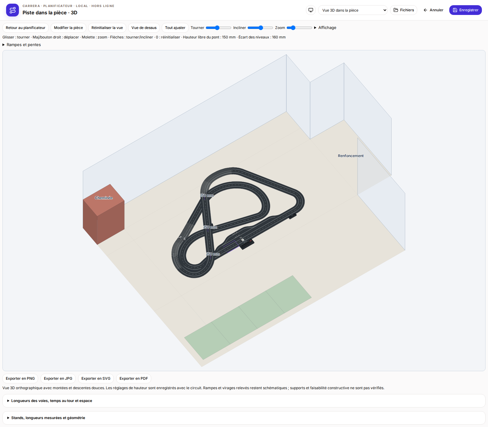

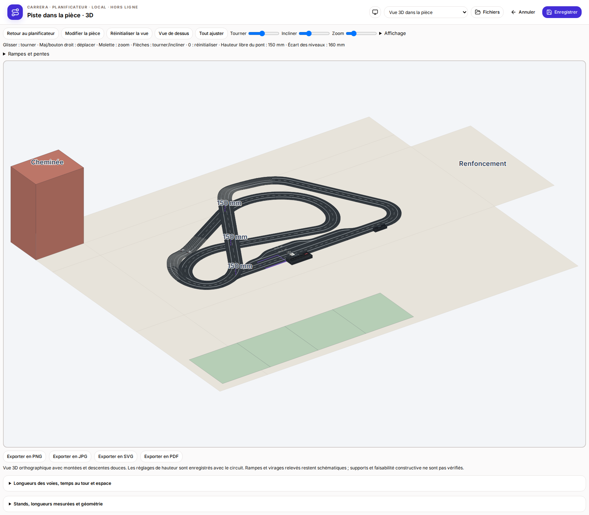

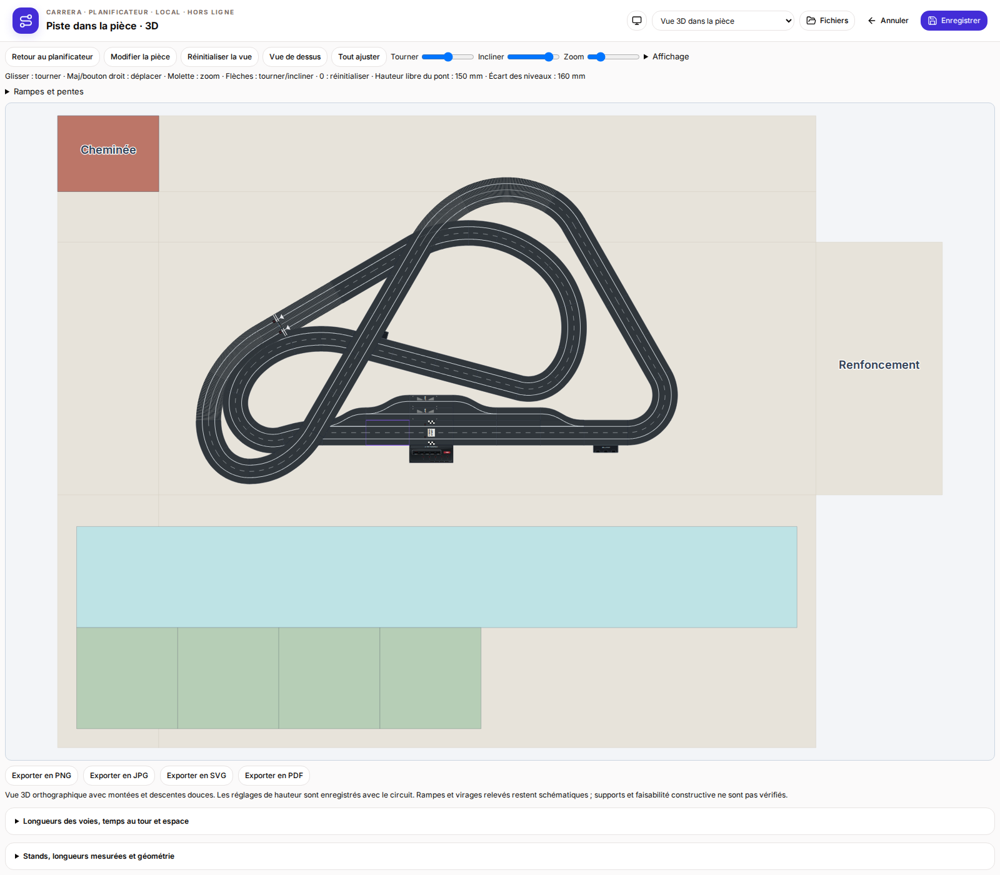

## Longueurs de rampe et pentes réglables

Dans **Affichage**, régler séparément montée et descente entre 100 et 20 000 mm. « Appliquer les longueurs » active les valeurs de 1 000 mm sans modifier les nombres. Les anciens plans conservent leur profil précédent jusqu’à cette activation.

La longueur suit l’axe horizontal du circuit, virages compris, sur plusieurs rails connectés si nécessaire. CU et rails de pont restent horizontaux à leur hauteur prévue. Le circuit existant n’est pas allongé : si les sections fixes ou rampes voisines limitent l’espace, la longueur réelle est réduite et signalée.

**Rampes et pentes** indique longueur réelle, dénivelé, pente moyenne et pente maximale de chaque transition. Par exemple, 160 mm de dénivelé sur 1 000 mm horizontaux donnent 16 % de moyenne et 30 % au maximum. Le calcul utilise la longueur réellement disponible. Aucun pourcentage n’est inventé lorsqu’aucun espace n’est disponible.

Le champ natif optionnel `sceneRamps` conserve `ascentLengthMm` et `descentLengthMm`. Sauvegarde, réouverture et échange JSON natif préservent les deux valeurs. Le profil reste schématique, sans validation dynamique ou constructive.

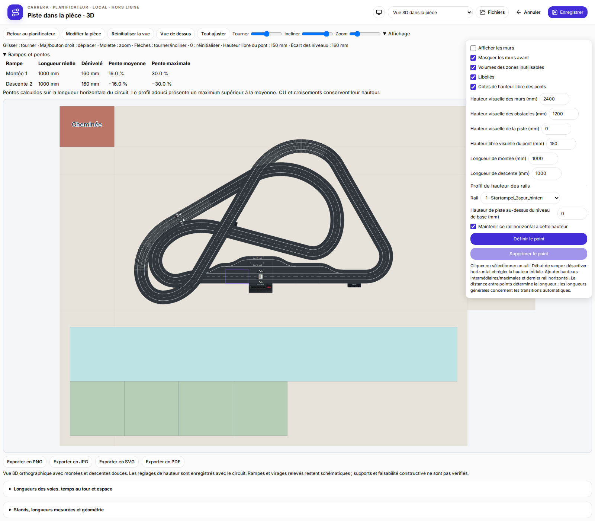

## Hauteurs individuelles par rail

Dans **Affichage → Profil de hauteur des rails**, sélectionner un rail ou cliquer dessus dans la vue 3D. La sélection de l’éditeur est transmise à la vue 3D.

1. Au départ de la rampe, définir la hauteur initiale et désactiver le maintien horizontal. La transition commence au début de ce rail.
2. Définir la hauteur maximale sur le rail supérieur ; activer horizontal crée un rail plat à cet endroit.
3. Ajouter des hauteurs intermédiaires et plateaux. Sur le dernier rail, régler la hauteur de retour (par exemple 0 mm) et activer horizontal.
4. Sur un rail de pont supérieur, régler directement sa **hauteur de passage libre**. Les autres ponts conservent leurs propres hauteurs. Le modèle tient compte des 10 mm d’épaisseur représentée.

Les hauteurs se rapportent au niveau de base de la piste, auquel s’ajoute la hauteur générale d’installation. L’espacement des points explicites détermine longueurs et pentes personnalisées ; les longueurs générales commandent les transitions automatiques. Sans nouveaux points, le comportement précédent est conservé.

Le champ optionnel `pieces[].elevation = {heightMm, flat}` appartient au rail. Sauvegarde et échange JSON natif le conservent ; supprimer un rail supprime son point. « Supprimer le point » restaure le profil automatique. CU et adaptateur restent horizontaux. Les passages libres utilisent les hauteurs réelles au croisement ; un passage négatif est rouge. Ce modèle reste schématique, sans validation constructive ou dynamique.

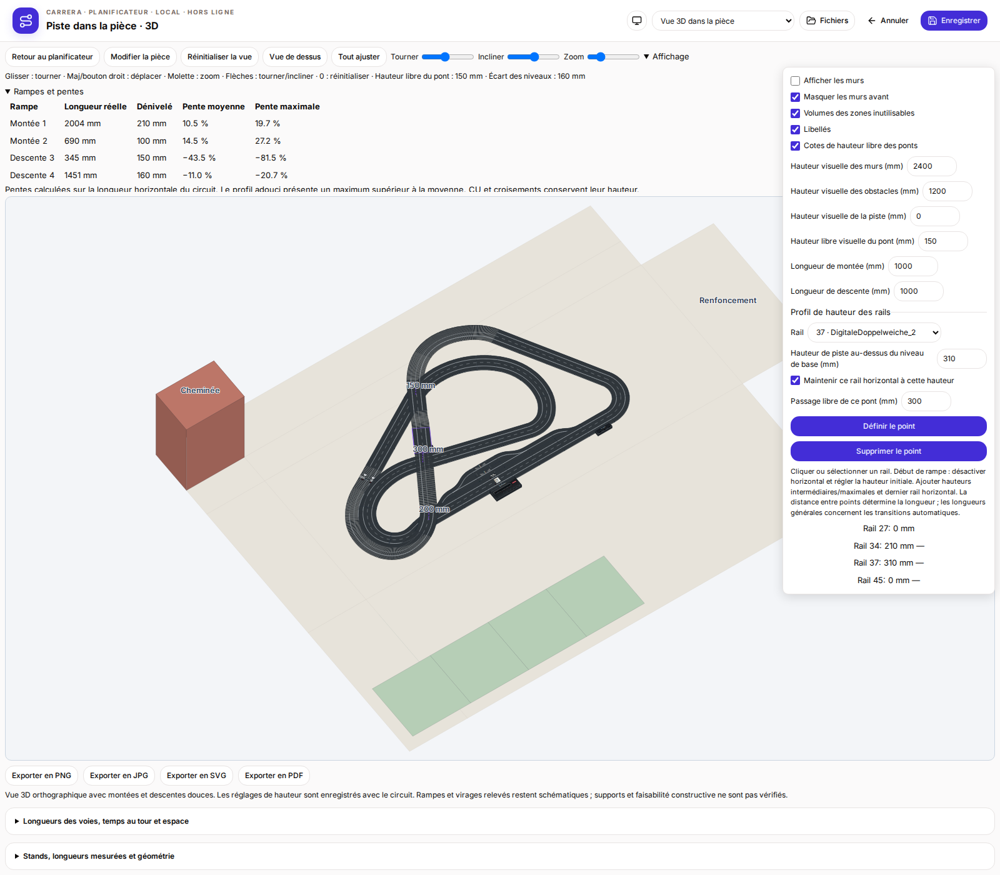

## Hauteurs et pentes en 2D

**Afficher hauteurs/pentes** dans la barre d’outils centrale affiche ou masque les valeurs sur les rails. La préférence est sauvegardée avec le circuit ; masquer ne supprime aucun point de hauteur. L’aspect existant des rails est conservé.

Les étiquettes indiquent les hauteurs initiale/finale en millimètres au-dessus du niveau de base et la pente moyenne réelle du rail. Un rail horizontal indique une hauteur unique et 0 %. Le filtre de niveaux s’applique également aux étiquettes.

Cliquer sur une étiquette ouvre **Modifier hauteur et pente** à droite (sous le circuit toujours visible sur petit écran). On peut aussi sélectionner un rail puis utiliser le bouton correspondant. Points, sections horizontales et suppression utilisent les mêmes données enregistrées qu’en 3D. L’éditeur affiche aussi la pente maximale calculée du rail.

Pour saisir une pente, choisir un **rail cible dans le sens de circulation**, entrer le pourcentage moyen et cliquer sur **Appliquer la pente**. Par exemple, +10 % sur 1 035 mm place la cible 103,5 mm au-dessus du départ. Une valeur négative descend. Deux points sont créés : au début du rail sélectionné et sur le rail cible horizontal. Les contraintes intermédiaires sont conservées ; les pentes locales du profil adouci diffèrent donc de la moyenne sur toute la section. Les étiquettes montrent les valeurs réelles de chaque rail.

Sections déconnectées/ambiguës et hauteurs cibles hors de 0–3 000 mm sont refusées. CU/adaptateur reste horizontal. Annuler/rétablir, sauvegarder et rouvrir conservent les modifications. La vue 3D affiche les mêmes hauteurs et ses modifications réapparaissent en 2D. Les étiquettes visibles sont incluses dans les exports d’images.

Le champ natif optionnel `showElevationLabels` conserve seulement la visibilité. Les hauteurs restent dans `pieces[].elevation` ; les pentes saisies sont conservées par leurs points calculés, sans valeur indépendante contradictoire.

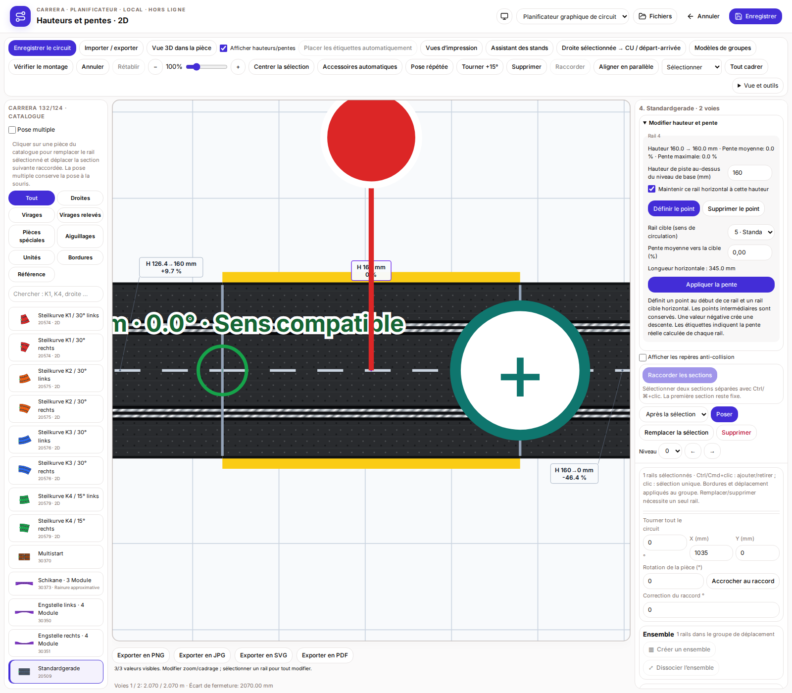

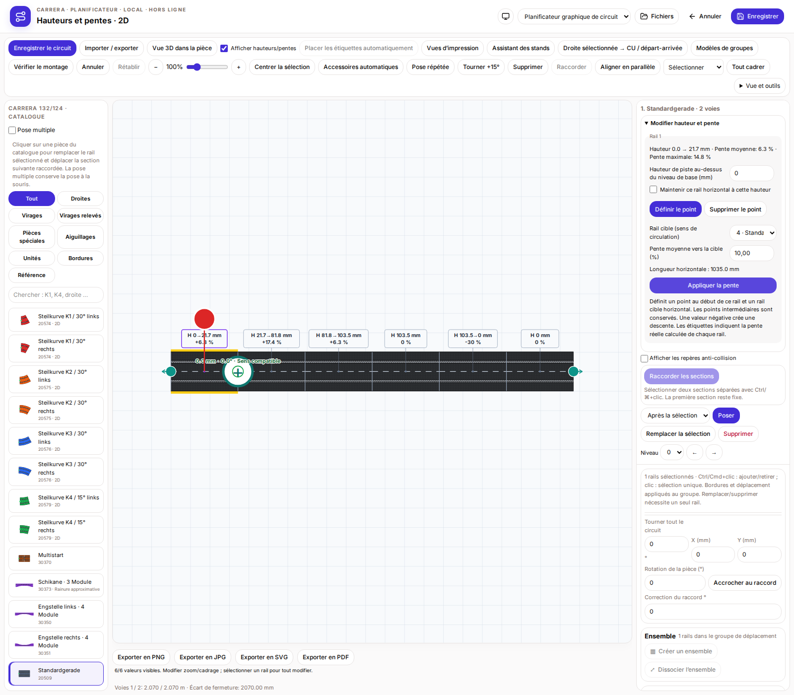

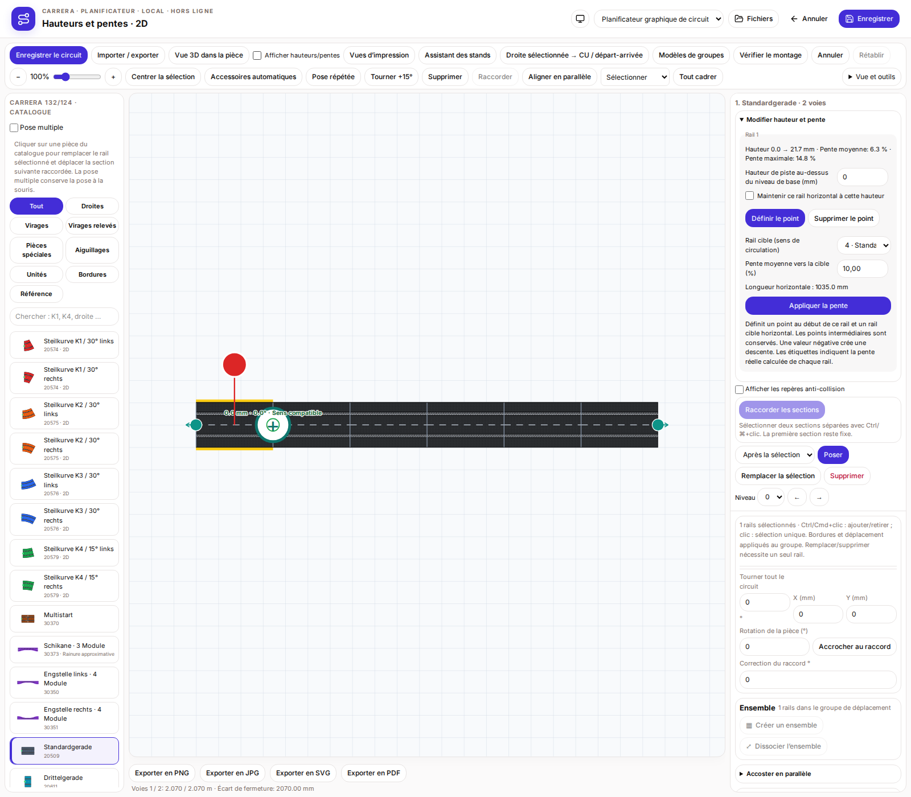

Sur les ponts, « ↕ … mm » indique le passage libre réel. Il se règle directement dans l’éditeur 2D, épaisseur du rail comprise dans le calcul. Si un rail supérieur croise plusieurs rails inférieurs, le passage minimal est affiché.

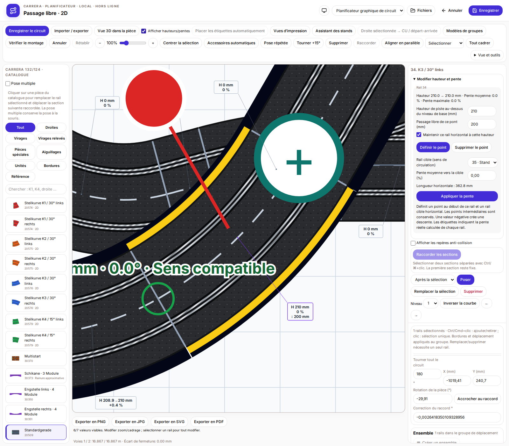

## Placement adapté au zoom sans superposition

Les hauteurs et pentes apparaissent comme des cartes horizontales **à côté** de la piste, reliées au rail par un trait fin. Les cartes évitent piste, bordures, boîtier CU et rails natifs des stands. La police reste entre 10 et 12 pixels à l’écran ; le zoom sur une sélection n’agrandit plus les cartes sur la piste.

Le placement est recalculé après zoom, déplacement et redimensionnement. Les cartes ne se superposent pas et restent dans la zone de dessin visible. Le rail sélectionné est prioritaire, puis les hauteurs définies, passages libres et rampes.

Si l’espace manque, certaines cartes sont temporairement masquées. Le compteur sous le dessin indique les cartes visibles dans le cadrage actuel, par exemple 4/55. Changer zoom ou cadrage permet d’en voir davantage. Toutes les valeurs restent modifiables par sélection du rail et aucune hauteur n’est supprimée. **Afficher hauteurs/pentes** commande toujours l’ensemble des cartes.

Seule la présentation change. Coordonnées, hauteurs, pentes et réglages enregistrés restent inchangés pendant zoom et réorganisation. Les positions automatiques sont des données d’affichage. Les positions manuelles souhaitées sont enregistrées avec le circuit, comme décrit ci-dessous. L’export d’image reprend l’agencement visible.

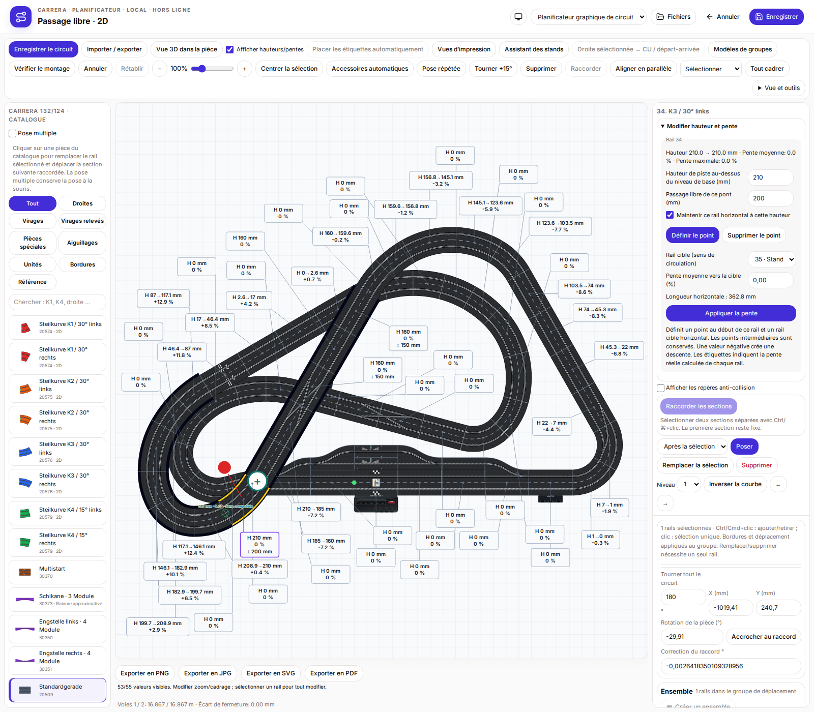

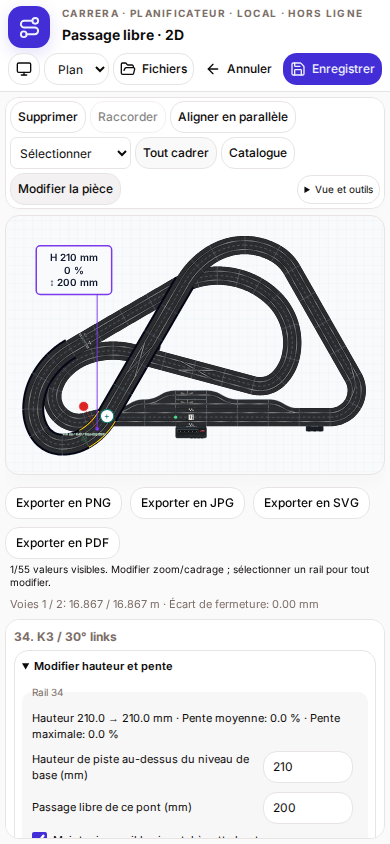

## Déplacer les étiquettes et rétablir le placement automatique

Glisser une carte avec la souris ou le doigt. Un clic bref ouvre toujours l’éditeur de hauteur. Son trait reste lié au rail. Le dépôt crée une seule modification de position, annulable et rétablissable.

**Placer les étiquettes automatiquement** dans la barre centrale supprime toutes les positions manuelles. Pour une seule carte, sélectionner son rail puis utiliser **Placer cette étiquette automatiquement** dans l’éditeur. Ces actions ne modifient ni rails ni hauteurs.

Une carte ayant le focus clavier se déplace de 4 pixels avec les flèches, ou 16 avec Maj. Suppr/Retour arrière rétablit sa position automatique sans supprimer le rail. Échap annule un déplacement en cours.

Les positions sont enregistrées avec le circuit et l’échange JSON natif. Le champ optionnel `pieces[].heightLabelOffset = {alongMm, acrossMm}` conserve des millimètres relatifs au centre et à la direction du rail. La position suit donc le rail déplacé ou tourné, sans coordonnées d’écran fixes. Les anciens plans restent automatiques.

L’évitement des collisions reste actif : le déplacement cherche un espace libre sans couvrir rails ou autres cartes. Un zoom différent ou une petite fenêtre peut adapter ou masquer temporairement une position souhaitée. Cette adaptation visuelle n’écrase pas la position enregistrée. Le zoom seul préserve positions souhaitées, hauteurs et coordonnées du circuit. Les formats TRK/Softyroyal ne transmettent pas cette extension native.

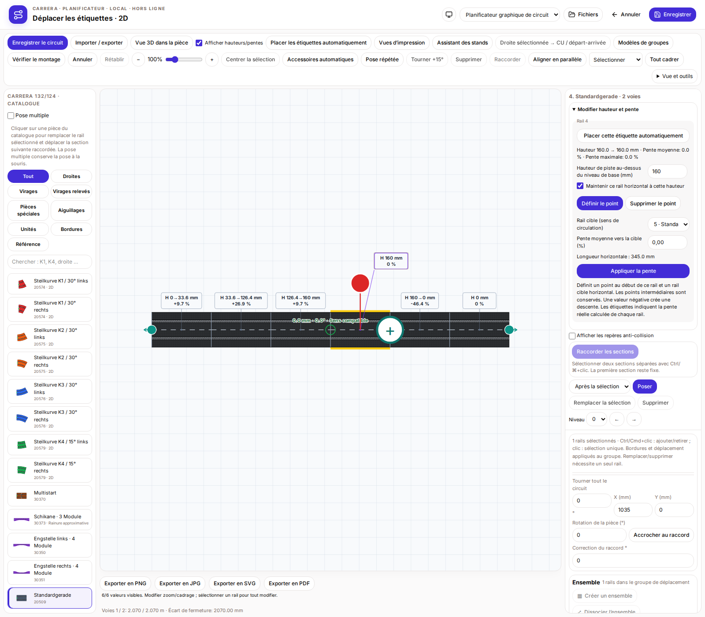

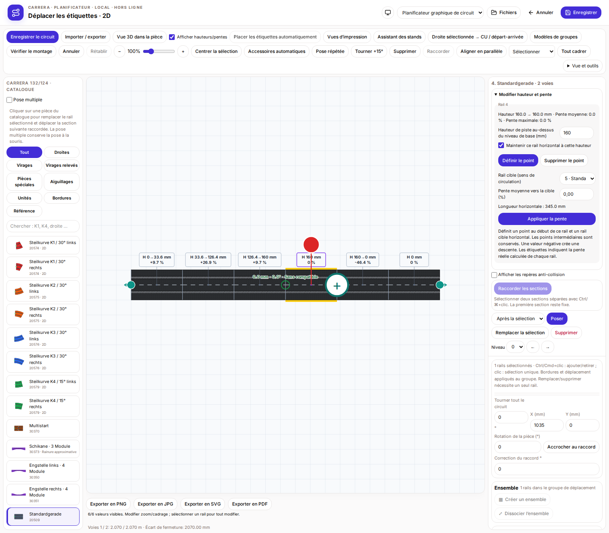

## Imprimer et exporter la vue actuelle

PNG, JPG, SVG et le nouveau bouton **Exporter en PDF** capturent le dessin actuel. Cartes déplacées, traits, visibilité, zoom et cadrage ne sont pas recalculés. Une position temporairement adaptée au manque d’espace est exportée telle qu’elle apparaît. Les valeurs masquées restent masquées. L’export ne modifie ni circuit ni positions souhaitées enregistrées.

**Aperçu avant impression** est accessible dans la barre centrale et utilise par défaut **Vue actuelle avec étiquettes**. Impression et **Exporter en PDF** dans cet aperçu partagent le même dessin figé. Format et orientation du papier ajustent l’ensemble proportionnellement, sans replacer les cartes. Utiliser **Tout cadrer** avant l’aperçu pour obtenir tout le circuit. Un zoom ou cadrage partiel est volontairement conservé.

Les modes techniques existants — aperçu, couleurs, assemblage et niveaux — restent disponibles séparément. Choisir **Vue actuelle avec étiquettes** pour reproduire l’écran.

SVG et PDF restent vectoriels, avec des polices intégrées. Rails, textures, conducteurs, traits et étiquettes restent nets à l’agrandissement. Le PDF utilise jsPDF/svg2pdf localement, sans connexion internet ; les traits de rails texturés sont convertis en contours vectoriels. Les positions manuelles proviennent du dessin figé sans recalcul ; seul l’ensemble est redimensionné proportionnellement au papier choisi. PNG/JPG restent des images jusqu’à 2 400 pixels. Le circuit natif reste modifiable indépendamment.

La validation compare toutes les positions des cartes et traits entre écran, SVG et capture d’impression. Les PDF directs et ceux de l’aperçu contiennent des polices intégrées et aucune image matricielle. Les PDF ont été contrôlés sur une page et rendus en haute résolution ; courbes, CU et deux rails de ravitaillement ont aussi été contrôlés. Les positions sont vérifiées en allemand, anglais et français, avec zoom sur sélection et valeurs masquées.

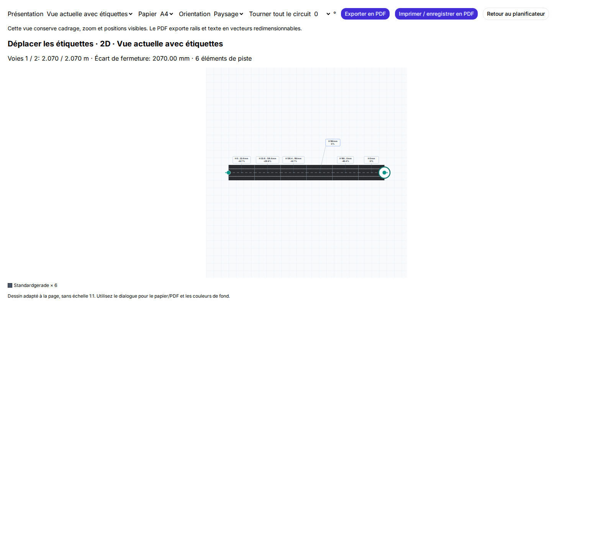

## Compatibilité RaceHubOS

L’adaptateur expérimental conserve également un instantané validé des hauteurs, rampes, visibilité et positions manuelles dans les métadonnées extensibles. Ces données survivent aux anciens parseurs lors de l’enregistrement et de la réouverture. Nombre et types de rails sont contrôlés avant restauration ; les fichiers JSON natifs gardent leurs champs normaux. Cela ne définit aucune interface officielle de plugins.
