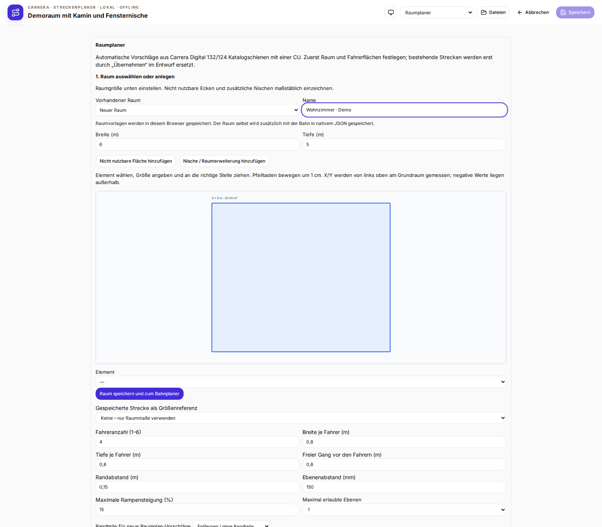
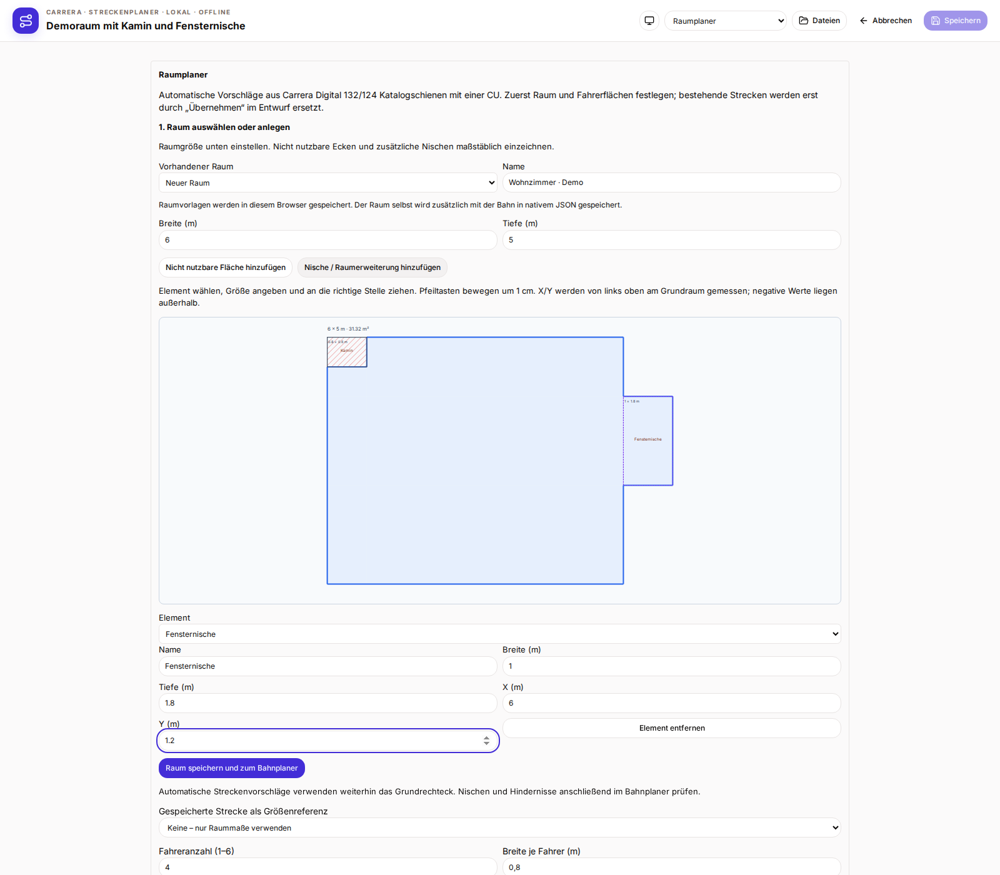
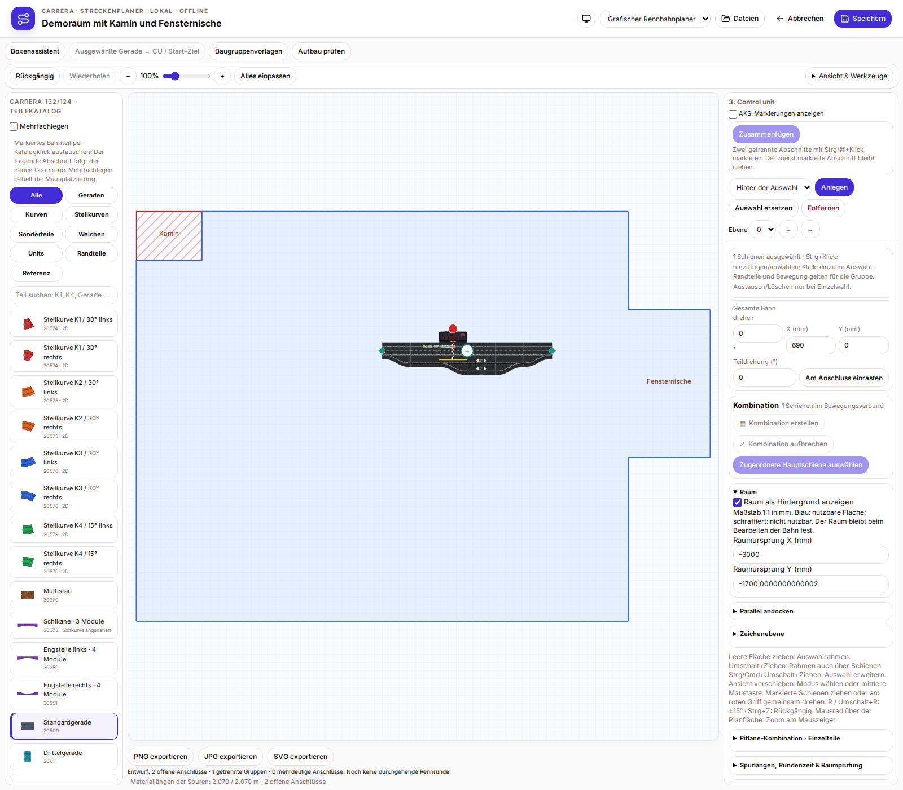
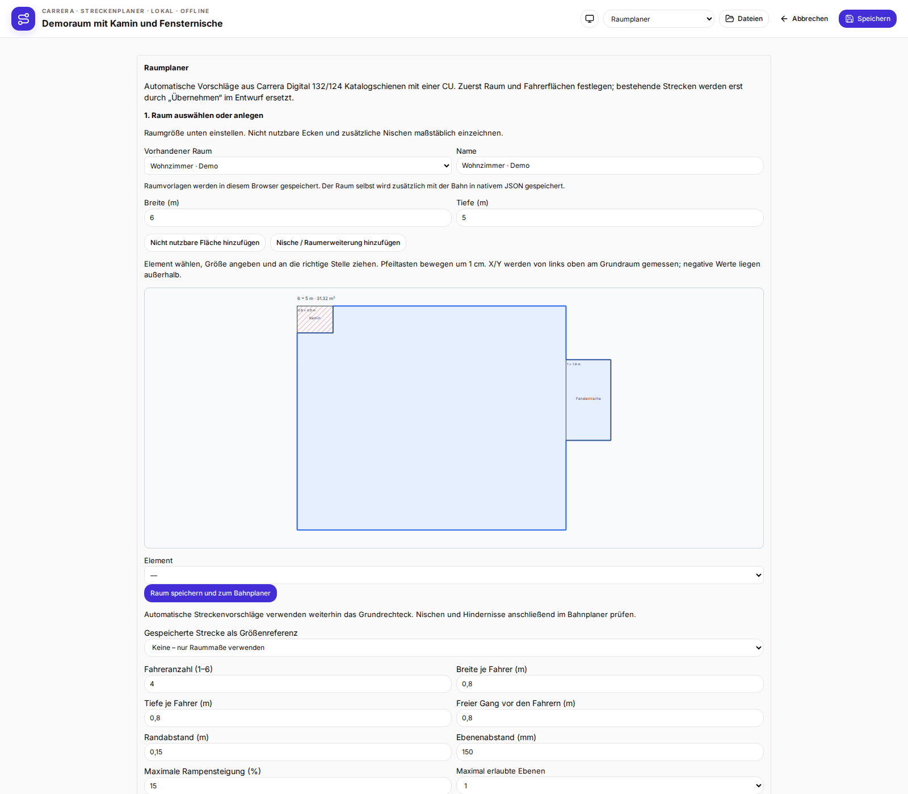

# Raumkontur und Einstieg über den Raumplaner

Neue Bahnen starten im Raumplaner. Zuerst eine vorhandene Raumvorlage oder einen neuen Raum wählen, dann „Raum speichern und zum Bahnplaner“ drücken. Bestehende Bahnen öffnen direkt im Bahnplaner; über den Modus „Raumplaner“ lässt sich ihr Raum ändern.

Breite und Tiefe des Grundraums in Metern eingeben. „Nicht nutzbare Fläche hinzufügen“ legt beispielsweise Kamin, Pfeiler oder Mauervorsprung an. „Nische / Raumerweiterung hinzufügen“ erweitert die nutzbare Fläche. Elemente benennen, Breite/Tiefe angeben und im Grundriss ziehen oder X/Y eingeben. Pfeiltasten bewegen das gewählte Element um 1 cm. X/Y beziehen sich auf die linke obere Ecke des Grundraums; negative Werte ermöglichen Erweiterungen links oder oben. Erweiterungen müssen über eine Kante oder Fläche mit dem Raum verbunden sein. Weitere rechteckige Elemente ermöglichen komplexere Ecken; reine Eckberührung reicht nicht.

Raumvorlagen liegen in diesem Browser, maximal 40. Beim Weitergehen wird eine gewählte Vorlage aktualisiert oder eine neue angelegt. Der Raum wird außerdem mit der Bahn im nativen JSON gespeichert und lässt sich daraus wiederverwenden. Browserdaten zu löschen entfernt die Vorlagen, nicht den in einer gespeicherten Bahn enthaltenen Raum. Alte TRK-/Softy-Formate übertragen keine Raumkontur.

Im Bahnplaner ist die vollständige Kontur maßstäblich im Hintergrund sichtbar. Blau bezeichnet nutzbare Fläche, Schraffur nicht nutzbare Fläche. „Alles einpassen“ berücksichtigt Raum und Bahn. In der rechten Seitenleiste kann der Hintergrund ausgeblendet oder sein Ursprung in Millimetern eingestellt werden. Schienenänderungen verschieben den Raum nicht. Eine Änderung des Raumursprungs lässt sich rückgängig machen. Die Schienenoptik bleibt unverändert.

Automatische Streckenvorschläge verwenden weiterhin das bisherige Grundrechteck und berücksichtigen Nischen und Hindernisse nicht als Suchbedingungen. Die Bahn muss anhand der sichtbaren Kontur kontrolliert werden. Eine automatische Kollisions- oder Baubarkeitsfreigabe ist damit nicht verbunden.

## Neue Bahn: zuerst Raum wählen

## Kamin und Fensternische mit Maßangaben

## Raumkontur hinter der Bahn

## Vorhandenen Raum wiederverwenden

