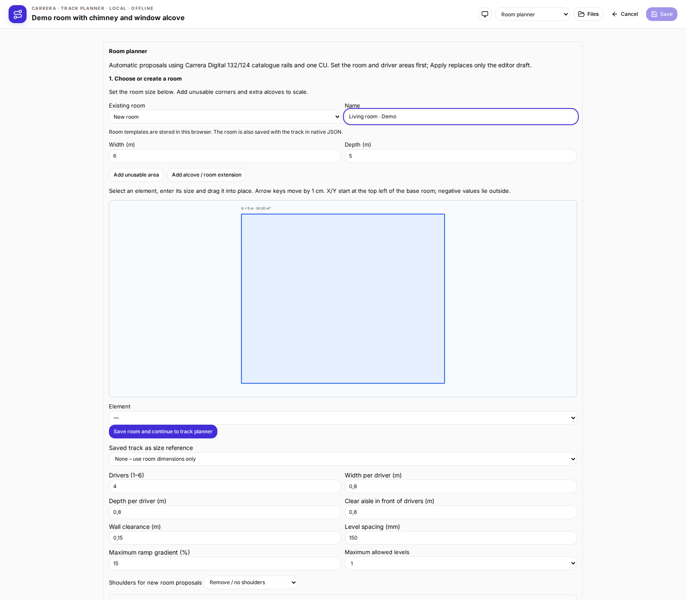
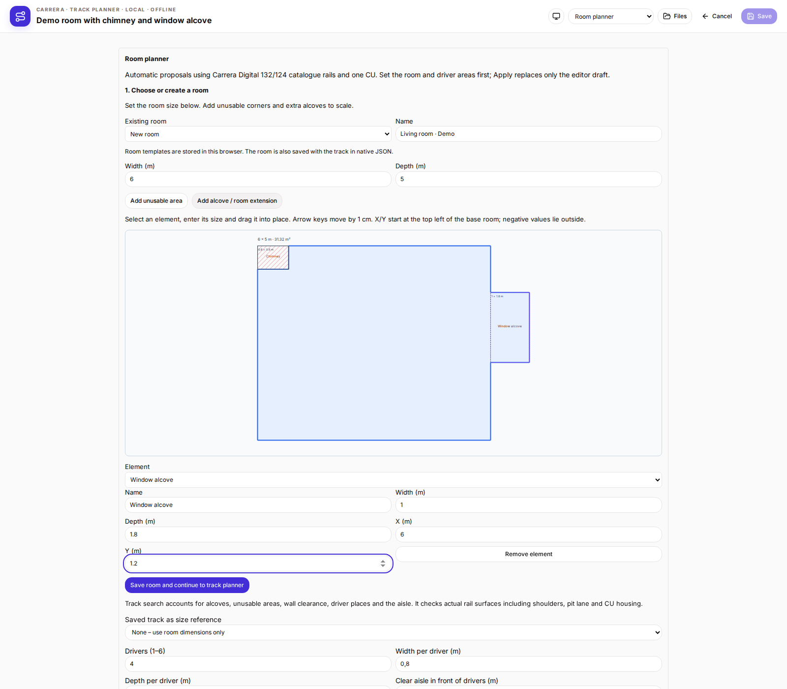
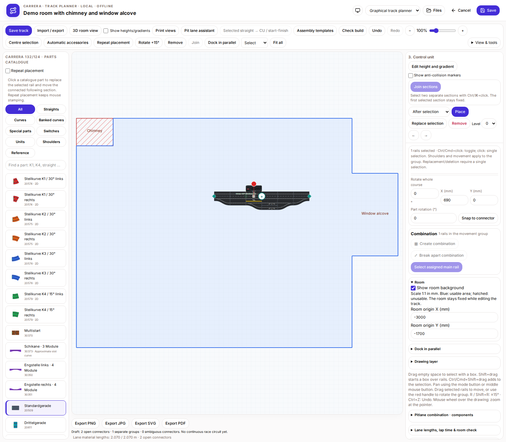
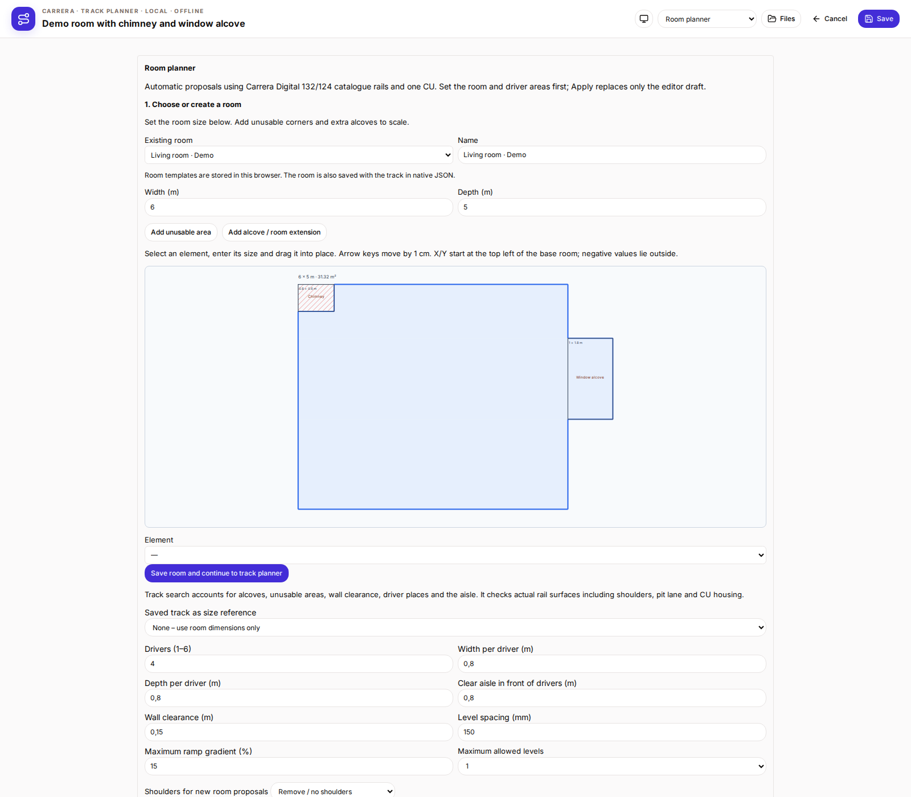
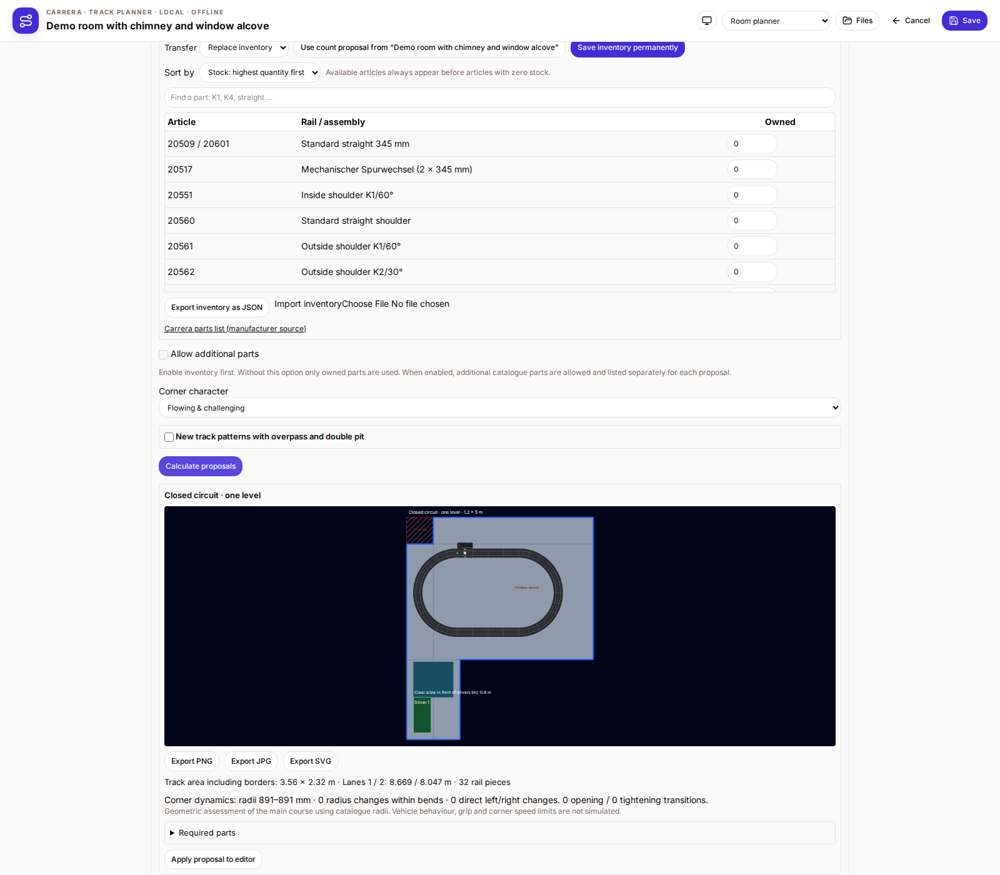
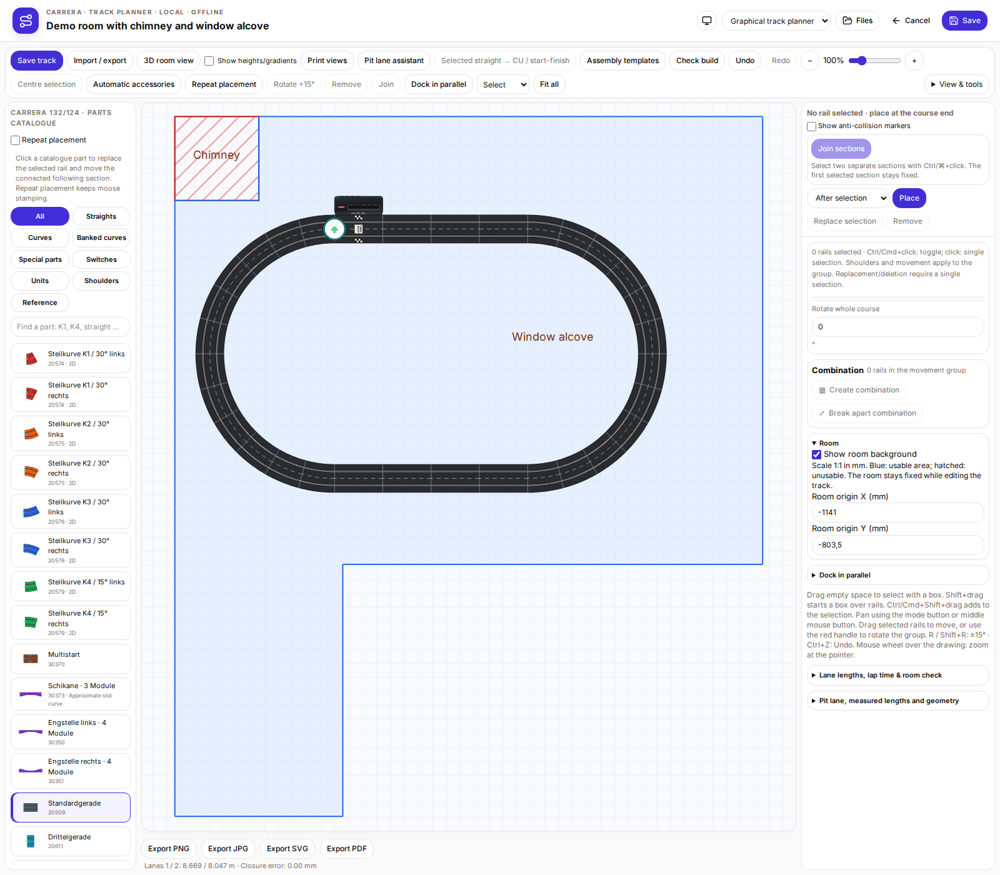

# Room footprint and room-first workflow

New tracks start in the room planner. Choose an existing template or create a room, then press “Save room and continue to track planner”. Existing tracks open directly in the track planner; switch to room-planner mode to edit their room.

Enter base-room width and depth in metres. Add an unusable area for a chimney, column or wall projection, or an alcove/extension for additional usable floor space. Name elements, enter width/depth and drag them on the floor plan or enter X/Y. Arrow keys nudge a selected element by 1 cm. X/Y start at the top left of the base room; negative values support additions on the left or top. Extensions must share an edge or area with the room; corner-only contact does not count. Combine rectangles for more complex corners.

Up to 40 room templates are kept in this browser. Continuing updates a selected template or creates a new one. The room is also saved with the track in native JSON and can be reused from saved tracks. Clearing browser storage removes templates, but not rooms inside saved track files. Legacy TRK/Softy formats do not carry room footprints.

The complete footprint appears to scale behind the track. Blue indicates usable floor; hatching marks unusable areas. Fit-all includes room and track. The right sidebar can hide the background or edit its origin in millimetres. Track edits leave the room fixed. Origin changes support undo. Rail artwork is unchanged.

Automatic search accounts for the actual room footprint, alcoves and unusable areas. Rails, shoulders, pit roads and CU housing must fit entirely in usable floor space; wall clearance, driver places and the aisle remain reserved. The search tries a bounded set of shapes and placements. No result does not prove that no layout is possible. Check physical buildability separately.

## New track: choose a room first

## Chimney and window alcove with dimensions

## Room footprint behind the track

## Reuse an existing room

## Automatic search using the room contour

The example base room is only 1.2 m wide; the extra alcove makes the proposal possible. Suggestions account for alcoves, chimneys and the reserved driver area. Preview and applied track use the same position.

## Track ready to save immediately

Dropped or applied tracks can be saved without manually correcting their coordinates.

