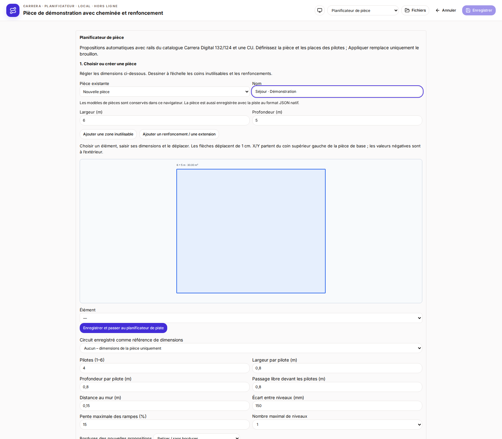
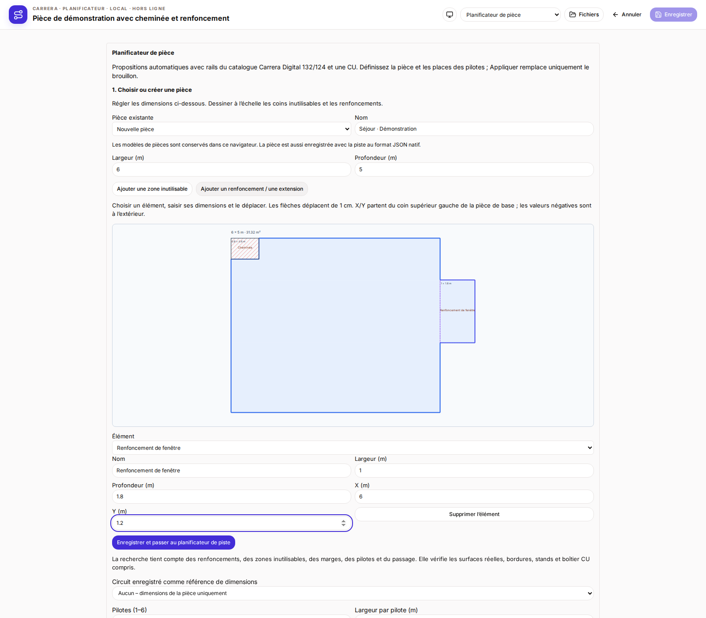
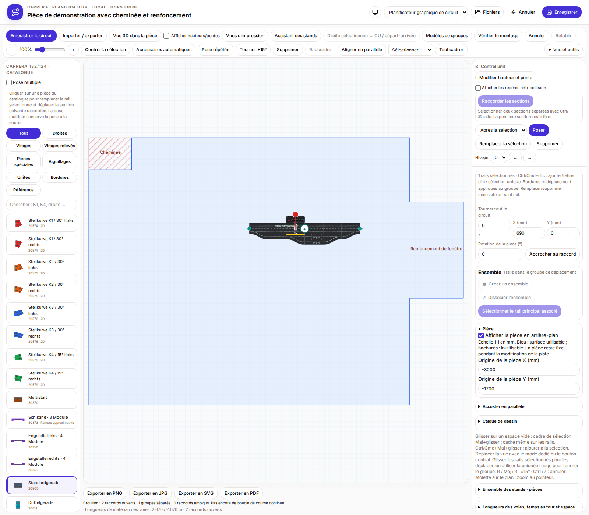
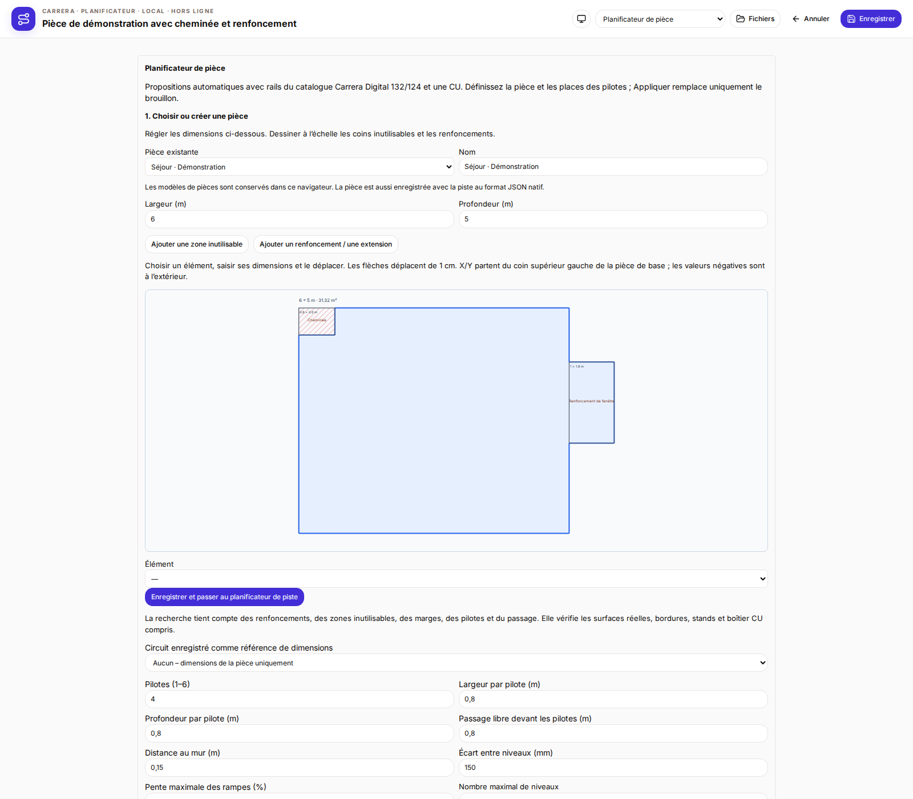
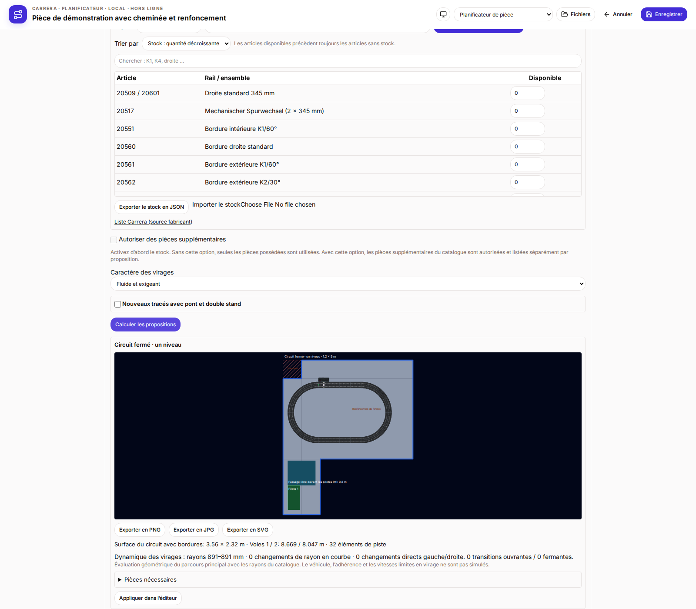
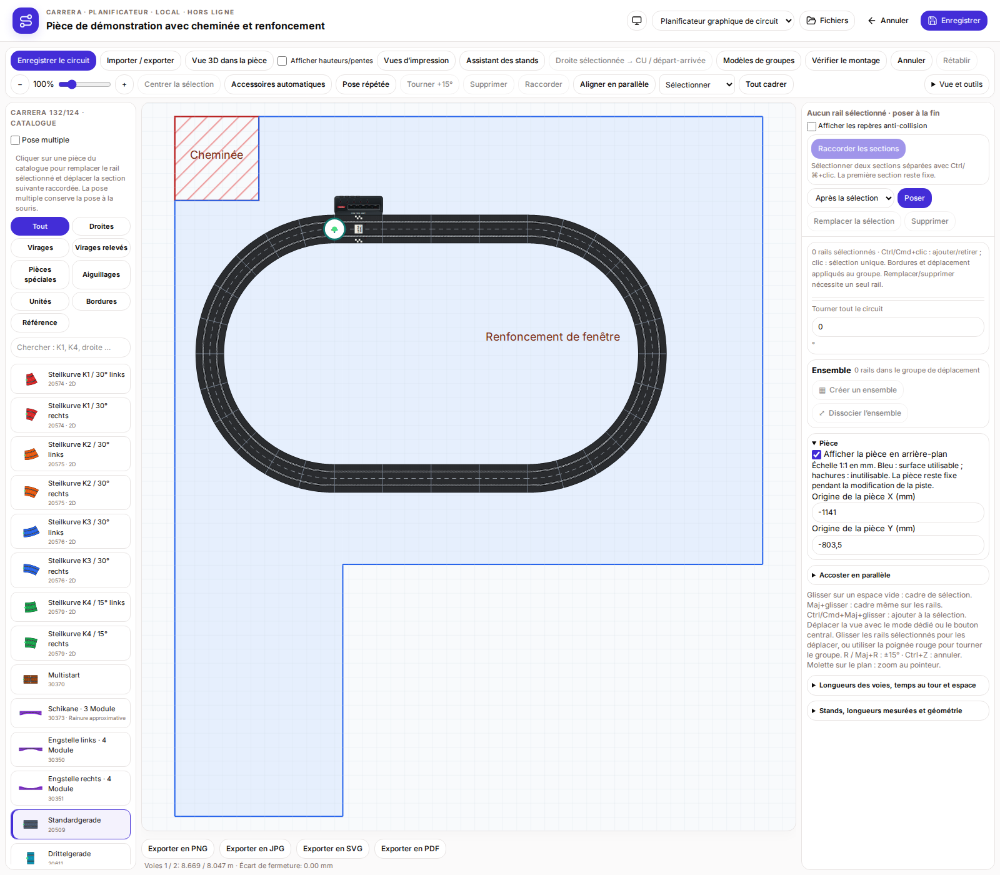

# Contour de la pièce et choix du local en premier

Les nouvelles pistes commencent dans le planificateur de pièce. Choisir un modèle existant ou créer une pièce, puis « Enregistrer et passer au planificateur de piste ». Une piste existante s’ouvre directement dans l’éditeur ; choisir le mode de planification de pièce pour modifier son local.

Saisir largeur et profondeur du rectangle de base en mètres. Ajouter une zone inutilisable pour une cheminée, un pilier ou un mur saillant, ou un renfoncement/une extension pour agrandir la surface utilisable. Nommer les éléments, saisir leurs dimensions et les déplacer sur le plan ou saisir X/Y. Les flèches déplacent un élément sélectionné de 1 cm. X/Y partent du coin supérieur gauche du rectangle de base ; les valeurs négatives permettent des extensions à gauche ou en haut. Les extensions doivent partager un bord ou une surface avec la pièce ; un simple contact par un coin ne suffit pas. Combiner plusieurs rectangles pour des formes plus complexes.

Jusqu’à 40 modèles de pièces sont conservés dans ce navigateur. Continuer met à jour le modèle sélectionné ou en crée un nouveau. La pièce est aussi enregistrée avec la piste au format JSON natif et peut être réutilisée depuis les pistes enregistrées. Effacer les données du navigateur supprime les modèles, mais pas les pièces présentes dans les fichiers de pistes. Les anciens formats TRK/Softy ne transportent pas ces contours.

Le contour complet apparaît à l’échelle derrière la piste. Le bleu indique la surface utilisable, les hachures les zones inutilisables. L’ajustement de la vue inclut pièce et piste. La barre latérale droite permet de masquer le fond ou de régler son origine en millimètres. Les modifications de rails laissent la pièce fixe. Le changement d’origine peut être annulé. L’aspect des rails est conservé.

La recherche automatique tient compte du contour réel, des renfoncements et des zones inutilisables. Rails, bordures, stands et boîtier CU doivent rester entièrement dans la surface utilisable ; les marges, pilotes et passage sont réservés. La recherche essaie un ensemble limité de formes et de positions. L’absence de résultat ne prouve pas qu’aucune piste n’est possible. La faisabilité physique doit être contrôlée séparément.

## Nouvelle piste : choisir la pièce

## Cheminée et renfoncement avec dimensions

## Contour de la pièce derrière la piste

## Réutiliser une pièce existante

## Recherche automatique selon le contour réel

Dans l’exemple, le rectangle de base ne mesure que 1,2 m de large ; le renfoncement rend la proposition possible. Les propositions tiennent compte des renfoncements, cheminées et de la zone des pilotes. L’aperçu et la piste appliquée utilisent la même position.

## Piste immédiatement enregistrable

Les pistes déposées ou appliquées peuvent être enregistrées sans correction manuelle des coordonnées.

