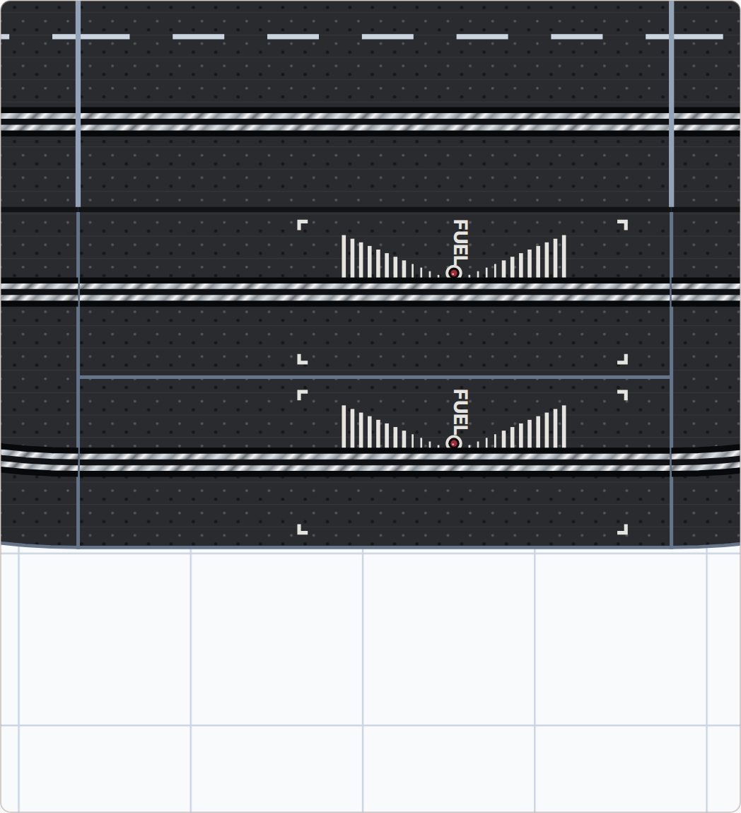
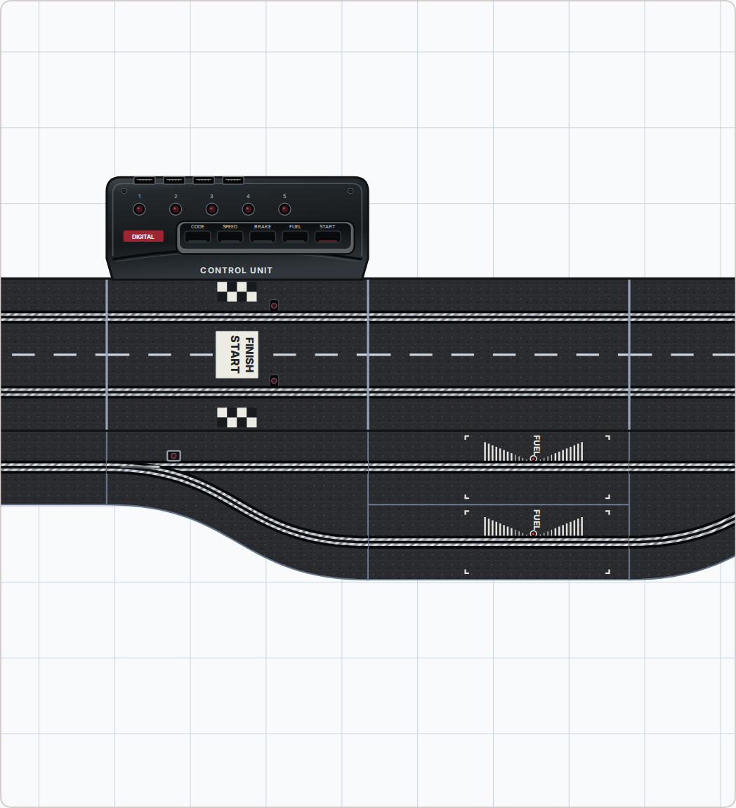
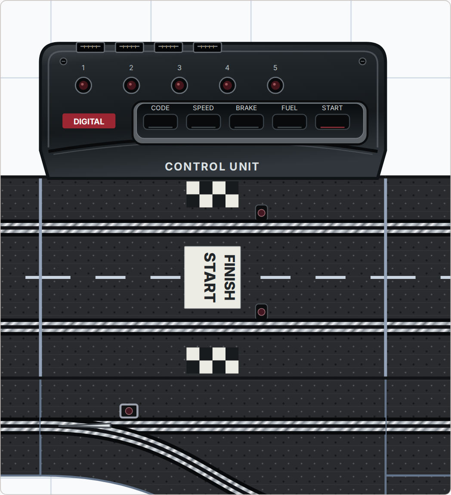
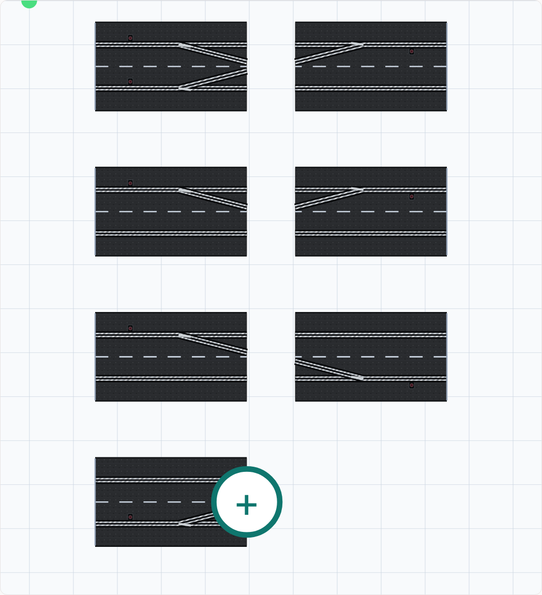

# CU, Start/Finish, FUEL and switch diodes

## Deutsch

Die CU hat ein abgestuftes, dunkelgraues Gehäuse mit Kanten, Anschlussbuchsen, fünf runden Kontrollleuchten und einer eingelassenen Tastenleiste. Start/Ziel liegt auf der zugehörigen Schiene vor dem Gehäuse: Schachbrettfelder an den Außenrändern, ein weißes Schriftfeld zwischen den beiden Spuren und kleine Sensorfenster links neben den Slots in Fahrtrichtung. Die Tankschienen zeigen die seitlich aufgedruckten, zum Infrarotsensor zulaufenden Streifen, Eckmarkierungen und FUEL-Schrift; Sensor, Streifen und FUEL liegen links der Spur in Fahrtrichtung. Beschriftungen bleiben auch bei gedrehten Teilen lesbar. Die übrige Fahrbahnoberfläche, Slots, Schienengeometrie und gespeicherten Positionen sind unverändert.

## English

The CU has a bevelled dark housing, connector sockets, five round indicators and a recessed button panel. Start/finish markings sit on its rail in front of the housing: outer checker patches, a white label between the lanes and small sensor windows left of each slot in driving direction. Fuel rails use printed striped wedges converging on the infrared sensor, corner marks and FUEL lettering; sensor, stripes and FUEL sit left of the slot in driving direction. Labels remain readable when parts rotate. Existing road surfaces, slots, geometry and saved positions are retained.

## Français

La CU reçoit un boîtier sombre à relief, des connecteurs, cinq voyants ronds et un panneau de touches encastré. Le départ/arrivée est placé sur son rail devant le boîtier : damiers sur les bords extérieurs, cartouche blanc entre les voies et petits capteurs à gauche des rainures dans le sens de circulation. Les rails de ravitaillement présentent des bandes convergeant vers le capteur infrarouge, des repères d’angle et le marquage FUEL, à gauche de la rainure dans le sens de circulation. Les textes restent lisibles après rotation. Le revêtement, les rainures, la géométrie et les positions enregistrées sont conservés.

## References and implementation

Visual references: official [Control Unit 30352](https://carrera-toys.com/products/20030352-control-unit) and [Pit Stop Adapter Unit 30361](https://carrera-toys.com/products/20030361-pit-stop-adapter-unit) product images, checked 7 November 2026. These are planner-owned SVG illustrations; no manufacturer bitmap or logo is embedded. Proportions are illustrative within the existing nominal planning footprint, not factory dimensional drawings. LEDs and buttons do not claim a hardware status.

The existing attributed `TrackUnitDetails.jsx` is deliberately refined. `TrackPlanPreview.jsx` passes the world heading into the legacy fuel drawing so nested transforms retain readable text. PROVENANCE preserves original source hashes and records current export hashes and reasons. No room, track connection or placement geometry changes are introduced by the artwork.

## DE

### CU und Start/Ziel

### Zwei Tankschienen

### CU mit Boxengasse

## EN

### CU and start/finish

### Two fuel rails

### CU and pit overview

## FR

### CU et départ/arrivée

### Deux rails de ravitaillement

### CU et stands

## Weichendioden · Switch diodes · Diodes des aiguillages

DE: Empfangsdioden befinden sich links der jeweiligen Spur in Fahrtrichtung, auch bei gedrehten Teilen. Gerade und Kurvenweichen erhalten eine Diode auf der abzweigenden Eingangsspur; Doppelweichen erhalten zwei. Das zweite Weichenmodul und passive Boxenausfahrten erhalten keine zusätzliche Diode. Boxeneinfahrten zeigen ihre Diode ebenfalls links. Die gleiche Darstellung gilt in 2D, 3D und Vektorexport; AKS-Einbauangaben bleiben unabhängig davon.

EN: Receiving diodes sit left of their slot in driving direction, including rotated parts. Straight and curved switches have one on the incoming switching lane; double switches have two. Second modules and passive pit exits gain no extra diode. Pit entries also place their diode on the left. The same artwork is used in 2D, 3D and vector export; AKS installation metadata remains independent.

FR: Les diodes de réception se trouvent à gauche de leur rainure dans le sens de circulation, même après rotation. Aiguillages simples et courbes : une diode sur la voie d’entrée concernée ; doubles : deux diodes. Aucun capteur supplémentaire sur le second module ni les sorties passives. L’entrée des stands reçoit aussi sa diode à gauche. Le dessin est partagé entre 2D, 3D et export vectoriel ; les données AKS restent indépendantes.

